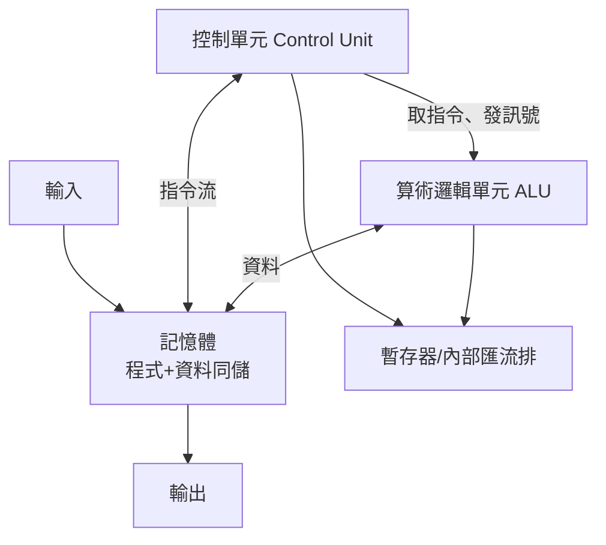

# 1.3 馮·諾伊曼架構的確立：將運算器、控制器與記憶體合為一體的邏輯藍圖

> 「程式與資料，放進同一個記憶體。」——這份寫在 100 頁打字稿上的報告，是過去八十年每一顆 CPU 的祖先。

## 一、數學天才闖進工程世界

約翰·馮·諾伊曼（John von Neumann）是 20 世紀最強的數學家之一：量子力學的數學基礎、賽局理論、遍歷理論都有他的名字。1944 年夏天，他在月台上巧遇賓州大學的赫爾曼·戈德斯坦（Herman Goldstein），得知 ENIAC 正在建造。他立刻意識到這台機器背後的數學本質：**計算機是一台實作「遞迴函數」的物理裝置**。

他加入 ENIAC 的後繼計畫 EDVAC，並於 1945 年 6 月口述、由戈德斯坦執筆，寫成《EDVAC 報告書的第一份草案》（First Draft of a Report on the EDVAC）。這份僅 101 頁、以同時期科學界慣例「只署馮·諾伊曼一人」的報告，將整台計算機抽象為五大單元：

## 二、「儲存程式」：一個觀念解放一個產業

ENIAC 的致命痛點是「設定程式比計算慢千倍」。馮·諾伊曼的解法石破天驚：

**把程式（一連串指令）與資料一視同仁，都編碼成二進制數字，儲存在同一個記憶體中。**

這帶來四個顛覆性的後果：

1. **程式可以被當成資料處理**：可以載入、修改、複製——編譯器、作業系統、軟體產業全部由此誕生。
2. **指令有「位址」**：所以有了**程式計數器（PC）**、跳躍（jump）、條件分支（branch）——「if」與「while」成為可能。
3. **機器可以自我升級**：改程式不用改硬體接線，通用性從此真正通用。
4. **指令集（Instruction Set）成為硬體與軟體的契約**：本書後面所有的 RISC vs CISC 之爭、x86 與 ARM 的帝國戰爭，爭的都是這份「契約」的設計權。

1948 年，曼徹斯特大學的「Baby」（SSEM）成為第一台實際運行儲存程式的機器；1949 年 EDSAC 在劍橋大學落成，威爾克斯（Maurice Wilkes）從美國取經回英，後來寫下名言：「我意識到，電腦生命的大部分時間，將花在為它們找錯。」

## 三、馮·諾伊曼瓶頸：八十年不變的宿命

這個架構也埋下它自己的詛咒——**馮·諾伊曼瓶頸（von Neumann bottleneck）**：

$$\text{CPU速度} \ggg \text{記憶體頻寬} \quad \Rightarrow \quad \text{CPU 大部分時間在「等」資料}$$

指令與資料共用一條通往記憶體的通道，CPU 就像一個絕世高手卻只有一扇窄門可用。解這個瓶頸的歷史，構成了 CPU 史的半部主線：

- **哈佛架構**（指令與資料分開的記憶體）在嵌入式系統中復活；
- **多層快取（Cache）**：1960 年代起成為標配，L1/L2/L3 層層圍繞；
- **亂序執行與推測執行**（第 6 章）：與記憶體延遲賽跑；
- **記憶體階層的摩爾定律**：快取越做越大；
- **AI 時代的「記憶體牆」**（第 11 章）：GPU 與 HBM 的戰爭，本質仍是同一個瓶頸。

## 四、制度與文化的影響

- **署名之爭**：報告只署馮·諾伊曼之名，讓莫奇利與埃克特在專利訴訟中吃虧——1973 年 Honeywell v. Sperry 案中，法院因 Atanasoff–Berry Computer（ABC）的先行揭露而撤銷 ENIAC 專利。這場訴訟確立了「電腦是公共財」的法律地位，客觀上加速了產業擴散，卻也讓「誰發明了電腦」成為永恆爭議。
- **軍事資助的雙面性**：EDVAC 由陸軍軍械部出資；報告本身最初被分類限制流通，但很快解密公開。戰後美國的 ONR（海軍研究辦公室）、後來的 ARPA 持續資助計算機研究，形成了大學—軍方—企業的鐵三角，這正是矽谷的制度土壤。

> **歷史因果鏈**：ENIAC 設定程式太慢 → 儲存程式架構 → 指令集成為硬軟體契約 → 快取戰爭與頻寬戰爭（貫穿全書）。「馮·諾伊曼瓶頸」是理解此後八十年所有 CPU 創新的鑰匙。
