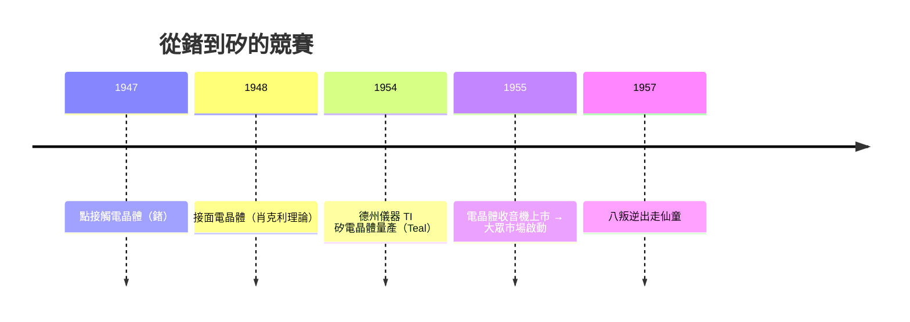

# 2.1 肖克利、巴丁與布拉頓的物理實驗：用鍺點接觸電晶體取代笨重的真空管

> 1947 年 12 月 16 日，貝爾實驗室的一張工作台上，兩片金箔壓在一塊鍺晶體上——人類文明從此換了一種「開關」。

## 一、為什麼貝爾實驗室要賭固態放大器？

戰後的 AT&T 面臨一個實際問題：橫跨美國的長途電話需要**中繼放大器**，而真空管可靠度太差、太耗電、壽命太短——埋在地下或掛在電線桿上的設備不可能天天更換燈絲。貝爾實驗室的副所長默文·凱利（Mervin Kelly）做出關鍵決策：成立**固態物理研究群**，長期投資「用半導體做放大器」。

這是「企業基礎研究」的黃金時代縮影：AT&T 是受管制的壟斷者，政府允許它壟斷電話市場，交換條件之一是將發明授權給產業界（1947 年電晶體專利後來以 25,000 美元授權費開放給數十家公司）。**壟斷利潤資助基礎研究，研究成果回饋全產業**——這個制度設計意外成為半導體革命的溫床。

## 二、三個人、三種才華的化學反應

威廉·肖克利（William Shockley）是理論物理學家、群隊主管；約翰·巴丁（John Bardeen）是深藏不露的量子理論高手（後來唯一兩獲諾貝爾物理獎的人）；華特·布拉頓（Walter Brattain）是實作天才、話多愛實驗的老江湖。

- 1945–46 年，肖克利提出的「場效應」構想實驗失敗——表面狀態（surface states）把電場吃掉了。
- 巴丁提出**表面態理論**解釋失敗，兩人改攻表面電導。
- 1947 年 12 月 16 日，布拉頓與巴丁把金箔切成兩條接觸鍺晶體，加上電解液，測得**功率增益約 1.3 倍、電壓增益約 15 倍**——第一個點接觸電晶體（point-contact transistor）誕生。
- 1948 年初，肖克利不甘心被自己的部屬「跳過」，獨自在旅館房間裡推導出更堅固、可量產的**接面電晶體（junction transistor）**——這才是日後量產的主流形式。

三人共獲 1956 年諾貝爾物理獎。諷刺的是，得獎那天他們在實驗室的關係已經破裂——肖克利與巴丁幾乎不再說話。

## 三、電晶體為何碾壓真空管？

| 特性 | 真空管 | 電晶體 |
|------|--------|--------|
| 體積 | 拇指大、需燈絲與玻璃管 | 指甲小、固態無機械件 |
| 壽命 | 數千小時（燈絲燒斷） | 理論上無限（無磨損） |
| 功耗 | 瓦級（加熱陰極） | 毫瓦級 |
| 啟動 | 需預熱數秒 | 即開即用 |
| 可靠性 | 機械脆弱 | 抗震、可焊死在電路板上 |

半導體的秘密在於能帶理論：矽、鍺的導電性可以被**微量的摻雜（doping）**精確控制——摻磷變成 N 型（多電子），摻硼變成 P 型（多電洞）。P-N 接面就是一個天然的單向閥；把兩個接面背對背（NPN），就得到「用小電流控制大電流」的開關與放大器。

## 四、經濟與社會的連鎖反應

- **德州儀器（TI）**：1954 年戈登·蒂爾（Gordon Teal）用**矽**取代鍺——矽在表面形成二氧化矽保護層、耐溫 150°C，且矽原料（沙）取之不盡。同年 TI 的 Regency 電晶體收音機上市，電晶體第一次走進消費市場。
- **軍事與太空的買單**：飛彈與衛星需要輕、省電、可靠的電子設備。1950–60 年代美國軍方採購了電晶體產量的一半以上，價格因此從 8 美元跌到 1 美元以下。**沒有國防預算，就沒有半導體的學習曲線**。
- **人才擴散**：肖克利 1955 年回到故鄉加州帕羅奧圖，創辦肖克利半導體實驗室。他招募了全美最聰明的一批青年——然後以災難級的管理逼走了他們。這批「叛逆者」將在下一節改寫歷史。

> **歷史因果鏈**：AT&T 壟斷利潤 + 凱利的長期投資 → 電晶體 → 免費授權擴散全產業 → 軍方買單壓低價格 → 消費電子起飛 → 肖克利的失敗管理催生矽谷。基礎科學（能帶論）、制度設計（授權政策）與偶然事件（人事糾紛）共同寫下這一章。
