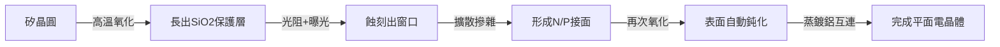

# 2.2 蕭克利實驗室的叛逆與矽谷誕生：從鍺到矽的材料學革命

> 「八叛逆」（Traitorous Eight）——1957 年的這場集體辭職，被《紐約時報》稱為「美國史上最重要的叛變之一」。

## 一、天才暴君肖克利

1955 年，諾貝爾級的威廉·肖克利把實驗室設在加州山景城（他的母親住在帕羅奧圖），招募全美最優秀的青年物理學家：羅伯特·諾伊斯（Robert Noyce）、戈登·摩爾（Gordon Moore）、傑伊·拉斯特（Jay Last）、讓·霍爾尼（Jean Hoerni）等八人。

肖克利是天才，卻也是災難級的管理者：

- 多疑：全員測謊；秘書打錯字，他懷疑是集體陰謀。
- 獨裁：方向頻繁改變（一度押注四層二極體而非電晶體），聽不進部屬意見。
- 無視商業：客戶與資金管理一塌糊塗。

1957 年 9 月 18 日，八人集體遞上辭呈。他們透過照相機大廠 Fairchild 的家族成員找到了金主——仙童攝影器材公司（Fairchild Camera and Instrument）同意投資 150 萬美元成立**仙童半導體（Fairchild Semiconductor）**。這件事的文化意義在於：它示範了一種全新的職業路徑——**從大公司出走、拿創投的錢、自己創業**。這條路徑後來被命名為「矽谷模式」。

## 二、為什麼是矽？——材料學的勝利

「矽谷」（Silicon Valley）的名字，來自一場持續數十年的材料之爭：

| 議題 | 鍺（Germanium） | 矽（Silicon） |
|------|-----------------|----------------|
| 熔點 | 938°C | 1,414°C（製程更難） |
| 操作溫度 | 約 75°C 就不可靠 | 可到 150°C 以上 |
| 表面 | 難以鈍化 | 天然生成**二氧化矽**保護層 |
| 原料 | 稀有 | 地殼含量第二的元素 |

1955 年 TI 的蒂爾率先量產矽電晶體，仙童緊追。真正的殺手鐧是讓·霍爾尼 1959 年發明的**平面製程（Planar Process）**：

平面製程讓所有元件「躺平」在晶片表面，被二氧化矽保護——穩定、可批量、可互連。**沒有平面製程，就沒有積體電路**。諾伊斯後來說：「有了平面製程，IC 幾乎是自動跟著來的。」

## 三、仙童的黃金年代與再次裂變

仙童半導體迅速成功：1960 年推出平面電晶體，與 TI 並列 IC 雙雄；1965 年員工已逾萬人。但母公司遠在紐約，利潤被抽走支援攝影器材部門，股票選擇權承諾跳票。於是「仙童出走」成為矽谷的儀式：

- 1968 年：**諾伊斯與摩爾出走，創辦 Intel**（帶走安迪·葛洛夫）。
- 1969 年：傑里·桑德斯（Jerry Sanders）帶隊創辦 **AMD**。
- 更早：Signetics、National Semiconductor、Amelco……直接或間接出自仙童。

據統計，仙童系統出身的公司超過百家，包括後來的 Sequoia 紅杉創投（創辦人 Don Valentine 來自仙童銷售部門）。矽谷人開玩笑：往帕羅奧圖的樹上丟塊石頭，會砸中一個仙童前員工。

## 四、制度拼圖：創投、大學與軍方

矽谷的誕生不是單一事件，而是多重制度因子的化學反應：

1. **創投的誕生**：1957 年 Fairchild 的投資是美國最早的現代創投案例之一；Arthur Rock 由此轉行，成為 Intel、Apple 的幕後金主。
2. **史丹福的推手**：工程學院院長弗雷德里克·特曼（Frederick Terman）刻意把大學土地租給科技公司（史丹福工業園區，1951），鼓勵師生創業——蕭克利正是被他請來的。
3. **軍方需求**：北加州的 Lockheed 導彈部門、NASA 艾姆斯中心提供穩定的訂單與人才池。
4. **文化**：加州的移民文化容忍失敗、崇尚流動；「跳槽」不丟臉，反而帶來人脈網路——這與東岸的終身僱傭文化截然相反。

> **歷史因果鏈**：蕭克利的暴政 → 八叛逆 → 仙童 → 平面製程（矽勝鍺）→ IC 商業化 → 仙童再裂變出 Intel/AMD → 創投制度成型。下一節，TI 的基爾比與仙童的諾伊斯將為「誰發明了 IC」打一場平手的戰爭。
