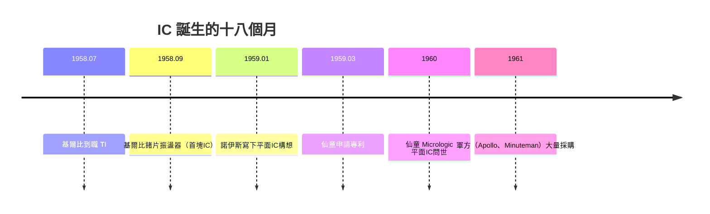
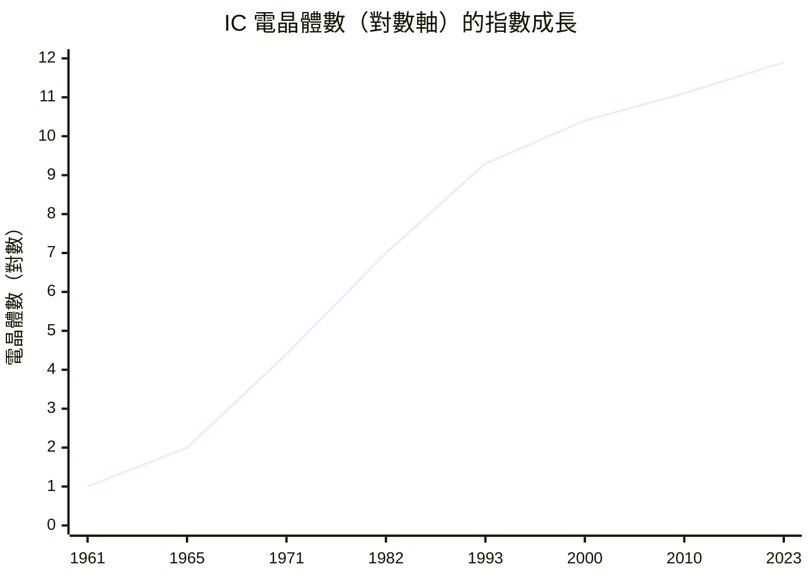

# 2.3 傑克·基爾比與諾伊斯的積體電路（IC）：將無數電晶體蝕刻在單一晶片上的奇蹟

> 1958 年夏天，德州儀器一位剛到職、還沒放假資格的新人，獨自留在實驗室裡——他造出了積體電路。半年後，加州的另一端，諾伊斯用另一條路徑到達同一個終點。

## 一、「暴政式微型化」的壓力

1958 年的軍方（尤其是空軍的「民兵」飛彈計畫）面臨「暴政式數字」（tyranny of numbers）危機：一部現代化的電子設備需要數萬個電晶體，而電晶體要一根根焊上電路板——**接點越多，故障率越高，體積越大**。數學上，系統可靠度隨元件數呈指數下降：

$$R_{system} = \prod_i R_i \quad \Rightarrow \quad n \text{ 個元件、各 } 99\%\text{ 可靠} \Rightarrow \text{整體可信度急速趨零}$$

唯一出路：**不要把零件連起來，直接在一塊材料上做出整個電路**。

## 二、兩條路，同一個終點

**基爾比的路（1958 年 9 月，德州達拉斯）**：新進員工基爾比沒有年假資格，在空蕩的實驗室裡想到——既然電阻、電容、電晶體都能用半導體做，何不**全用一塊鍺做出來**？他用蜂蠟把鍺片貼在玻璃上，蝕刻出電阻與電容，再用金線搭接。9 月 12 日，他的「移相振盪器」通電成功——人類第一塊 IC，但零件之間靠手工金線連接，且用鍺、無法量產。

**諾伊斯的路（1959 年 1 月，加州山景城）**：諾伊斯的出發點是**互連問題**——手工焊接是良率殺手。他在仙童的會議上寫下構想：利用霍爾尼的平面製程，把所有互連**用金屬蒸鍍在二氧化矽絕緣層上，一體成型**。這才是可以規模化量產的 IC。

兩人因此打了一場持續十年的專利戰。1969 年美國海關與專利上訴法院裁定：基爾比贏得「IC 的發明概念」專利，諾伊斯贏得「平面製程 IC」專利——**並列為積體電路的發明人**。2000 年基爾比獨得諾貝爾物理獎（諾伊斯已於 1990 年去世；諾獎不頒給已故者）。兩人私交甚篤，這是工程史上少見的君子之爭。

## 三、誰買單？軍方與太空計畫的價格保護傘

1961 年 IC 售價高達 50 美元一顆（同功能分立元件只要 3 美元），商用市場無人問津。改變遊戲規則的是兩個不計成本的買主：

- **阿波羅登月計畫**：阿波羅導引電腦（AGC）使用了數千顆 IC。NASA 的採購讓 IC 產量暴增。
- **民兵二型/三型飛彈**：空軍要求小型化與高可靠度，是 IC 最穩定的大客戶。

經典的**學習曲線**於是啟動：

$$\text{價格} \propto (\text{累積產量})^{-0.3} \quad \Rightarrow \quad \text{產量每翻倍，價格約降 20\%}$$

到 1965 年，IC 價格跌到 2 美元；1968 年，商用市場首次超過軍用市場。**軍方付了學費，市場收割了果實**——這個模式此後在半導體業反覆出現（DRAM、太陽能、電動車電池皆是）。

## 四、摩爾定律：把趨勢寫成宣言

1965 年，仙童的戈登·摩爾為《Electronics》雜誌寫一篇展望，畫了一條線：**單一晶片上的電晶體數每年翻一倍**（1975 年他修正為每兩年翻一倍）。這本來是對 1959–1965 六年趨勢的歸納，卻被業界當成**自我實現的預言**——投資者據此融資，工程師據此訂路線圖，跟不上的人出局。

> **歷史因果鏈**：飛彈的「暴政式數字」→ IC 發明（基爾比＋諾伊斯）→ 軍方/阿波羅買單 → 學習曲線降價 → 摩爾定律宣言 → 整個數位時代的投資節奏。有了便宜的「零件組」，下一步就是把**整顆 CPU** 一次做進一顆晶片——第三章的 Intel 4004。
