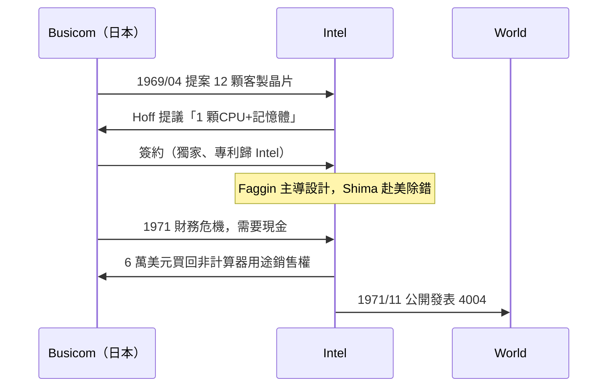

# 3.1 來自日本計算機公司的訂單：Busicom 與英特爾最初的微型化妥協

> 一家瀕臨破產的日本計算機公司，一紙被英特爾高層嫌麻煩的合約——卻在解約談判中意外催生了世界第一顆微處理器。

## 一、1969 年的英特爾：一家做記憶體的公司

1968 年，諾伊斯與摩爾創辦 Intel，全名 Integrated Electronics（整合電子）。當時的商業計畫非常明確：**做半導體記憶體（SRAM/DRAM），取代磁芯記憶體**。CPU 不在規劃之中——邏輯電路客製化程度高、量少、利潤薄，是「麻煩的生意」。

## 二、Busicom 的 12 顆晶片提案

1969 年 4 月，日本計算機公司 Busicom（Business Computer，當時計算器市場的領頭羊之一，正與夏普、卡西歐激戰）來到英特爾，帶來一份已由日本工程師嶋正利（Masatoshi Shima）設計完成的合約草案：為 Busicom 141-PF 計算器開發一組 **12 顆客製化邏輯晶片**（七顆為主要晶片）。

當時的計算器業是殘酷的紅海：一台計算器從 1,000 美元跌到數百美元，業界每兩年淘汰一代。Busicom 急需壓低成本。而英特爾年輕工程師泰德·霍夫（Ted Hoff）接案後發現：這 12 顆晶片的設計複雜混亂，若改用**通用處理器架構**——一顆 CPU 加上幾顆記憶體與 I/O 晶片，把計算器邏輯寫成程式——晶片數可以減少、架構可以共用。

這個想法的本質是：**用軟體的靈活換取硬體的簡單**。此處恰好呼應第一章：這正是「儲存程式」思想在晶片尺度上的重演。

## 三、費金的抵達與設計的落實

霍夫提出了架構方向（4 位元、通用處理器、堆疊），但英特爾當時沒有 MOS 大規模設計經驗。1969 年底，從仙童跳槽來的**費代里科·法金**（Federico Faggin，義大利物理學家）抵達，被任命為計畫負責人。他做的是真正決定成敗的工程：

- 嶋正利提供了極詳盡的邏輯規格（長達數百頁的定義文件）；
- 法金設計了 4004 的電路與佈局，包含 2,300 個電晶體；
- 嶋後來赴美加入英特爾參與除錯，貢獻了指令集的關鍵細節（並在日後以 Zilog Z80 聞名）。

歷史學界對「誰發明了微處理器」的敘事之爭持續多年：霍夫代表架構直覺，法金代表電路實作，嶋正利代表規格與除錯，三者缺一不可。1970 年代的專利屬於英特爾，而 2009 年的京都獎同時頒給三人，算是歷史的折衷判決。

## 四、合約的轉折：回購的代價

1970–71 年間，Busicom 自身陷入財務危機（計算器價格戰血流成河），而英特爾方面也希望把這顆晶片賣給其他客戶。1971 年雙方談判：**英特爾以 6 萬美元買回（回購）該晶片非計算器用途的獨家銷售權**。

這 6 萬美元被普遍認為是商業史上最超值的交易之一：英特爾獲得了把 4004 賣給全世界的權利。對 Busicom 而言，這是絕境中的現金；對英特爾而言，這是從「接案代工」走向「標準品販賣」的關鍵一步。

## 五、經濟史的隱喻

- **日本計算器大戰**（夏普、卡西歐、Busicom）是「摩爾定律式的價格屠殺」最早的主戰場，逼出了微型化需求。
- 英特爾從「賣服務」轉為「賣標準品」，是半導體商業模式的分水嶺：標準品可以 scale，客製品不行。
- Busicom 最終在 1974 年倒閉，但它點火的那顆晶片改寫了世界。

> **歷史因果鏈**：日本計算器價格戰 → Busicom 求助英特爾 → 霍夫的通用架構提案 → 法金+嶋的實作 → Busicom 破產壓力下的回購談判 → 英特爾獲得全世界。下一節：法金用什麼技術把 CPU 真的塞進一顆矽片。
