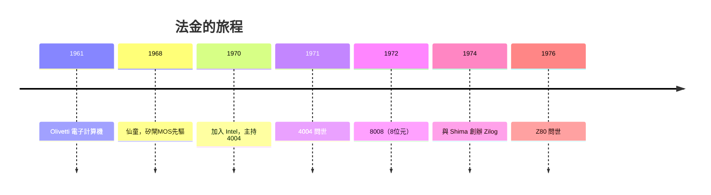

# 3.2 費代里科·法金（Federico Faggin）的矽閘極技術：解決多晶片互連的關鍵突破

> 4004 的晶片上，法金用手刻了「F.F.」兩個字母簽名——這是工程師在歷史文件上的親筆簽名。

## 一、MOS 的難題：金屬閘的詛咒

1970 年，英特爾決定承接 4004 計畫時，工業界的 MOS（金屬-氧化物-半導體）製程主流是**鋁金屬閘**（aluminum gate）。它的問題在流程順序：摻雜擴散的溫度（約 1,000°C）遠高於鋁的熔點（660°C），所以**金屬閘必須最後才做**——這導致閘極與源/極之間存在對位誤差，必須重疊預留，寄生電容大、速度慢、漏電高，良率低下。

**矽閘極（Silicon Gate）技術**改變了流程順序：先沉積多晶矽（polysilicon）做閘極，再以閘極自身為遮罩做離子佈植或擴散，形成精確對齊的源/極（自對準，self-aligned）。最後才蒸鍍鋁做互連。

$$\text{鋁閘：對位誤差大、寄生電容高} \quad \Longrightarrow \quad \text{矽閘：自對準、電容小、密度高、速度快}$$

多晶矽能耐高溫，所以可以「先閘後源極」，實現自對準；二氧化矽覆蓋其上還能做絕緣互連。這個技術原本由霍爾尼在仙童構想、貝爾實驗室與 Intel 工程師在 1968–69 年間推進，而**法金是把矽閘做到能可靠量產、並用它造出第一顆微處理器的人**。

## 二、法金其人：從奧利維蒂到矽谷

法金 1941 年生於義大利維琴察，曾在奧利維蒂（Olivetti）參與該公司最早的電子計算機，後赴美加入仙童，研發了業界第一代矽閘 MOS 技術（包括 FAMOS，即 EPROM 的基礎）。1969 年他被霍夫遊說加入英特爾，第一句話是：「我想做點真正新的東西。」

在 4004 的設計中，法金的具體貢獻包括：

1. **電路設計與佈局**：2,300 個電晶體，在 12 平方毫米的晶片上，全部手工繪製（用彩色鉛筆在方格紙上畫佈局圖，再縮小製版）。
2. **動態邏輯**：巧妙使用動態電路減少電晶體數，把功耗與面積壓到極限。
3. **可製造性**：解決了矽閘製程的良率問題，讓「實驗室奇蹟」變成「可以出貨的產品」。

## 三、六個月的衝刺與成功

1970 年 4 月法金到職，1971 年 3 月第一顆 4004 成功通電——約十個月的工期，在人手只有法金一人（加上支援工程師與來日本的嶋正利）的條件下完成。第一顆晶片通電時，法金回憶：「晶片完美地工作了，我當場落下眼淚。」

4004 規格摘要：

| 項目 | 規格 |
|------|------|
| 位元寬 | 4 位元 |
| 電晶體 | 2,300 個 |
| 時脈 | 740 kHz |
| 封裝 | 16 腳 DIP |
| 指令 | 46 條 |
| 製程 | 10 μm 矽閘 PMOS |

## 四、法金的下一步：Zilog 與 Z80

1974 年，法金與嶋正利離開英特爾，創辦 **Zilog**。他們設計的 **Z80（1976）**是 8 位元時代的傳奇：向下相容 Intel 8080、再加強指令集、單一 5V 電源，被用在世紀經典的 TRS-80、ZX Spectrum、任天堂 Game Boy，以及無數工業控制器中——至今仍在生產。

## 五、工程文化的啟示

法金的經驗說明一件常被忽略的事：**「架構創意」與「可製造性」是兩種不同的才能**。霍夫提供了架構，法金提供了「能做出來、能做出很多」的製程與電路技藝。半導體史的敘事常偏愛前者（因為好講故事），但真正的瓶頸往往在後者。

> **歷史因果鏈**：鋁閘的性能天花板 → 矽閘自對準技術 → 法金的量產化功力 → 4004 成真 → 8008/Z80 → 8 位元普及。下一節：4004 正式發表，微處理器時代的開場。
