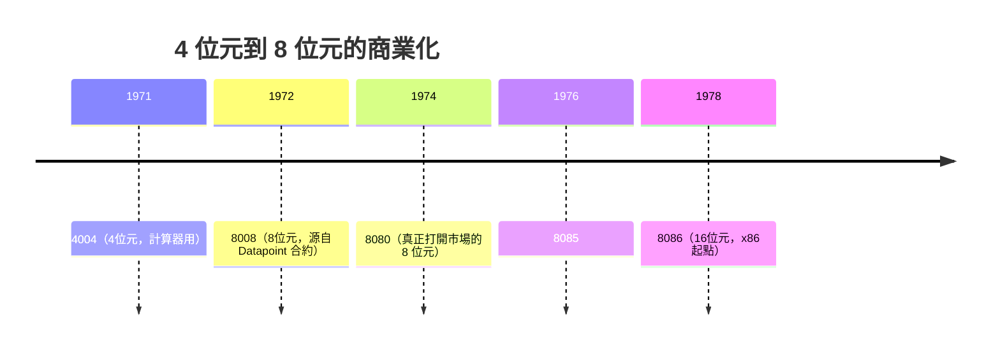

# 3.3 1971 年 Intel 4004 發表：人類歷史上第一顆商用微處理器的誕生

> 1971 年 11 月 15 日，《Electronic News》上的一則小廣告：「Announcing a new era in integrated electronics」——一個「把電腦放進一顆晶片」的新紀元，以四行文字宣告開始。

## 一、發表的策略：低調到近乎敷衍

英特爾以極低調的方式發表 4004，因為公司的心思仍在 DRAM 與 EPROM 上。廣告的重點措辭是「micro-programmable computer on a chip」——它甚至不叫「微處理器」（microprocessor 一詞之後才逐漸定著）。

真正的轉折來自市場的反應：嵌入式控制應用（儀器、販賣機、電梯、計程車計價器……）發現「買一顆可程式的晶片，重寫程式就能改功能」遠比設計客製邏輯電路划算。英特爾順勢而行：

## 二、4004 的技術性格

- **哈佛架構色彩**：程式與資料分開定址（4 位元資料、12 位元位址），這是嵌入式處理器的常見選擇。
- **4 位元的妥協**：Busicom 的計算器需要的是 BCD 十進位運算，4 位元剛好處理一個十進位數字——需求決定了架構。
- **多晶片組**：實際上是 4001（ROM）、4002（RAM）、4003（移位暫存器）、4004（CPU）的家族，需要外接記憶體。

## 三、誰是「第一顆微處理器」？

嚴謹的歷史學者會提醒我們：「第一」的頭銜有幾個競爭者：

| 候選 | 說明 |
|------|------|
| Intel 4004 | **第一顆「商用化並大量販售」的單晶片微處理器** |
| Texas Instruments TMS1000 | 1974 年上市，單晶片、含 ROM/RAM/CPU，量產量巨大（計算器、玩具） |
| Garrett AiResearch CADC（MP944） | 1970 年為 F-14 戰機設計的多晶片組，軍機用途、長期保密 |
| Four-Phase Systems AL1 | 1971 年，8 位元，多晶片組 |

最公允的說法：**4004 是第一顆以「通用可程式處理器」身分公開銷售的單晶片微處理器**。軍方版本更早但保密；TMS1000 是單晶片「微控制器」（MCU）的先聲。歷史的「第一」常取決於定義的邊界。

## 四、商業衝擊：從零件到平台

4004 及其後繼者的真正革命不在技術（它的性能不及當年的大型機的一角），而在**商業模式的置換**：

1. **從「設計邏輯」到「寫程式」**：工程師不再畫電路圖，而是寫組合語言。開發成本從「硬體工程」轉為「軟體工程」，降低了創新門檻——任何小型團隊都能造出「有腦」的機器。
2. **量產經濟**：同一顆晶片賣給一千種應用，攤提了光罩成本，價格沿學習曲線下降。
3. **軟體資產開始累積**：一旦程式可以在一顆處理器上執行，這些程式碼就是「資產」，下一顆處理器最好能執行舊程式——這個動機將在第四章直接催生 x86 的「向後相容」帝國基因。

## 五、文化側寫：英特爾的「只有偏執狂能生存」

1970 年代的英特爾內部，記憶體（DRAM）才是正室，微處理器是庶出。直到 1985 年，日本 DRAM 的價格戰把英特爾逼到牆角，葛洛夫與摩爾著名的對話——「如果我們被董事會換掉，新來的 CEO 會做什麼？」「會退出記憶體事業。」「那我們為什麼不自己走出這扇門，再走回來？」——英特爾才正式轉型為微處理器公司。

4004 時代的英特爾人並不知道自己在點燃什麼。法金後來說：「我們以為我們在做一顆更好的計算器晶片。」歷史的荒謬在於：**改變世界的產品，通常在誕生時被視為邊角料。**

> **歷史因果鏈**：4004（4位元，計算器）→ 8008/8080（8位元，開啟嵌入式與個人電腦先聲）→ MITS Altair 用 8080 → 微軟 Altair BASIC → 個人電腦產業萌芽。第四章：IBM PC 與 x86 的歷史偶然。
