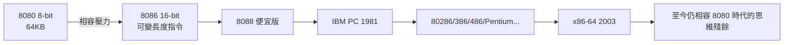

# 4.1 8086 與 8088 處理器的問世：為了向後相容而埋下的複雜指令集（CISC）基因

> 8086 的設計者們當年只想「趕快做一顆 16 位元晶片救火」，沒想到它定義了此後四十年個人電腦的心臟。

## 一、救火行動：8 位元的黃昏與 Zilog 的威脅

1976 年前後，英特爾處境微妙：

- 8080 雖然成功，但 8 位元市場競爭者蜂擁（Zilog Z80、Motorola 6800/6809、MOS 6502）。
- 自家的 8800（iAPX 432）採用激進的物件導向架構，進度嚴重落後，需要一顆「過渡產品」穩住市場。
- 客戶開始要求更大的位址空間（8 位元 CPU 最多 64KB 記憶體，已不夠用）。

於是英特爾在 1976 年啟動一個小團隊，1978 年推出 **8086**（16 位元），1979 年推出 **8088**（外部匯流排 8 位元的廉價版）。設計者包括 Stephen Morse（指令集架構）、William Pohlman（專案經理）等。

## 二、向後相容：原罪還是護城河？

8086 的指令集並不優雅，原因很實際：**市場上已有大量 8080 軟體（含 CP/M 作業系統與應用程式），客戶要求新晶片能「容易移植」**。於是：

- 暫存器名稱與結構沿用 8080 的概念（A、B、C、D…）；
- 指令長度可變（1–6 位元組）、編碼緊湊——這是 CISC 的典型特徵；
- **分段記憶體（segmentation）**：16 位元暫存器要存取 20 位元位址空間（1MB），於是用「段暫存器×16＋偏移」的土法——日後成為程式設計師的噩夢與 DOS 640KB 之牆的根源。

**CISC 基因的誕生**：可變長度指令、多種定址模式、記憶體運算元（一條指令可直接對記憶體做加法）——這些設計在 1978 年是「移植方便」的務實選擇，在 1985 年後的 RISC 眼中是「管線化的災難」。x86 之後的每一代設計者，都要在「相容舊指令」與「效能」之間找平衡，這正是第三、四章的主線。

## 三、8088 的僥倖：一個「妥協的妥協」

8088 本質上是 8086 的降級版：內部 16 位元、外部資料匯流排只有 8 位元。這使它：

- 更便宜（封裝腳位少、主機板電路簡單）；
- 可以沿用 8 位元時代的周邊晶片（8255、8259 等現成廉價支援晶片）；
- 速度慢一些，但對當年應用無關痛癢。

英特爾推出它只是為了搶低階市場，沒想到這個「妥協的妥協」將被 IBM 選中——**歷史經常青睞的不是最優秀的設計，而是最便利的設計**。

## 四、當年的市場：沒人知道誰會贏

1979–1980 年，16 位元 CPU 的賽局是開放的：

- **Motorola 68000**：32 位元暫存器、整潔的正交指令集，技術評價遠高於 8086；
- **Zilog Z8000**、**National 16032**：各有優勢；
- Unix 工作站廠商幾乎清一色選 68000。

如果 IBM 當年選了 68000，計算機史將完全改寫。IBM 的選擇如何發生，是下一節的故事。

> **歷史因果鏈**：8 位元市場競爭 + 8800 落後 → 8086/8088 應急 → 向後相容的 CISC 基因 → 等待 IBM 的挑選。這顆「救火晶片」的命運，將由一個走投無路的藍色巨人決定。
