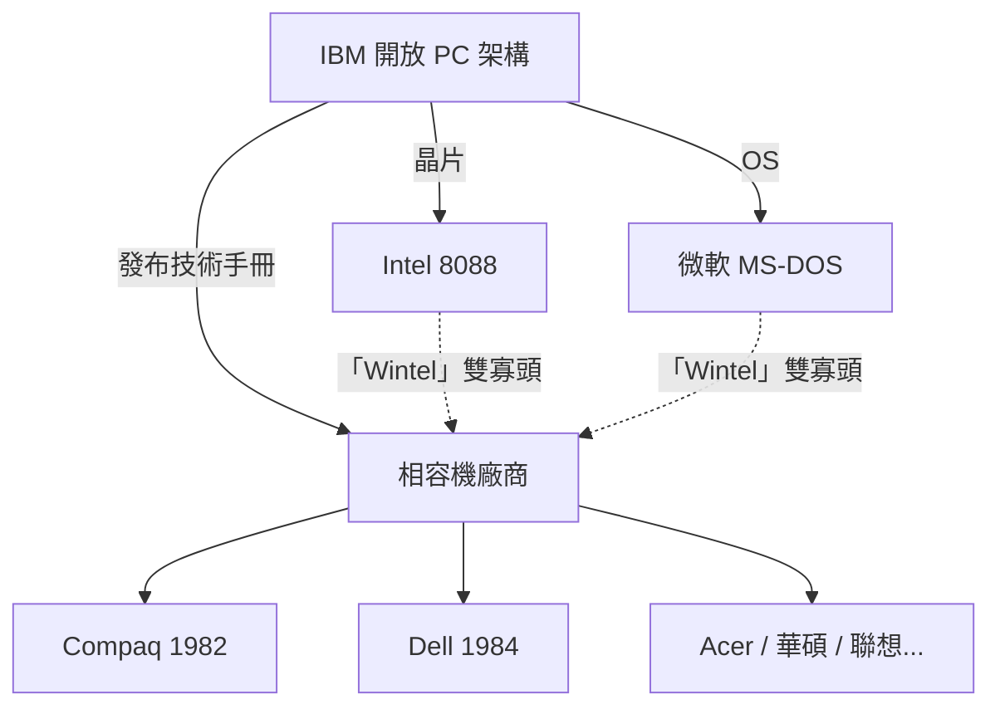

# 4.2 1981 年 IBM PC 選擇英特爾：一場改變全球電腦產業生態的世紀外包合約

> IBM 當年只想「快點做一台小機器跟蘋果搶市場」，於是把它拆給外面的小公司做——結果親手把自己的王座讓了出去。

## 一、IBM 的焦慮：藍色巨人的遲鈍

1980 年的 IBM 是世界最大的電腦公司，但其利潤來自大型機（System/360 系）與客製服務，**沒有個人電腦產品**。蘋果 II 的暢銷（1977–1980 年間銷量數十萬台）、以及 Atari、Commodore 的攻城掠地，讓 IBM 高層焦躁。

傳統的 IBM 開發流程要數年、要動用數百人、要一切自製（自家的晶片、自家的作業系統）。而個人電腦市場變化以月計。於是 IBM 做出歷史性決定：授權佛羅里達州博卡拉頓的一個小團隊（Project Chess，領導者 Don Estridge），**採用「開放架構」策略**——盡量用現成的、外面買得到的零件，一年內出貨。

## 二、晶片的選擇：為什麼是 8088？

IBM 團隊評估過 Motorola 68000，但最終選擇 Intel 8088，原因實際得驚人：

1. **現成支援晶片**：Intel 8 位元時代周邊（中斷控制器 8259、計時器 8253、DMA 8237）成熟廉價，8088 可直接搭配，不必重新設計。
2. **8 位元匯流排**：主機板更簡單、成本更低，且可相容當時現成的 8 位元介面卡設計經驗。
3. **開發工具**：Intel 的開發系統（ICE、組譯器）已可用；且 DEC 的設計顧問（David Bradley 等）熟悉 Intel 生態。
4. **時間**：一年內出貨的硬性死線，排除了任何需要重新設計周邊的方案。

技術評價更高的 68000 就這樣出局——它「太新」，周邊生態尚未成熟。

## 三、開放架構的雙面刃

IBM 採用開放架構，本意是趕時間，卻意外創造了人類史上最大的產業生態：

- IBM **沒有鎖死介面**，反而發布了完整的《IBM PC 技術參考手冊》（含 BIOS 原始碼），希望第三方開發周邊擴大生態。
- 結果是**相容機（clone）**大爆發：Compaq 用逆向工程乾淨重寫 BIOS（1982），Dell 用直銷模式崛起，台灣的主機板與代工產業從此起飛。
- IBM 曾試圖用 Micro Channel 架構（PS/2，1987）奪回控制權，失敗——**開放一旦發生，就收不回來了**。
- 1990 年代，「Wintel 聯盟」（Windows + Intel）成為產業的真正統治者，IBM 自己反而被邊緣化，2005 年將 PC 部門賣給聯想。

## 四、經濟與地緣的連鎖效應

- **英特爾登基**：從一家 DRAM 公司，變成「PC 標準的心臟」。此後三十年的 x86 路線圖（386、486、Pentium……）就是 PC 產業的節拍器。
- **台灣的黃金機會**：1980 年代末，PC 相容機的開放讓台灣（宏碁、華碩、鴻海……）成為全球 PC 製造中心，後來延伸到半導體代工（台積電的崛起與 PC 生態的需求高度相關）。
- **微軟的世紀合約**：IBM 以為自己買的是「一套作業系統」，結果簽下的是「微軟可以授權給別人」的條款——下一節的主角。

> **歷史因果鏈**：蘋果的壓力 → IBM 趕工 → 開放架構 + 8088 → 相容機大爆發 → Wintel 帝國 → IBM 失去王座。經典教訓：**在標準之戰中，控制標準的人不是發明標準的人，而是讓標準長出生態的人。**
