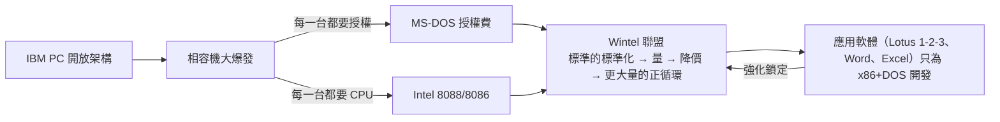

# 4.3 蓋茲與微軟的捆綁：當硬體標準（x86）與作業系統（MS-DOS）結為鐵血同盟

> IBM 付了 5 萬美元買了一套「買斷」的作業系統——結果買到的是「別人也能賣」的授權。這是商業史上最昂貴的一次合約疏忽。

## 一、微軟當年是誰？

1980 年的微軟是一家 30 人的小公司，主力產品是各種微型電腦的 BASIC 直譯器（起家於 1975 年為 MITS Altair 8080 寫的 BASIC）。它沒有作業系統產品。

當 IBM 來到西雅圖找蓋茲談 PC 作業系統時，蓋茲誠實地說：這不是我們的產品，你去找 Digital Research 的 Gary Kildall——他的 **CP/M** 是當時 8 位元個人電腦的標準作業系統，最有資格拿到這份合約。

## 二、Digital Research 的失誤

接下來的插曲是商業史的經典教材：Kildall 的妻子 Dorothy（公司法務負責人）與 IBM 的談判破裂——卡在保密協議與授權條款上（IBM 只肯提供「單一價格、無限拷貝」的授權，不簽保密協議，Dorothy 不肯讓步）。傳說中「Kildall 開著飛機去飛行、讓 IBM 律師等他」的故事多半是後來的渲染，但**談判破裂是事實**。

IBM 回頭找微軟。蓋茲當機立斷：

1. 買下一家西雅圖小公司 Tim Paterson 寫的 **QDOS**（Quick and Dirty Operating System，86-DOS），約 5–7.5 萬美元；
2. 改造成 **PC-DOS** 交給 IBM；
3. **關鍵條款：微軟保留將 MS-DOS 授權給其他廠商的權利**。

IBM 願意接受，是因為它認為「硬體才是利潤所在，軟體是附屬品」——這是大型機時代的思維（IBM 靠機器賺錢，軟體綁機器送）。它沒想到，個人電腦時代價值鏈倒轉了。

## 三、鐵血同盟的形成

相容機越多，MS-DOS 的安裝量越大；應用軟體廠商（如 Lotus 1-2-3，1983）為最大安裝基數的平台開發，進一步鎖定平台；新的相容機廠為了執行這些軟體，又必須買 MS-DOS 與 x86 CPU。**這是一個自我強化的飛輪**，經濟學上稱為「網路外部性」（network externality）與「鎖定效應」（lock-in）。

## 四、x86 的「相容性詛咒」就此定形

這個同盟對 CPU 架構的深遠影響：

1. **軟體資產 = 遷移成本**：企業買了 DOS 下的應用，就離不開 x86。英特爾此後每一代 CPU 必須**完整相容** 8086——連最沒用的舊指令都要保留電晶體去實作它。
2. **CISC 的包袱鎖死**：RISC 陣營（第三篇）嘲笑 x86 指令集醜陋，但工程上醜陋不致命，**生態致命**。任何想取代 x86 的晶片（Itanium、PowerPC Mac、ARM PC）都要先解決「舊軟體跑不跑」的問題。
3. **微軟的反噬與獨立**：1990 年代微軟力量大到能主導英特爾（堅持 NT 支援多平台、壓制英特爾的 Native Signal Processing），兩家的同盟實為「互相利用、互相忌憚」。蓋茲的名言：「英特爾的架構升級對我們只有成本，沒有好處。」

## 五、制度與法律的後續

- 1994–98 年美國司法部與微軟的反壟斷訴訟，正是針對這種「平台捆綁」的威力（IE 綁 Windows 排除 Netscape）。
- 而英特爾在 2005 年被 AMD 與歐盟反壟斷追擊（向戴爾等廠商付「獨家回扣」），被罰 14.5 億歐元——**平台霸權的兩端都逃不過反壟斷之劍**。

> **歷史因果鏈**：Kildall 談判破裂 → 微軟買 QDOS → 保留授權權利的合約漏洞 → 相容機飛輪 → Wintel 壟斷 → x86 的相容性鎖定四十年。從此，指令集之爭不再只是工程問題，而是**生態與制度之戰**——第三篇的 RISC 革命，就是在這堵牆上撞出的第一道裂縫。
