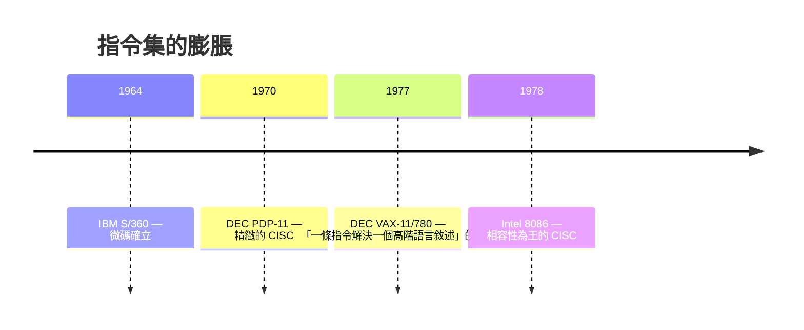

# 5.1 複雜指令集（CISC）的膨脹危機：為什麼 20% 的指令佔了 80% 的執行時間？

> 1970 年代末，編譯器學者打開機器碼統計表，發現一個尷尬的事實：硬體工程師辛苦實作的華麗指令，程式設計師幾乎從來不用。

## 一、指令集為什麼會胖？

指令集膨脹有其歷史必然性，驅動力有三：

1. **記憶體昂貴**：1960–70 年代主記憶體以 KB 計價。指令越「有力」（一條指令做越多事），程式越短，越省錢。VAX 的設計口號就是「為了縮短程式碼」。
2. **微程式控制（microprogramming）的成熟**：IBM System/360（1964）確立了用微碼實作指令的技術，加上 1970 年代 MOS 記憶體（ROM/PROM）便宜，**把指令做複雜的邊際成本變低**。於是每代機器都「順手」加指令。
3. **向後相容**：新機器要跑舊程式，舊指令一條都不能刪。

VAX-11 是 CISC 哲學的巔峰：`INDEX`、`POLY`（多項式求值）、`EDITPC`（十進位字串編輯）等巨型指令，單條指令的微碼長達數百步。DEC 的工程師自豪地稱之為「與高階語言的語意對齊」。

## 二、魔鬼的統計：80/20 法則降臨指令集

1970 年代後期，幾項關鍵研究動搖了 CISC 的根基：

- **David Patterson 的團隊（柏克萊）**與 **David Wall / John Hennessy（史丹福）**統計真實程式（編譯器、作業系統）的動態指令分佈，發現：
  - 簡單的 load/store、分支、比較占了**絕大多數執行時間**；
  - VAX 的 `CALL`、`INDEX` 等複雜指令使用率極低，卻占掉大量晶片面積、拖慢所有指令的譯碼；
  - 更糟的是，**編譯器根本不會產生那些複雜指令**——編譯器作者偏好簡單、可預測的指令模式。

一條被 99% 的時間忽略的指令，卻讓剩下 1% 的時間也變慢（譯碼邏輯變複雜、管線變難做）。這是硬體與軟體的**第一次大規模「需求錯配」**。

## 三、理論的崩塌：複雜指令不等於快

CISC 的隱含假設是「一條指令做越多事，總時間越短」。但分析執行時間的組成：

$$T = N_{ins} \times CPI \times T_{clock}$$

（指令數 × 每指令週期數 × 時脈週期）

複雜指令降低了 $N_{ins}$，卻急速拉高 $CPI$（VAX 的 `CALL` 要數十個週期）、並限制 $T_{clock}$ 的提升（譯碼與控制邏輯的關鍵路徑變長）。實測顯示：**用多條簡單指令取代一條複雜指令，總時間反而更短**。

1980 年代初，Patterson 與 Hennessy 各自在柏克萊與史丹福完成原型（RISC-I/II 與 MIPS），論文引述的關鍵數據成為 RISC 宣言的基石。而 DEC 的 VAX 團隊自己也在 1980 年代中期意識到問題（內部研究 BCC 專案），卻受制於 VAX 的相容包袱無法轉身——DEC 最終被收購（1998 年，康柏），成為 CISC 時代巨人的墓誌銘之一。

## 四、經濟與制度背景

- **記憶體降價**改變了算式：DRAM 價格在 1970 年代暴跌，程式碼變小不再值錢，「精簡」從省錢手段變成效能手段。
- **編譯器學科的成熟**：1970 年代龍書（Aho–Ullman《Compilers》）問世，工程師第一次能系統地問「編譯器到底會產生什麼碼」——指令集從「給人類寫組語用」轉為「給編譯器用」，設計哲學整個翻轉。
- **大學重返舞台**：CISC 時代的創新來自 IBM、DEC 等巨頭；RISC 時代的旗手是大學教授——學術界與產業界的主客易位，是計算機史的重要結構變化。

> **歷史因果鏈**：記憶體貴＋微碼成熟 → CISC 膨脹 → 編譯器統計揭穿「複雜≠快」→ 效能公式指出的出路 → RISC 革命（下一節）。80/20 這把刀，將由兩位加州教授揮出。
