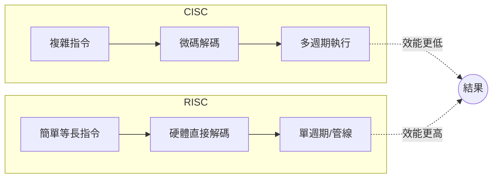

# 5.2 大衛·帕特森與約翰·亨尼西的 RISC 哲學：簡單、管線化與每週期執行一個指令

> 1980 年，柏克萊的一間實驗室與史丹福的一間實驗室，各自造出一顆「故意不夠聰明」的晶片——結果比所有聰明的晶片都更快。兩位教授後來共享了 2017 年圖靈獎。

## 一、兩個原型：RISC-I 與 MIPS

**柏克萊 RISC（David Patterson 主導）**：Patterson 從 VAX 的失敗統計出發，帶領研究生造出 RISC-I（1981，44,420 個電晶體）。核心主張：

1. **少而簡的指令**：RISC-I 只有 31 械指令（後來 39 條），全部等長（32 位元）、單週期執行；
2. **Load/Store 架構**：只有載入與儲存指令能碰記憶體，其餘指令只操作暫存器；
3. **暫存器視窗（register windows）**：函式呼叫不把參數搬到記憶體，而是切換一組新暫存器——這是柏克萊對「程序呼叫昂貴」的獨特解法（被 Sun SPARC 繼承）；
4. **交給編譯器**：把複雜性從硬體搬到軟體（延遲槽、排程），「編譯器是架構的夥伴」。

**史丹福 MIPS（John Hennessy 主導）**：MIPS = Microprocessor without Interlocked Pipeline Stages。核心主張是**把管線做到極致**，甚至**硬體不做危險檢查**（無硬體互鎖），由編譯器保證指令排程安全。簡單的硬體 → 更高的時脈。MIPS 後來成為公司（1984），長期統治工作站與嵌入式市場。

## 二、哲學內核：複雜性去哪裡了？

RISC 不是「少做功能」，而是**把複雜性搬家**：

| | CISC | RISC |
|---|---|---|
| 複雜性所在 | 硬體（微碼、譯碼器） | 軟體（編譯器、組譯器） |
| 指令 | 可變長、數百條 | 等長、數十條 |
| 記憶體存取 | 任意指令可碰 | 僅 load/store |
| 週期目標 | 一條指令多週期 | 趨近一指令一週期 |
| 硬體省下的面積 | 用於譯碼與微碼 | 用於更多暫存器（32 個）與管線 |

2018 年，Patterson 與 Hennessy 在圖靈獎演講中把這場革命總結為一句口訣：**「用更簡單的硬體，配合更聰明的軟體。」**（Make common case fast; simpler is faster.）

## 三、產業化的歧路與正果

- **柏克萊 RISC** 的理念被 Sun 的 Bill Joy 看中，催生 **SPARC**（1987）；
- **史丹福 MIPS** 直接成立 MIPS Computer Systems，統治了 SGI 工作站、任天堂 N64、PlayStation 1/2 與無數嵌入式設備；
- **IBM 的先驅地位**：其實 IBM 的 John Cocke 在 1970 年代的 IBM 801 計畫早已實作 RISC 思想，但 IBM 因內部政治未大力推廣——Patterson 與 Hennessy 的功勞在於**把思想講清楚、教給全世界**。他們的教科書《Computer Architecture: A Quantitative Approach》成為所有晶片架構師的聖經，孕育了此後三十年的設計者（包括本書後文的無數主角）。

## 四、時代的燃料：工作站與 Unix

RISC 能在 1980 年代末攻城掠地，靠的是「**工作站**」這個新市場：

- Sun、SGI、Apollo、HP 造 Unix 工作站賣給工程師與科學家；
- 這些客戶付得起高價、要的是效能而非相容；
- Unix + C 語言的**可攜性**打破了「軟體綁架構」的鎖定，讓「換 CPU」第一次變得可行。

換句話說：**沒有 Unix 生態的可攜性，就沒有 RISC 的戰場**。這與 x86 陣營（DOS 相容性鎖死）形成鏡像——生態決定架構的命運，這條定律貫穿全書。

## 五、英特爾的回應

面對 RISC 圍剿，英特爾的選擇是「**外面 RISC，裡面 RISC**」：對外維持 x86 指令集，內部則將譯碼後的指令轉成「微操作（micro-ops）」按 RISC 原則管線執行。Pentium Pro（1995）起，x86 正式蛻變為「披著 CISC 外皮的 RISC 核心」。這個策略救了英特爾，也宣告了「純正統之爭」的終結——最後勝出的不是哪種哲學，而是**誰能兼得**。

> **歷史因果鏈**：80/20 統計 → RISC-I/MIPS 原型 → 教科書傳播 → 工作站/Unix 生態接盤 → MIPS、SPARC、PowerPC 圍剿 Intel → Intel 以「CISC 外殼 + RISC 核心」化解。下一節：這場圍剿的實戰細節。
