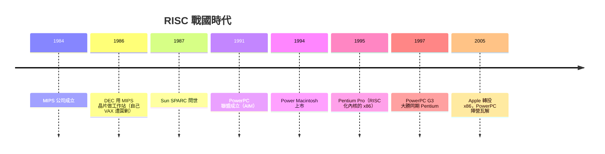

# 5.3 MIPS、SPARC 與 PowerPC 的崛起：工作站時代各路豪傑對英特爾的圍剿與反擊

> 1990 年代的 CPU 戰國時代：五強爭霸、語言是 Unix、戰場是工作站與伺服器。最後的贏家卻是唯一被圍剿的那家。

## 一、三大 RISC 陣營的崛起

**MIPS（1984，史丹福系）**：Hennessy 的學生 John Moussouris 等人創業，R2000/R3000 成為 SGI 工作站與早期 PlayStation 的心臟。MIPS 是「賣 IP 授權」模式的先驅——**不自己大量造晶片，把架構授權給別人**，這個模式後來被 ARM 發揚光大。1990 年代末 MIPS 逐漸轉向嵌入式，2021 年宣布轉投 RISC-V 陣營，是「自己創造、又被下一代取代」的完整輪迴。

**SPARC（1987，Sun Microsystems）**：Bill Joy 把柏克萊 RISC 的暫存器視窗思想變成產品，SPARCstation 成為 Unix 工作站的象徵。Sun 的口號「The Network is the Computer」預言了雲端時代，但公司本身在網路泡沫（2001）與 2009 年被甲骨文收購後式微。

**PowerPC（1991，IBM–Apple–Motorola 聯盟）**：三強結盟對抗 Wintel——IBM 出 POWER 架構、Apple 出應用與品牌、Motorola 出製造。Apple 從 1994 年起把 Mac 全面轉向 PowerPC。聯盟的目標是「用更好的架構圍剿 x86」，結局卻是教科書級的生態教訓（見下）。

## 二、圍剿為何失敗？——四個結構性原因

**1. 生態差距（最致命）**：工作站晶片的軟體是 Unix + 專有應用，每家一套；x86 卻有 DOS/Windows 的億級安裝基數。**個人電腦用戶要的是「能跑昨天的軟體」**，不是「多 20% 效能」。

**2. 規模經濟差距**：x86 量產給全球 PC 市場，單顆成本可壓到工作站晶片的零頭；RISC 晶片一年只賣幾十萬顆，研發成本無法攤提。英特爾用晶圓廠規模碾壓架構優勢。

**3. 內部政治**：DEC 同時擁有 VAX、MIPS 系工作站、自研 Alpha——三條戰線互鬥；IBM 的 POWER 與 RS/6000 內耗；Sun 燒錢擴張。圍剿者最大的敵人常是自己。

**4. 標準的慣性**：1990 年代中期，Windows 95 + Office 成為企業 IT 的不可逆選擇。PowerPC 陣營曾嘗試 PowerPC 版 Windows NT（1995），微軟做了一版後默默放棄——**平台戰爭的裁判是微軟，不是晶片**。

## 三、Apple 的兩次教訓

Apple 的架構史是本節最好的教材：

- **680x0 → PowerPC（1994）**：理由是效能，過程痛苦（需要模擬器跑舊程式），但勉強成功——因為 Mac 用戶少而忠誠；
- **PowerPC → x86（2005，Intel Mac）**：PowerPC 的 G5 頻率撞牆、筆電功耗劣勢（IBM/Motorola 拿不出低功耗版本），賈伯斯宣布轉向，Rosetta 模擬器保駕護航；
- **x86 → Apple Silicon（2020，ARM）**：第四次轉換，這一次 Apple 自己造晶片。

**三次轉換的共同教訓：晶片供應商無法滿足 Apple 的整合野心時，Apple 就自己上。** 這條線直接通向第八章的 Apple Silicon。

## 四、英特爾的反擊：Pentium Pro 與 P6

被圍剿的英特爾並非坐以待斃。Pentium Pro（1995，P6 微架構）完成關鍵蛻變：

1. **譯碼為微操作（micro-ops）**：x86 指令在譯碼後拆成類 RISC 的微操作，後段管線完全按 RISC 原則運作；
2. **亂序執行**（詳見 6.2）；
3. **接腳上的模組化**（雖然當時的封裝策略失敗，但思想存續）。

P6 證明：**x86 的「翻譯層」只花掉 5–10% 的電晶體，卻換來 100% 的軟體生態**。此後二十年，x86 每一代都用 RISC 技術強化自身——圍剿者有的衰落（MIPS、SPARC、Alpha），有的轉身（IBM POWER 退守大型機與遊戲機），而真正把 RISC 理念帶到全世界數十億設備的，是一隻來自劍橋的蜜蜂——ARM（第八章）。

> **歷史因果鏈**：RISC 教科書 → 三大陣營商業化 → 工作站黃金年代 → 生態與規模經濟碾壓 → P6 的「翻譯層」策略 → 純 RISC 陣營退守/轉型 → ARM 接棒。RISC vs CISC 的「聖戰」結論：**架構優劣不決定勝負，生態與規模才決定。**
