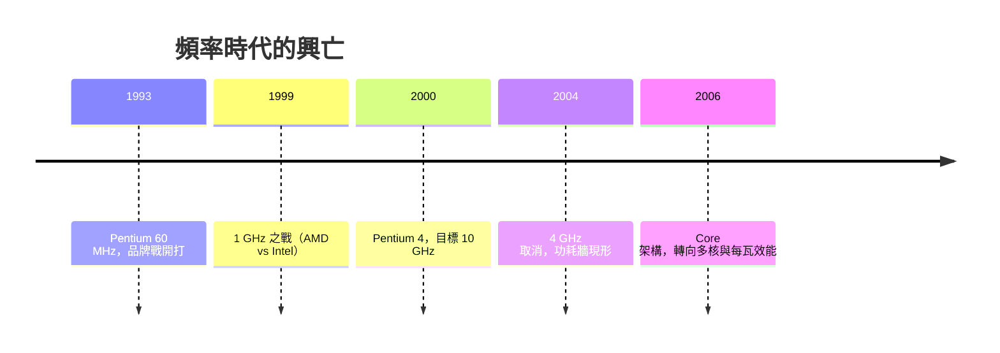

# 6.3 英特爾 Pentium 的反擊與 MHz（頻率）狂熱：把晶片時脈推向極限的行銷與工程競賽

> 1990 年代末，個人電腦的規格表上，最醒目的數字不是記憶體、不是硬碟，而是那個 GHz。「時脈」從工程參數變成了社會身分象徵。

## 一、Pentium 的命名戰爭：數字保衛戰的失敗

1993 年英特爾推出第五代 x86，本該叫「586」——但它發現**數字無法註冊商標**（法院裁定 80586 是通用名稱，AMD、Cyrix 都可以叫 586）。於是英特爾做了一件劃時代的事：**為晶片取品牌名**。Pentium（Penta＝五）誕生，隨之而來的是史上最昂貴的消費性晶片廣告戰——「Intel Inside」貼紙計畫。

「Intel Inside」的制度創新在於：英特爾補貼 PC 廠商的廣告費，換取電腦機殼上貼英特爾商標——**把 B2B 的零件做成 B2C 的品牌**。消費者開始「指定要 Intel 的電腦」，英特爾掌握了定價權，PC 廠商淪為組裝商。這個行銷模式重塑了整個半導體業的品牌思維。

## 二、MHz 狂熱：一個數字的帝國

1994–2000 年，英特爾與 AMD 展開以時脈為指標的軍備競賽：

| 年份 | 里程碑 |
|------|--------|
| 1993 | Pentium 60/66 MHz |
| 1995 | Pentium Pro 200 MHz |
| 1997 | Pentium II 300 MHz |
| 1999 | Pentium III 首破 1 GHz（AMD 與 Intel 為「誰先破 GHz」互相搶發，相差僅兩天） |
| 2000 | Pentium 4 威廉特（Willamette）上市 |

背後的工程邏輯：**效能 ≈ 頻率 × IPC（每週期指令數）**。提升 IPC（更寬的亂序引擎）工程難度高、見效慢；拉頻率（加深管線、縮短關鍵路徑）立竿見影，且數字上「好看」。Pentium 4 的 NetBurst 架構是這條路的極致：**20 級（後來 31 級）超深管線**，目標是 10 GHz。

## 三、行銷如何扭曲工程

MHz 戰爭帶來的系統性扭曲：

1. **媒體與賣場只標頻率**：消費者用 MHz 比較晶片好壞——於是每 MHz 效能較低的晶片（如 NetBurst）反而因頻率數字大而暢銷。AMD 被迫推出「效能指數」命名（Athlon XP 2500+ 實際只有 1.8 GHz），**承認了數字的破產**。
2. **蘋果的先見**：1990 年代 PowerPC 的效能其實與 Pentium 相當，但 Mac 的頻率數字低，被媒體譏為「慢」——2005 年 Apple 轉投 Intel 的公開理由之一就是「頻率戰打不下去」（第八章將再談）。
3. **工程資源錯配**：為了頻率犧牲每週期效率（IPC），Pentium 4 的實際效能常輸給更舊的 Pentium III 同頻版本。

## 四、牆來了：4 GHz 的葬禮

2004 年 5 月，英特爾向客戶發出內部備忘錄：**取消 4 GHz Tejas 計畫**。NetBurst 撞上的是物理定律（詳見第七章）：

- 管線越深，每級邏輯越簡單，但**時脈觸發器與時脈樹本身的功耗暴增**；
- 動態功耗與頻率近似成正比、與電壓平方成正比，而縮小製程帶來的電壓下降紅利已近枯竭；
- Prescott 核心功耗已達 115W，散熱器開始像小型暖氣機。

2005 年英特爾正式轉向：**新任 CEO 歐德寧宣布「效能 = 頻率」時代結束，多核心是未來**。Pentium M（原本為筆電設計的低功耗架構）被拉回桌上型，成為 Core 架構（2006）的基礎——**向功耗妥協，等於承認 NetBurst 路線的死亡**。頻率狂熱就此終結：此後二十年，消費級 CPU 時脈大致停在 3–5.8 GHz 區間。

## 五、文化的遺產

MHz 時代留下的不只是教訓，還有持久的產業文化：

- **規格行銷的模板**：此後的「核心數」（2000s）、「像素數」（相機）、「mAh」（手機）都重演了「單一數字統治市場」的劇本與它的破產；
- **超頻次文化**：玩家用液氮把 CPU 推上極限時脈的「極限超頻」運動，是工程文化與次文化的奇特混血；
- **廣告的文化記憶**：「Intel Inside」的登登登燈號音效（Intel Bong，1998 年起）成為史上辨識度最高的音頻商標之一。

> **歷史因果鏈**：數字無法註冊商標 → Pentium 品牌戰 → MHz 成為消費符號 → NetBurst 深管線豪賭 → 撞上功耗牆 → 轉向多核心（第七章）。頻率戰爭的終結，正是下一章「丹納德縮小法則終結」的序曲。
