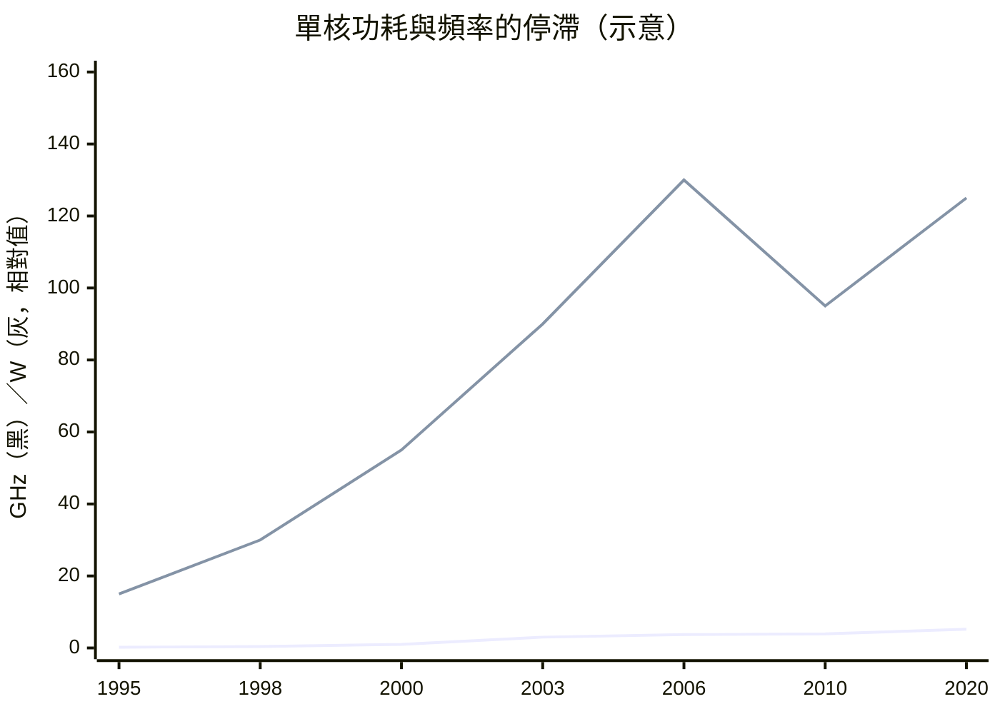

# 7.1 頻率提升的物理極限：漏電流（Leakage Current）與散熱過熱的噩夢

> 2004 年，英特爾取消了 4 GHz 晶片。不是工程師不夠努力，而是物理定律拒絕配合——這堵牆的名字叫「功耗牆」。

## 一、兩條縮小定律的分手

半導體黃金時代靠兩條定律護航：

- **摩爾定律**（1965）：電晶體數量指數成長——**關於密度**；
- **丹納德縮放法則**（Dennard Scaling，1974，IBM 的 Robert Dennard）：電晶體縮小 $k$ 倍時，電壓與電流同比例下降，**功耗密度保持不變**——縮小的同時不會更熱，還能同時提速。

丹納德法則的數學核心：

$$P_{dyn} \approx C V^2 f, \qquad \text{若 } V \propto k,\; f \propto k,\; C \propto k \;\Rightarrow\; P \propto k^0 \text{（不變）}$$

它的美妙之處：**製程每進步一代，速度提升、功耗不變、單位功耗效能直線上升**——免費的午餐。1970–2000 年的所有效能成長，都吃這頓免費午餐。

## 二、午餐結束：三個物理陷阱

**1. 電壓不能再降了。** 電晶體的導通電壓有下限：閘極電壓必須顯著高於約 60 mV 的熱電壓極限（亞閾值斜率的物理極限，室溫下每降 60 mV 電流才降十倍），否則「關不緊」。2000 年代初電壓停在 ~1V 附近不再下降——而 $P \propto V^2$，這項紅利直接消失。

**2. 漏電流（Leakage）接管。** 電晶體縮小後，閘極氧化層薄到只剩幾個原子厚（1.2 nm ≈ 5 層原子），電子以量子穿隧**直接穿牆而過**；加上源極到汲極的亞閾值漏電與接面漏電，**靜態功耗（晶片放著不做事也在漏電）從可忽略變成總功耗的一半以上**。45 nm 時代英特爾被迫引入高介電常數閘介質（high-k，2007）來堵漏——這是 1960 年代以來電晶體結構最大的一次改動。

**3. 功耗密度逼近核反應爐。** 效能與頻率近似線性，但漏電與 $V^2$ 沉重的代價疊加後，晶片功耗密度飆升——Pentium 4 Prescott 的功耗密度已高於電爐的加熱面板，接近核反應爐的量級（面積比）。散熱成了真正的瓶頸：矽接面溫度上限約 100°C，再高就會熱失控。

（示意數據：頻率 2004 年後近乎水平，功耗則在 130W 上下震盪。）

## 三、工程界的反應：從「更快」到「更省」

功耗牆逼出了整個設計哲學的翻轉：

- **動態電壓頻率調整（DVFS）**：晶片依負載即時調整電壓與頻率——「閒時打盹」成為基本禮儀；
- **電源閘（power gating）**：把不用的區塊整塊斷電（省電模式分級：C-states 等）；
- **時脈閘（clock gating）**：關掉閒置電路的時脈樹（時脈樹本身吃掉 30% 動態功耗）；
- **近臨界電壓運算**：把電壓壓到剛好能工作的邊緣，用錯誤校正換能耗（學界先進方向）；
- **Big.LITTLE 異質核心**（ARM，2011）：大小核搭配——重活用大核，輕活用小核。

## 四、為什麼「多核心」是唯一的出路？

單核的算式是死路：

$$P \propto C V^2 f, \quad V \text{ 卡住}, \; f \text{ 拉高則 } P \text{ 爆炸}$$

但**面積（電晶體數量）仍在按摩爾定律成長**。既然不能把電晶體用在「更快」上，就只能用在「更多」上：**同一塊晶片放八個省電的核心**，每個核心都工作在能效甜蜜點上。2005 年英特爾的公開宣示「性能四年翻倍靠多核而非頻率」，正是這個數學的商業宣言。

> **歷史因果鏈**：丹納德法則賜予免費午餐 30 年 → 電壓下限 + 漏電流 + 熱密度 → 午餐結束（2004–2006）→ 設計哲學全面轉向能效 → 多核心範式（下一節）。物理學家丹納德本人 2019 年的一場演講中親口承認：「縮放已經到了極限。」
