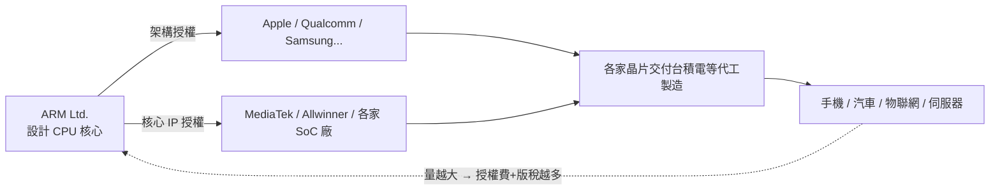

# 8.2 IP 授權模式的商業顛覆：ARM 不賣晶片，只賣大腦藍圖的商業帝國

> 「我們不跟任何人競爭，所以我們跟所有人合作。」——ARM 的商業模式打破了半導體業「自研自造」的百年慣例。

## 一、模式革命：從賣產品到賣設計圖

傳統半導體公司的模式：設計晶片 → 自己或代工製造 → 賣晶片。ARM 的模式：

收入結構兩層：
1. **授權費（license fee）**：一次性取得設計權；
2. **版稅（royalty）**：每顆量產晶片抽成（約為晶片售價的 1–2%）。

這個模式的精妙之處：**ARM 的利益與整個生態的成長完全綁定**。它沒有競爭對手（它不賣晶片），客戶之間互相競爭——每一家的勝利都讓 ARM 受益。到 2010 年代，ARM 晶片累計出貨超過千億顆，全球人口人手十顆有餘。

## 二、為什麼客戶買單？

對晶片公司而言，授權 ARM 核心的誘因：

1. **不必重造輪子**：CPU 核心是 SoC 中難度最高、風險最大的部分；買 IP 把風險轉移給 ARM；
2. **專注差異化**：高通專攻數據機與 GPU（Adreno）、蘋果專攻單核效能與機器學習、聯發科專攻多核性價比——**架構統一，應用各異**；
3. **軟體生態共享**：所有 ARM 晶片共享同一指令集生態，開發者一次編譯處處運行——這正是 x86 之所以強大的同一邏輯，但 ARM 用「開放授權」實現了比 x86 更廣的覆蓋。

## 三、與 x86 模式的對照：兩種帝國的哲學

| | Intel（x86） | ARM |
|---|---|---|
| 商業模式 | 賣晶片（高毛利製造+品牌） | 賣 IP（低毛利但零製造風險） |
| 資本結構 | 重資產（自有晶圓廠） | 輕資產（純設計公司） |
| 生態控制 | 封閉：只有 Intel 能造 x86 | 開放：數百家都能造 ARM |
| 風險 | 承擔製程投資（一座廠百億美元） | 承擔架構路線（沒做對方向就出局） |
| 弱點 | 製程落後即全盤皆輸（2010s Intel 之痛） | 不直接控成品，品質依賴客戶 |

ARM 模式的制度意義深遠：**它把「設計 CPU」的門檻從半導體巨頭降到任何一家系統公司**——蘋果、華為、亞馬遜都能造自己的 CPU。這種「設計能力民主化」，正是第十章 RISC-V 運動的思想先聲。

## 四、重大關卡：軟銀併購與 NVIDIA 收購案

2016 年，日本軟銀（SoftBank）以 320 億美元收購 ARM——孫正義的願景是物聯網時代每台設備都有晶片，ARM 是「收租的地主」。2019 年 ARM 重新上市後，2020 年 NVIDIA 宣布以 400 億美元收購 ARM，引爆全球產業與政治的劇烈反應：

- **高通、蘋果、三星、微軟**全部反對：ARM 一旦落入 NVIDIA（自家也有伺服器晶片），中立性蕩然無存；
- **英、美、中、歐**監管機構齊出手：ARM 是地緣戰略資產（英國的技術驕傲、中國晶片業的命脈之一）；
- 2022 年交易告吹，NVIDIA 支付 12.5 億美元分手費；2023 年 ARM 於納斯達克重新 IPO。

這場失敗的收購證明了一件大事：**指令集架構已從商業資產升級為地緣政治資產**——它與石油、晶圓廠同級，是國家級的戰略資源。這也直接催生了各國對 RISC-V 的押注（第十章）。

## 五、訴訟插曲：ARM vs Qualcomm（Nuvia 案）

2022 年，ARM 起訴高通：高通收購 Nuvia（前蘋果晶片工程師創業公司）後，以「架構授權」直接使用 Nuvia 的自研核心。訴訟暴露了授權模式的灰色地帶——**「架構授權」與「核心授權」的邊界之爭**。2024 年陪審團多數判決有利於高通。此案說明：授權帝國的法律地基，仍在持續被考驗。

> **歷史因果鏈**：低功耗基因（8.1）→ 選擇授權而非製造 → 生態飛輪（人人造 ARM，人人付版稅）→ 行動時代獨佔 → 軟銀/NVIDIA 風波 → 架構成為地緣政治資產 → 刺激 RISC-V 開源運動（第十章）。ARM 的模式成功了，但它也親手示範了「封閉授權」的天花板——下一代革命者的機會。
