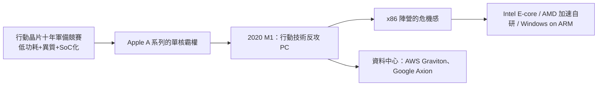

# 8.3 智慧型手機與 Apple Silicon 的崛起：從高通 Snapdragon 到蘋果 M 系列晶片的降維打擊

> 2020 年 11 月 10 日，蘋果發表 M1：一台用「手機晶片技術」造的筆記型電腦，續航 18 小時，效能打贏同級 Intel。桌上型 CPU 的四十年帝國，第一次聽見城牆裂開的聲音。

## 一、手機晶片的軍備競賽

2007 年 iPhone 問世到 2010 年代，手機 SoC 成為地球上競爭最激烈的 CPU 戰場：

- **高通 Snapdragon**：自研 Kryo/Scorpion 核心（ARM 架構授權）+ 自家 Adreno GPU（購自 ATI 的圖形資產）+ 頂級數據機；
- **Apple A 系列**（2010 年起）：每代自研核心，單核效能從 2013 年 A7（首次 64 位元，比 ARM 公版早兩年！）開始一路碾壓；
- **華為海思麒麟、三星 Exynos、聯發科天璣**：各有市場。

關鍵的結構性因素：**蘋果同時控制硬體、作業系統與晶片**，可以垂直優化（快取設計配合 iOS 排程器、GPU 配合 Metal API），而高通必須服務幾百家客戶。Apple A 系列的單核效能長期領先安卓陣營 2–3 年——**垂直整合的威力**在此展露無遺。

## 二、M1 的降維打擊（2020）

M1 的本質：**把 iPhone 晶片放大**。它的技術組合：

1. **架構**：ARM64（蘋果持有架構授權，核心全自研）；
2. **異質設計**：4 個效能核 + 4 個效率核 + 統一記憶體架構（UMA：CPU/GPU/NPU 共用記憶體）+ 神經網路引擎（16 核）+ 電路整合（Thunderbolt、Secure Enclave 全部上片）；
3. **製程紅利**：台積電 5nm——當時 Intel 還在 10nm 挣扎；
4. **生態策略**：Rosetta 2 二進位轉譯讓 Intel 軟體直接可跑，加上 Universal 2 原生編譯，兩年內完成主流軟體遷移。

M1 打擊的痛點：**同級 x86 筆電的功耗是 M1 的 2–3 倍，續航腰斬**。MacBook 的評測從此只剩一個話題：「這台電腦不用充電。」

## 三、Intel 的十年之痛

回顧 Intel 為何丟掉這場戰爭：

1. **錯過手機**（2006 賣掉 XScale、Atom 進軍失敗）：失去行動市場＝失去先進製程的最大贊助商；
2. **製程連續失誤**（2014–2020）：14nm 停滯多年、10nm 難產——一代製程延遲，全線產品被台積電 7nm/5nm 碾壓；
3. **商業模式的路徑依賴**：高毛利桌上型 CPU 的舒適區，讓它對「低毛利、大量」的行動邏輯免疫；
4. **蘋果的「背叛」**：2005 年蘋果轉投 Intel 曾是 Intel 的榮耀，2020 年被自己扶植的客戶甩開——**PC 業的忠誠從來只屬於效能與能效**。

## 四、擴散效應：ARM 全面開花

M1 的成功像一顆石子，激起全行業的連鎖反應：

- **PC 陣營**：聯想、華碩、小米推出 Snapdragon X Elite 筆電（Windows on ARM 第三次嘗試，這次效能真正到位）；AMD 與 Intel 全面加入大小核與能效競賽；
- **伺服器**：AWS Graviton（2018 起）、Google Axion、Microsoft Cobalt——雲巨頭用 ARM 自研晶片省電費、省授權費、增談判籌碼；ARM 在資料中心份額快速成長；
- **地緣政治**：各國注意到「ARM 架構 + 台積電代工」這條路可以被蘋果走通，也就可以被任何國家走通——刺激了中國的鯤鵬、歐洲的 SiPearl、以及（更開源路線的）RISC-V 押注。

## 五、思想的收束：SoC 時代，CPU 的角色再定義

M1 之後，獨立的「CPU 公司」的意義正在稀釋：**現代晶片是 CPU（管理者）+ GPU（算力）+ NPU（推理）+ I/O（連接）的複合體**。CPU 從「主角」轉為「交響樂團的指揮」——不再演奏最多的音符，但決定全場的節奏。這個角色重塑，正是本書最後一章（異質運算與 AI 時代）的主題。

> **歷史因果鏈**：手機 SoC 軍備競賽 → 蘋果垂直整合十年磨劍 → M1 反攻 PC → 製程與能效的雙重碾壓 → 全行業 ARM 化 → 地緣政治加碼自研。至此，x86 的四十年霸權進入多極時代；而更根本的挑戰——摩爾定律的極限與開源架構——正在後方集結。
