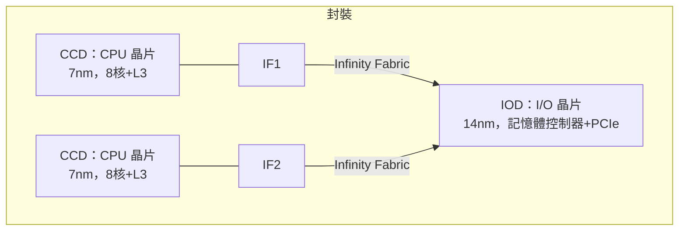

# 9.2 AMD Zen 架構與 Chiplet 革命：用高速互連（Infinity Fabric）將多個小晶片拼成一顆怪獸級 CPU

> 2017 年之前，AMD 被認為快要出局；2017 年之後，它用「把晶片拆開來做」的思路，打出一場半導體史上最經典的絕地反擊。

## 一、瀕死的 AMD 與 Bulldozer 的教訓

2011–2016 年的 AMD 是災難時期：Bulldozer 架構的「模組化雙核」設計失誤、每瓦效能遠遜 Intel、股價一度跌破 2 美元、瀕臨破產。公司被迫抵押自有晶圓廠（2009 年已分拆為 GlobalFoundries），轉為無晶圓廠（fabless）公司——**這個「被迫」，意外成為 Chiplet 戰略的前提條件**。

2012 年，Jim Keller（傳奇架構師，曾操刀 AMD K8 與蘋果 A4/A5）回歸，啟動 **Zen 計畫**。他的設計哲學被總結為一句：「**真正的對手不是 Intel，是物理與經濟。**」

## 二、Zen + Chiplet：兩步棋

**第一步：Zen 架構（2017）——把核心做好。** 全新設計的 RISC 化微架構：乾淨的微操作、高效的快取層級、SMT 四路解碼。同頻效能（IPC）較前代暴增 52%，終於與 Intel 同台競爭。

**第二步：Chiplet 化（2019，Zen 2）——把晶片拆開。** 第一代 Ryzen 用單體 die；第二代 Ryzen（Zen 2）徹底改變結構：

- **CCD（核心晶片）**：只放 CPU 核心與 L3，用台積電最先進製程（7nm）；
- **IOD（I/O 晶片）**：記憶體控制器、PCIe、Infinity Fabric，用成熟便宜製程（14nm）——因為 I/O 電路對製程不敏感，用先進製程是浪費；
- **Infinity Fabric**：AMD 自研的高速互連，讓多顆 die 像一顆晶片一樣運作。

## 三、經濟學的勝利

Chiplet 化的收益清單：

| 維度 | 單體（Monolithic） | Chiplet |
|------|--------------------|---------|
| 良率 | 大 die 指數劣化（9.1） | 小 die 良率高，報廢損失小 |
| 製程成本 | 全部用先進製程 | 只有核心用先進製程，I/O 用舊製程 |
| 產品線彈性 | 一個設計一種規格 | 2 顆 CCD＝16 核，8 顆＝EPYC 64 核——**同一套積木出全產品線** |
| 混搭代工 | 單一依賴 | 核心交台積電、I/O 可他廠（分散風險） |

結果：EPYC 伺服器 CPU（最多 128 核）以「每插槽更多核心、每瓦更多效能、更低價格」猛攻資料中心；Ryzen 從 Intel 手中奪回消費市場。**2017–2024 年 AMD 股價上漲逾 40 倍**，Intel 市值一度被 AMD 反超（2022）——單體時代的王者被「積木式」的挑戰者翻盤。

## 四、後續擴散與 3D 化

- **Intel 跟進**：Foveros 封裝 +「tile」策略（Meteor Lake 起），昔日嘲笑對手的公司全面轉向；
- **3D V-Cache（2022）**：用 TSV 矽穿孔把 L3 快取**垂直堆疊**在 CCD 之上，遊戲效能暴漲——Chiplet 的下一步是「不只並排，還要疊高」；
- **蘋果、輝達的混合路線**：M1 Ultra 用 UltraFusion 把兩顆 die 拼成一顆邏輯上的巨晶片；輝達 Blackwell 用兩片 reticle-size die 拼 GPU。**「拼裝」已成為頂級晶片的標配，而非權宜之計。**

## 五、思想的深意：摩爾定律的「翻譯」

摩爾定律的本質是「每兩年用同樣成本買到雙倍電晶體」。當製程進步變慢、晶圓變貴，Chiplet 提供了新的翻譯：

> **既然不能讓單片矽上塞更多電晶體，那就讓「多片矽」在同一個封裝裡協同工作——用封裝與互連的進步，繼續兌現摩爾定律的承諾。**

「系統級思考取代製程級思考」——這是後摩爾時代的哲學主軸，也是下一節台積電 CoWoS 與 3D 堆疊的舞台。

> **歷史因果鏈**：Bulldozer 慘敗 → 無晶圓廠化的「被迫」→ Jim Keller 的 Zen → Chiplet 拆解 + Infinity Fabric → 經濟性碾壓單體 → Intel/蘋果/輝達全面跟進 → 摩爾定律以封裝形式延續。下一節：讓這場拼裝成真的封裝工程革命。
