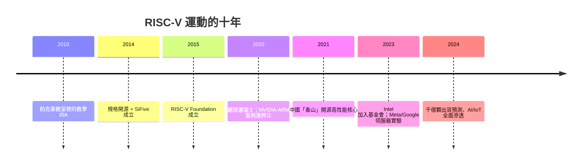

# 10.1 x86 與 ARM 的專利枷鎖：柏克萊大學發起的開源指令集（RISC-V）運動

> 2010 年，柏克萊的一間實驗室想找一個乾淨的教學用指令集，發現市場上沒有——於是他們決定：自己造一個，然後**免費送給全世界**。

## 一、指令集為什麼被「鎖」起來？

理解 RISC-V 的誕生，先要理解現有架構的「枷鎖」結構：

**x86**：
- 專利牆：英特爾與 AMD 交叉授權（1970 年代至今），x86 製造權實質上只有兩家（VIA 的殘餘授權除外）；
- 歷史包袱：40 年相容債務（5.1 的 CISC 膨脹、真實模式、分段記憶體殘餘）；
- 進口門檻：任何新玩家想進 x86，要跨專利、要跨 Intel 的生態霸權。

**ARM**：
- 授權費＋版稅：設計晶片要先付錢（架構授權動輒數千萬美元起）；
- 中立性風險：NVIDIA 收購案（8.2）暴露了「單一公司控制架構」的地緣風險；
- 方向控制權：ARM 決定指令集往哪走，客戶只能跟。

**關鍵洞察**：指令集（ISA）本身是**抽象規格**——它描述「CPU 應該做什麼」，不涉及任何具體電路。**規格不需要受限於電晶體專利**。RISC-V 的創辦人看清了這一點：完全可以設計一個「乾淨、無專利包袱、永久開放」的 ISA。

## 二、柏克萊的起點：教學需求變成運動

2010 年，柏克萊平行運算實驗室（ASPIRE Lab）的 Krste Asanović 與研究生 David Patterson（RISC 革命的元老，此時已退休返聘）需要一個 ISA 來搭建研究用的晶片。評估後的困境：

- x86：太複雜，且有專利雷區；
- ARM/MIPS：授權談判曠日費時，學術用途受限；
- 結論：**自己設計**。

團隊的核心人物 Andrew Waterman 與 Yunsup Lee 在三個月內完成 RISC-V 初版。2014 年他們成立了 **SiFive**（第一家 RISC-V 商業公司），並把 ISA 規格以**BSD 開源授權**釋出——任何人可以自由實作、商用、修改，**永遠免版稅**。

Patterson 的角色極具象徵性：**1980 年代 RISC 革命的理論家，三十年後親手為「開放架構」點火**。他的名言：「指令集不該被任何一家公司私有——它應該像以太網路標準一樣開放。」

## 三、RISC-V 的技術設計哲學

RISC-V 不是「免費的 ARM」，它在設計上有獨特主張：

1. **模組化 ISA**：基礎指令集（RV32I/RV64I，僅 47 條指令）＋可選擴展（M 乘除、A 原子操作、F/D 浮點、V 向量、C 壓縮指令、P packed SIMD…）。**晶片只實作需要的模組**——嵌入式可以極小，超算可以極大；
2. **教科書式乾淨**：沒有歷史包袱（與 x86 相反）、無強制微碼、無隱藏狀態——正統 RISC 教科書的直接實踐；
3. **擴展的治理**：由 RISC-V International 基金會（2015 年成立，2020 年總部遷至瑞士——**刻意選在政治中立的瑞士**）以開放程序管理擴展，避免單一公司的私心；
4. **擴展訂製自由**：架構授權允許廠商加自己的專有指令——**「開放核心、客製分支」**，這是 ARM 架構授權（昂貴）才能享受的自由。

## 四、地緣政治的推波助瀾

2018 年之後，三件事讓 RISC-V 從學術運動升級為國家戰略：

1. **NVIDIA-ARM 收購案**（2020）：業界恐慌「中立架構消失」，尋求替代方案；
2. **美中科技戰**：華為被斷供 ARM 架構授權後，中國業界全面擁抱 RISC-V（阿里平頭哥玄鐵系列、中科院「香山」）；美國國會亦有議員建議限制美國公司參與 RISC-V——**開源架構陷入「管不住也斷不掉」的地緣悖論**；
3. **國家級押注**：歐盟（EuroRISC-V 計畫）、印度（2020 年代國家處理器計畫以 RISC-V 為基底）、中國（十四五規劃明文支持）、日本（Rapidus 生態）、巴西（政府採購）——**各國的動機一致：不想讓 CPU 命脈掌握在別國公司手裡。**

## 五、制度創新：基金會治理

RISC-V International 的治理模式借鑑了開源軟體（Linux）的成功：數百家會員（Intel、高通、Google、阿里巴巴、華為…）共同制定標準，任何人可提擴展、經技術委員會審議通過。**Intel 2023 年甚至加入基金會並投資 RISC-V 生態**——「敵人加入標準組織」是開放模式成熟的標誌。

> **歷史因果鏈**：x86 專利牆 + ARM 授權風險 → 柏克萊認清「ISA 是抽象規格，不必被鎖」→ 開源 + 模組化設計 → 地緣政治引爆國家級押注 → 基金會治理固化開放性。下一節：免費的架構如何從小晶片一路殺到伺服器。
