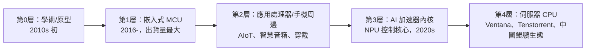

# 10.2 從嵌入式設備到伺服器晶片：免授權費的 RISC-V 如何吸引全球黑客與國家的瘋狂押注？

> RISC-V 的路線圖與 ARM 五十年前如出一轍：從最不起眼的嵌入式角落出發，一路向上蠶食——只是這次，速度被十億美元級的國家資本加速了。

## 一、滲透的階梯：從微控制器到 AI 加速器

RISC-V 的商業化路徑是一條典型的「低端顛覆」（disruptive innovation）階梯：

**第 1 層（已經贏了）**：微控制器不需要應用生態（程式寫好燒死），授權費是純成本，RISC-V 在此是純利。Espressif（ESP32-C 系列）、芯華章、SiFive Core-Complex 等在 2020 年代大量出貨，累計 RISC-V 核心出貨量已破百億顆。

**第 2–3 層（攻城中）**：智慧音箱、電視、SSD 控制器、GPU 的管理核心——「旁路應用」對 ISA 生態要求低。阿里平頭哥的玄鐵 C910（2019，首款高性能 RISC-V 核）與其後的 C920 進入真實消費與工業產品。**AI 加速器是關鍵跳板**：NPU 的控制核心對 ISA 無既有包袱，新的加速器公司（Tenstorrent、Groq 週邊、Meta MTIA）選 RISC-V 毫無心理負擔。

**第 4 層（最後堡壘）**：伺服器。Ventana、Tenstorrent（Jim Keller 新公司）嘗試 RISC-V 伺服器晶片；中國「香山」開源高性能核心（中科院團隊，2021 年起）是國家級的象徵工程——**性能目標直指 ARM Neoverse 級別**。

## 二、黑客文化與開源社區

RISC-V 能快速積累動能，靠的是開源軟體世代的熟練打法：

1. **開源核心**：Rocket（柏克萊）、BOOM（亂序執行）、香山——工程師可以直接下載、修改、投片，如同當年玩 Linux；
2. **工具鏈先到**：GCC/LLVM 支援、Linux 內核支援、QEMU 模擬器齊備——**軟體先行**，硬體跟上；
3. **Chips Alliance、RISE 計畫**：產業聯盟資助軟體生態（Google、Intel、阿里都贊助）；
4. **教學滲透**：全球數百所大學用 RISC-V 教計算機架構（Patterson 的教科書新版直接改用 RISC-V 範例）——**新一代工程師的第一顆 CPU 記憶，是 RISC-V**。這個教育層面的「世代替代」，是十年尺度上最強的滲透力。

## 三、經濟誘因：免費的部分與收費的部分

「免授權費」≠「零成本」，但成本結構確實顛覆：

| 項目 | ARM 授權 | RISC-V |
|------|----------|--------|
| 架構授權費 | 數千萬–上億美元 | 0 |
| 每顆版稅 | 晶片售價 1–2% | 0（若自研核心） |
| 開發成本 | 較低（買現成核心） | 較高（自研或買 SiFive 等 IP，但可議價） |
| 適合誰 | 追求省事、量大的大廠 | 想要差異化、怕鎖定的玩家 |

**RISC-V 的真正誘因不是省錢，是自由**：可以為 AI 負載加自訂指令、可以為汽車做安全認證分支、可以不怕供應商漲價或斷供。對國家而言，則是**供應鏈主權**——這解釋了為何大資本（國家級）與小玩家（黑客級）同時押注。

## 四、地緣政治的實戰

- **中國**：華為（被斷供 ARM）全力 RISC-V 化；阿里平頭哥、賽昉、中科院香山構成完整生態；2023 年美國國會有人提議限制美企參與 RISC-V，引發「開源能不能被管制」的憲法級辯論——**開放規格的本質（任何人可自由使用）讓出口管制無從下手**，這是地緣科技戰中罕見的「制度性死角」；
- **印度**：2011 年起的國家處理器計畫（Shakti 系列）2020 年代全面 RISC-V 化——政府主導、教育配合、成本低；
- **歐洲**：歐盟晶片法內含開源架構條款，SiPearl、Bull 等探索 HPC 用 RISC-V；
- **美國**：DARPA 的 CHERI 安全擴展（基於 RISC-V 的安全架構研究）顯示官方對開放架構的務實態度。

## 五、與 ARM 的正面相遇

2020 年代中期，兩者的摩擦升溫：ARM 的行銷直接攻擊 RISC-V「生態碎片化」（見 10.3）；RISC-V 陣營則以「模組化、無版稅、地緣中立」反擊。有趣的是 **ARM 自己也推出 RISC-V 相容產品線（2023，供客戶搭配）**——商業的現實主義戰勝意識形態。

> **歷史因果鏈**：嵌入式先贏（無生態負擔）→ AI 加速器跳板 → 伺服器攻堅（香山、Ventana）→ 開源社區 + 教育世代替代 → 國家級押注（中美歐印）→ 制度性「管不住」→ 與 ARM 正面競爭。免費架構能否真正登頂，取決於它最大的軟肋——生態碎片化，下一節的主題。
