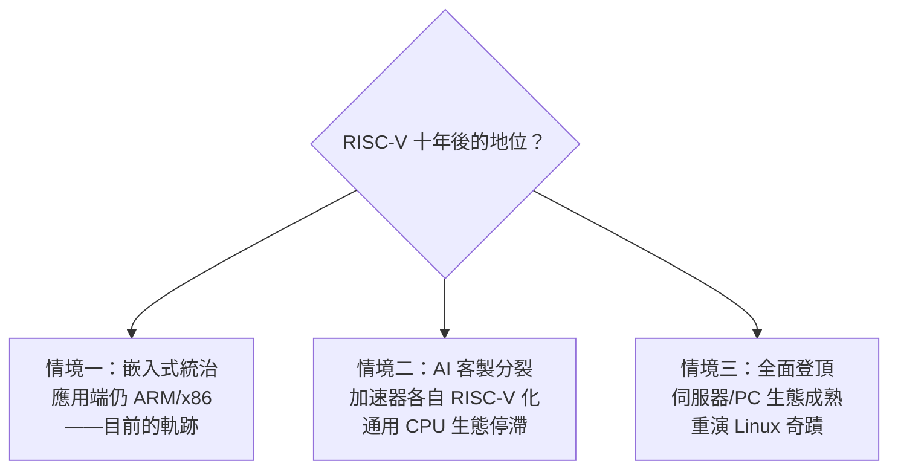

# 10.3 開源硬體生態的機遇與挑戰：軟體碎片化危機與能否撼動巨頭地位的終極考驗

> 開源軟體花了三十年贏得世界（Linux 進入每一台伺服器）；開源硬體能複製這個奇蹟嗎？RISC-V 面對的不是「技術能不能」的問題，而是「生態願不願意」的考驗。

## 一、軟體碎片化：開放的原罪

RISC-V 的模組化（10.1）是雙面刃。ARM 用「單一公司拍板」換來指令集的絕對一致性；RISC-V 用「開放擴展」換來自由，代價是：

1. **自訂擴展氾濫**：每家晶片公司加自己的專有指令（AI 算子、安全、DSP），程式一旦用到就鎖死在那家晶片上——「開放架構上的封閉分支」；
2. **基礎指令集分裂**：RV32/RV64 之外，向量擴展 V 的版本迭代（0.7 → 1.0）曾讓早期投片廠商的晶片直接不相容；
3. **作業系統支援的長尾**：數千種 RISC-V 芯片組合，Linux 需要一一適配——「可開機的通用 RISC-V 系統」長期是奢望。

ARM 行銷的攻擊點正是這裡：「**RISC-V 沒有一致的生態，每顆晶片都是孤島。**」RISC-V International 的對策：

- **Profile 機制**（RVA22/RVA23）：定義「伺服器/應用級處理器必須實作哪些擴展」，收斂碎片化；
- **治理收緊**：擴展必須通過基金會標準程序才能冠名 RISC-V；
- **軟體標竿**（如 Android 已支援 RISC-V，Google 官方投入）。

## 二、開源硬體的三道門檻

軟體的開源模式能否移植到硬體？RISC-V 的經驗指出三道不同層次的門檻：

**（1）設計開源 ≠ 製造開源**
Linux 的複製成本為零；晶片的複製要走光罩、流片、封裝——**一次投片數百萬美元起**。開源核心降低了設計門檻，但沒有降低製造門檻。「開放架構 + 封閉製造」是當前的現實（可對照 9.1 的晶圓廠集中化）。

**（2）驗證成本**
晶片的正確性驗證（formal verification、模擬、矽後除錯）占開發成本 70%——這部分無法靠「眾人皆貢獻」簡單分攤。學術界提出的形式化驗證流水線、FPGA 原型與開源驗證套件（如 riscv-tests、Sail 模型）正在降低此門檻。

**（3）性能前沿的組織難題**
頂級 CPU（Apple M 系列級）需要數百名資深工程師與數十億美元。開源社區的志願者模式做得出好的小核心，做不出 M5。**香山**（中科院，開源高性能核心）是試圖用「機構化開源」（國家資助 + 全職團隊 + 開源發佈）跨越這道門檻的實驗——它的成敗將是開源硬體模式的重要判例。

## 三、機遇：三個結構性紅利

儘管挑戰嚴峻，RISC-V 手握三張 ARM/x86 沒有的牌：

1. **AI 時代的客製化需求**：大模型推理需要自訂資料流與指令，通用 ISA 的「一刀切」失靈——RISC-V 的擴展自由恰好匹配（Tenstorrent、諸多 NPU 公司的選擇）；
2. **開發工具鏈的成熟借力**：Chisel/FIRRTL（柏克萊的硬體描述語言）、開源 EDA（OpenROAD、OpenLane）首次讓「個人設計晶片」接近可行——硬體界的 GitHub 時代正在成形；
3. **地緣政治的需求推力**：每個不想「卡脖子」的經濟體都需要一個不設防的架構——這是任何商業公司都買不到的市場。

## 四、能否撼動巨頭？三種情境

歷史的參照系是 Linux：1991 年的玩具，2010 年代統治伺服器、安卓與超算——**但花了二十年，且靠的是伺服器這個「生態要求較低、成本敏感」的灘頭**。RISC-V 若要重演，合理的灘頭依次是：嵌入式（已勝）→ AI/NPU（進行中）→ 伺服器（2030 年代的戰場）→ 消費 PC（最難，鎖定最深）。

另一個參照是 **MIPS 的落幕**（2021 年宣布轉投 RISC-V）：上一代 RISC 帝王親自為新王加冕——「舊架構的退場加速新架構的登場」，這是技術生態系的自我新陳代謝。

## 五、思想總結：開放的辯證

RISC-V 之爭本質上是一場制度實驗：

> **封閉架構用「集中的決策與生態」換取一致性與效率；開放架構用「分散的創新與自由」換取韌性與主權。** 計算機史的循環——IBM 大型機的封閉 → Unix 的開放 → Wintel 的封閉 → 網際網路的開放 → 行動 App 的半封閉——提示我們：**每一次封閉的勝利都孕育下一場開放革命。** RISC-V 就是這個辯證法的最新一頁。

> **歷史因果鏈**：模組化的碎片化風險 → Profile 治理收斂 → 開源硬體三門檻（製造/驗證/前沿性能）→ 香山式的「機構化開源」實驗 → AI 客製需求 + 地緣推力 → 三種未來情境。無論結果如何，開源指令集已永久改變了產業的談判籌碼——連巨頭都必須假裝擁抱開放。
