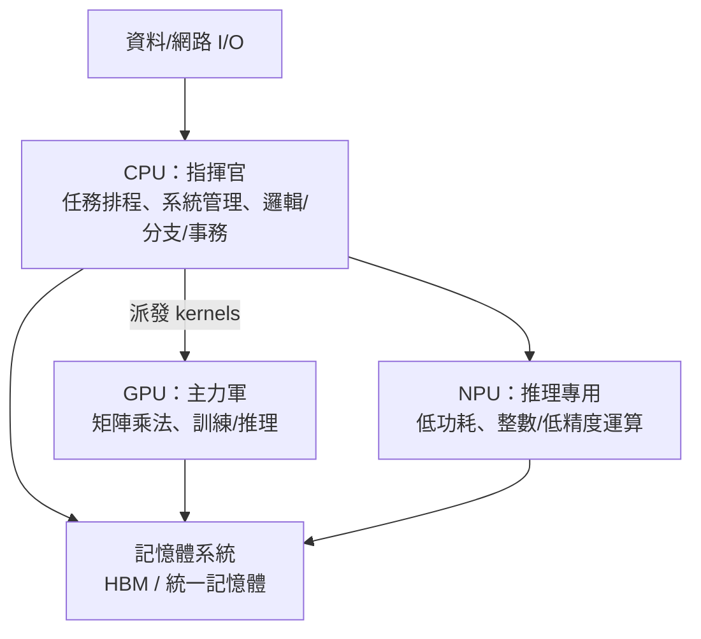

# 11.1 從 CPU 單挑到 CPU + GPU + NPU 矩陣協同：AI 大模型時代運算權力核心的轉移

> 2012 年之前，晶片的王是 CPU；2012 年之後，跑神經網路的是 GPU。這場權力轉移的弔詭之處在於：CPU 沒有被淘汰，而是被「降格為經理」——但這個經理，決定著整個資料中心的心跳。

## 一、深度的巧合：GPU 撿到 AI

AI 硬體革命始於一個技術與需求的意外交會：

- **GPU 的本來使命**：圖形渲染——本質是「對百萬個像素執行同樣的數學」＝極致資料平行（SIMD/SIMT）；
- **神經網路的本質**：矩陣乘法（GEMM）——恰好也是「對海量數據執行同樣的乘加」；

2007 年 NVIDIA 推出 CUDA，開放 GPU 通用運算；2012 年 Alex Krizhevsky、Ilya Sutskever 與 Geoffrey Hinton 用 **兩顆 GTX 580** 訓練 AlexNet，在 ImageNet 競賽中以大幅優勢奪冠——**深度學習革命的實質開幕式，主辦單位是 NVIDIA 的行銷部**（Hinton 事後回憶：是學生們堅持用 GPU，他自己最初不以為然）。

為什麼 GPU 碾壓 CPU？

$$\text{CPU：少數強核心，優化「延遲」}\qquad \text{GPU：萬計簡單核心，優化「吞吐」}$$

矩陣乘法天生無資料相依，可完全平行化——CPU 的亂序執行、分支預測、深管線（第六章的全部黑魔法）在此**無用武之地**；GPU 只需要「把一萬個乘加器餵飽」。2016 年 NVIDIA 為 Deep Learning 量身打造 Tensor Core（P100 起），2022 年 ChatGPT 點燃全行業，H100 成為這個時代的「石油」。

## 二、CPU 的新角色：指揮官與協調者

在異質系統中，CPU 的工作不再是「算得快」，而是「管得好」：

CPU 的不可替代性：

1. **控制流與分支邏輯**：AI 工作流的「膠水」（資料預處理、分詞、排程、錯誤處理）是不規則、分支密集的程式——正是 CPU 的主場；
2. **系統管理**：虛擬化、安全（TPM/TEE）、容器、網路協定棧——資料中心的地基全在 CPU 上；
3. **資料移動的調度**：決定哪個 tensor 在哪個裝置、何時搬運——**通訊與調度的效率，往往比算力更決定整體吞吐**。

## 三、SoC 時代：NPU 的崛起與「端側 AI」

智慧型手機的另一條戰線：**NPU（神經網路處理器）**上片。

- **Apple A11（2017）**首搭 Neural Engine；華為麒麟 970（2017）首推「NPU」行銷詞；
- 動機：端側推理（拍照美化、語音喚醒、即時翻譯）對功耗極敏感，把資料丟去雲端既慢又耗電——**「能效比特」成為端側 AI 的核心指標**；
- 到 2020 年代，旗艦 SoC（Apple M 系列、Snapdragon 8 Elite、天璣 9400）全部內建 NPU——**AI 從雲端戰爭轉為端側戰爭**。

PC 端同步跟進：**AI PC**（2023–24 起微軟 Copilot+ 認證要求 NPU 算力 40 TOPS+）——筆電晶片的三件套（CPU+GPU+NPU）成為新標配。Intel、AMD、高通在「每瓦 TOPS」上重新開戰，重演第六章的行銷戰劇本（這次的主數字是 TOPS，取代了當年的 MHz）。

## 四、經濟與權力的重排

- **NVIDIA 登頂**：2023 年市值破兆、2024 破 3 兆美元——**一家賣遊戲顯示卡的公司成為 AI 時代的鐵路公司**（賣鏟子的哲學）；
- **客製 ASIC 浪潮**：Google TPU（2015 起）、AWS Trainium/Inferentia、Meta MTIA、Microsoft Maia——雲巨頭自研加速器，繞開 NVIDIA 的毛利；
- **新戰場：推理**：訓練是一次性投資，推理是持續性成本——「每 token 成本」成為新 KPI，推動量化（INT8/FP4）、稀疏化、MoE 架構與專用推理晶片的軍備競賽；
- **CPU 廠的求生**：Intel 與 AMD 全面整合 NPU/AMX 矩陣指令——**不轉型的 CPU 公司，將在 AI 時代淪為「配角晶片」**。

## 五、思想轉折：從通用到專用

過去七十年的主旋律是**通用化**（馮·諾伊曼機器 → 通用 CPU → 通用 GPU）；AI 時代的主旋律是**專用化**（為特定數學結構客製的資料流架構）。這不是倒退，而是**計算經濟學的成熟**：當算力需求呈指數成長而電晶體成長放緩（後摩爾時代），唯一的出路是「把每一顆電晶體用在最常發生的運算上」——**領域特定架構（DSA）**，Hennessy 與 Patterson 在 2017 年圖靈獎演講中的命名與預言。

> **歷史因果鏈**：圖形運算的本質（資料平行）＝ 神經網路的本質 → CUDA 布局十年 → AlexNet 奇蹟 → GPU/加速器登基 → CPU 轉型指揮官 → NPU 端側化 → TOPS 行銷戰 → 客製 ASIC 浪潮。但異質矩陣也製造了新的戰場：**裝置之間的匯流排與記憶體頻寬**，下一節的主題。
