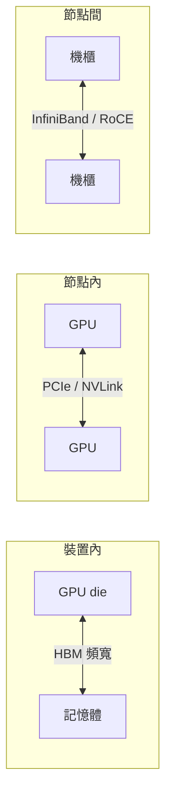

# 11.2 異質運算中的匯流排瓶頸：PCIe、NVLink 與記憶體頻寬的生死之戰

> 在 AI 資料中心裡，最貴的資源不是算力，是「算力之間的溝通」。當一萬顆 GPU 合力訓練一個模型，決定成敗的往往不是晶片有多快，而是資料流動有多快。

## 一、馮·諾伊曼瓶頸的「放大版」

1.3 節的老問題——CPU 與記憶體之間的窄門——在異質時代被放大成三層瓶頸：

**瓶頸一（HBM 頻寬）**：大模型推理是「記憶體受限」的工作——每生成一個 token，要把數十億參數從記憶體搬到算力單元。算術強度（arithmetic intensity）不足時，GPU 的乘加器大量閒置。這解釋了為何 HBM 的頻寬（HBM3e 達 1–1.5 TB/s）成為 AI 晶片規格表的第一行。

**瓶頸二（節點內互連）**：一張 H100 的 PCIe 5.0 頻寬 64 GB/s，NVLink 900 GB/s——**差 14 倍**。多 GPU 訓練（模型並行、張量並行）需要 GPU 之間頻繁交換梯度，PCIe 會成為斷點。這是 NVIDIA 死守 NVLink 生態、AMD 推 Infinity Fabric、Intel 推 CXL 的根本原因：**互連協定就是 AI 時代的城牆**。

**瓶頸三（節點間網路）**：數萬張 GPU 的叢集，梯度同步要跑過 InfiniBand（400G/800G）——訓練 GPT 級模型的通訊時間可占總時長的 30–50%。**網路工程成為 AI 基建的核心學科**。

## 二、PCIe：通用匯流排的極限

PCIe 的歷史（2003 年 PCIe 1.0 起，每代頻寬翻倍）是「通用性」的勝利——插槽裡可以插顯卡、網卡、SSD、任何東西。但它的兩大困境：

1. **點對點拓撲**：CPU 的 PCIe 通道數有限（一般 128 條），GPU 多了就要透過交換器（switch），延遲與頻寬分攤；
2. **「資料過路 CPU」的傳統模型**：傳統架構裝置之間的資料常要經過主機記憶體中轉——於是誕生了 **P2P（peer-to-peer）DMA、GPUDirect**（NVIDIA 讓 GPU 直接互傳、繞過 CPU）與 **CXL**（Intel 主導，基於 PCIe 物理層的快取一致性協定，讓 CPU/GPU/記憶體裝置共享一致記憶體空間）。

CXL 的戰略意義：**把「記憶體」從裝置內部解放為可池化的資源**——CXL 記憶體擴展器讓伺服器掛載超出 CPU 原生通道的記憶體，緩解「記憶體牆」。這是馮·諾伊曼架構八十年來第一次在系統層被正式「修補」。

## 三、NVLink 與封閉生態的威力

NVIDIA 的互連戰略是教科書級的平台經營：

- **NVLink**（2014 起）：GPU 直連、高頻寬、（NVSwitch 後）全互連拓撲——H100 DGX 節點內 8 卡全互連，NVSwitch 機櫃級全互連（GB200 NVL72：72 顆 GPU 拼成一個邏輯 GPU）；
- **軟體鎖定**：NVLink 與 CUDA/NCCL 深度綁定——**硬體差異化 + 軟體黏性**，重演 Wintel 同盟的劇本；
- **開放者的對抗**：AMD ROCm（開放）、Intel/微軟等支持的 **UALink**（2024 聯盟，開放互連標準）與乙太網陣營的 **Ultra Ethernet**——試圖用開放標準拆解 NVIDIA 的城牆。

這場互連之戰的格局與 1980 年代的匯流排戰爭（ISA vs EISA vs MCA）、2000 年代的晶片組之爭一脈相承：**誰控制裝置之間的語言，誰就控制平台**。

## 四、記憶體的復仇：HBM 與 CXL

HBM（High Bandwidth Memory）是 AI 時代的英雄零件：

- **技術**：DRAM 堆疊 8–12 層，用矽中介層（9.3 的 CoWoS）與 GPU 超短距離互連——頻寬是同代 DDR 的 5–10 倍；
- **經濟**：HBM 成本占 AI 晶片 BOM 的 40–50%，產能由 SK 海力士、三星、美光三分天下——**記憶體廠從景氣循環受害者變成 AI 時代的貴族**；
- **制度**：HBM 由 JEDEC 標準化，但先進封裝（CoWoS）的結合讓台積電成為實質 gatekeeper——AI 供應鏈的鎖鏈再次確認。

下一代競賽已經開跑：**CXL 記憶體池化、定製 HBM（客製 HBM，給特定晶片客製基底 die）、處理器內建記憶體（Apple 統一記憶體、AMD 3D 堆疊）**——「讓資料離算力更近」成為所有架構師的聖杯，這正是存算一體（下一節）的思想前奏。

## 五、CPU 在匯流排戰爭中的新角色

CPU 仍是系統的中心節點：所有的 PCIe 拓撲從它出發、CXL 的根複合器在它身上、虛擬化與安全由它把關。但它的定位已然改變——**從「算力的提供者」變成「資料流的仲裁者」**。英特爾在 CXL 上的豪賭、AMD 的 Infinity Fabric 貫穿全系統、以及雲廠自研晶片的 DPU/IPU（資料處理器，本質是「卸載 I/O 管理的 CPU」），都說明：**匯流排與記憶體，才是異質運算真正的權力中樞。**

> **歷史因果鏈**：AI 工作負載的通訊密集性 → 三層瓶頸（HBM/互連/網路）→ NVLink 封閉城牆 vs UALink/乙太網開放聯盟 → HBM 成為新石油 → CXL 修補馮·諾伊曼瓶頸 → CPU 轉型為資料流仲裁者。最後一節：馮·諾伊曼架構的終局之問。
