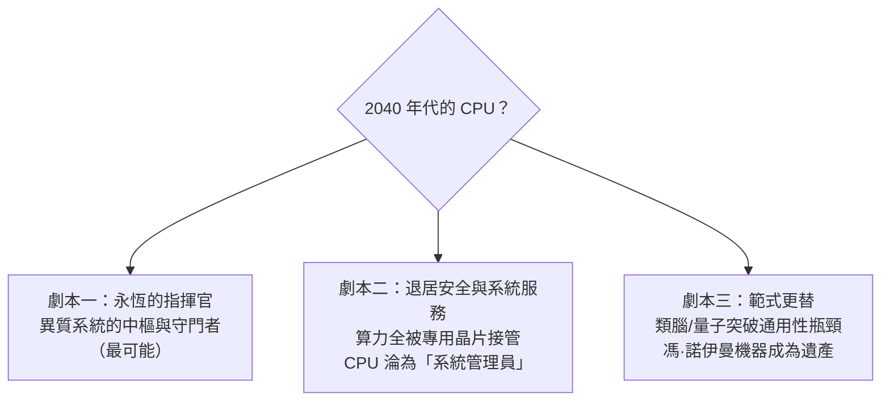

# 11.3 終極迷思：當量子運算、類神經晶片崛起，傳統馮·諾伊曼架構的 CPU 最終會走向何方？

> 每個時代都有人宣布馮·諾伊曼架構的死亡。八十年過去，它依然在每一台設備裡跳動。但這一次，挑戰者們似乎動了真格。

## 一、馮·諾伊曼架構的「不死之謎」

先理解它為何如此頑強——它不是一種晶片設計，而是**一套計算的抽象契約**：

1. **通用性**：同一台機器跑任何演算法（1.3 的儲存程式思想）——靈活性是所有專用機器的宿命對手；
2. **軟體生態的複利**：數十年累積的編譯器、作業系統、工具鏈、人類知識——遷移成本天文數字；
3. **可程式性與可驗證性**：確定性執行、精確例外、可除錯——工程世界賴以運轉的秩序；
4. **它一直在自我改良**：快取、亂序、推測、向量化、異質化——馮·諾伊曼機器像一艘不停加裝新引擎的老船。

歷史的教訓：**每次「馮·諾伊曼終結論」都發生在通用性與效能的矛盾尖銳時，而每次的結局都是「共存與分工」**（GPU 沒有殺死 CPU，NPU 也沒有）。因此對任何新架構的正確問題不是「它會不會取代 CPU」，而是「**它會在哪個生態位上取代 CPU**」。

## 二、挑戰者的陣列

**（1）存內計算（Compute-in-Memory / Processing-in-Memory）**
直接在記憶體單元內做乘加，消滅「資料搬家」的能耗（資料移動的能耗是計算的 100–1000 倍）。類比式 CIM（用電流幅值表示數字）可做到極高能效，但精度、可程式性、製程整合是硬傷。目前主攻端側推理（毫瓦級 Edge AI）。

**（2）類腦/脈衝神經晶片（Spiking Neural Networks）**
Intel Loihi 2、IBM TrueNorth/ NorthPole、BrainChip——模擬生物神經的事件驅動計算：**不活動就不耗電**。適合感知任務與超低功耗場景。瓶頸：訓練演算法不成熟、軟體生態從零開始。這是「馮·諾伊曼之外的第二條計算哲學」——**計算不是指令流，而是事件流**。

**（3）光計算（Photonic Computing）**
用光做矩陣乘法（干涉、馬赫-曾德干涉儀陣列）：光速、低能耗、天然平行。适合推理矩陣乘法的「前饋」部分；非線性、精度、可程式性仍是難關。Lightmatter、曦智等新創押注，路線圖指向「光電混合」——**光算矩陣、電算邏輯**。

**（4）量子運算（Quantum Computing）**
與前述完全不同的計算範式：量子疊加與糾纏，對「質因數分解（Shor）、無結構搜尋（Grover）、量子化學模擬」有指數/多項式加速。但——

- 需要**錯誤校正**（一個邏輯量子位元要數百到數千個物理量子位元），實用規模尚在遠方；
- **不能取代 CPU 跑 Excel**：量子計算只對特定數學結構有優勢，通用運算反而更慢；
- 正確的定位：**量子是「數學協處理器」**——CPU 呼叫它解特定問題，如同今天呼叫 GPU。Google（Willow，2024）、IBM（千位元級）、中國（九章、祖沖之）的競賽是長跑，不是終局。

**（5）可逆計算與熱極限**
更遠的地平線：Landauer 極限（擦除一位元的理論最小能耗）提示現有數位邏輯的能耗還有千倍下降空間，但可逆邏輯（Toffoli 閘）至今無法實用化——這是**物理學家留給半導體業的最後一張支票**。

## 三、CPU 的長期定位：三種劇本

**劇本一**的證據鏈：無論 GPU、NPU、DPU 如何進化，系統都需要一個「執行不規則邏輯、管理例外與安全、與人類意圖對接」的通用處理器。**通用性本身就是一種效能**——當 90% 的算力被專用化，剩下 10% 的靈活性價值反而上升。

**劇本二**的跡象：資料中心的算力占比中，加速器節點膨脹、CPU 節點占比下滑；蘋果 M 系列的 NPU 已接管多數日常 AI 推理——CPU 的「日常存在感」確實在稀釋。

**劇本三**的警語：如果類腦或光電混合架構在「通用可程式性」上真正突破（目前皆未），這將是自 1945 年以來計算架構的第一次根本革命。

## 四、回望：本書的最後一課

從楚澤的繼電器（1.1）到今天——這八十年的主線其實只有一句話：

> **人類不斷把「邏輯」變成「物質」，又不斷被物質的極限逼出新的抽象。**

- 繼電器的極限 → 真空管；
- 真空管的極限 → 電晶體；
- 電晶體的極限 → 積體電路；
- 積體電路的極限 → 微處理器與指令集戰爭；
- 頻率的極限 → 多核心與能效；
- 單體晶片的極限 → Chiplet 與先進封裝；
- 通用計算的極限 → 異質運算與領域特定架構。

每一代工程師都以為自己觸到了天花板，每一代都發現天花板是**可以往上翻開的一扇門**。馮·諾伊曼架構會不會是最後一扇門？沒有人知道。但可以確定的是：**無論未來的計算由什麼物質承載，它都會繼承 CPU 的精神遺產——用抽象對抗複雜，用契約連接萬物。**

> **本書因果鏈的終點**：楚澤的二進制開關 → 馮·諾伊曼契約 → 指令集帝國的興衰 → 物理極限的連環突破 → 異質運算的權力分散 → 未來的開放問題。CPU 的故事沒有結局，因為「計算」本身仍在進化。
