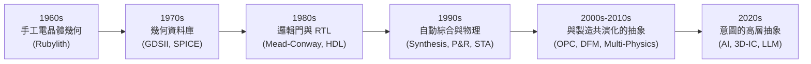
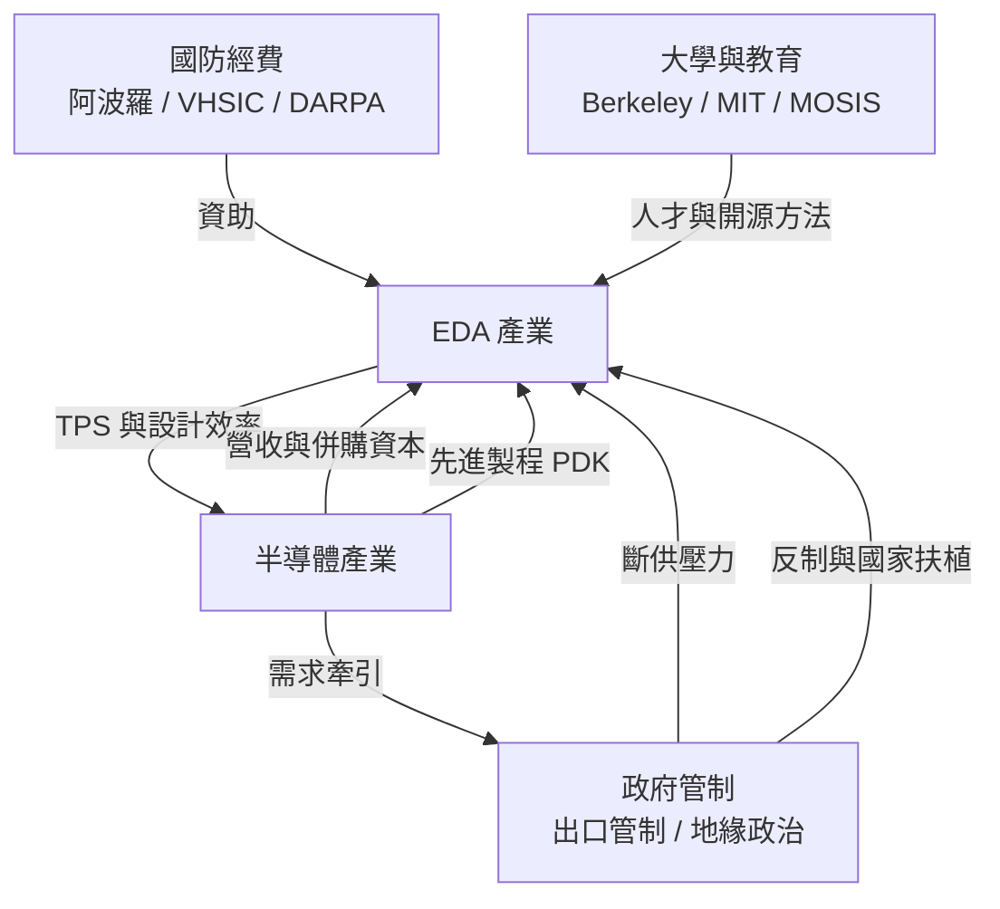

# 前言：畫出微觀世界的神筆——EDA 如何讓人類工程師在幾釐米矽片上建造百億級數位城市

## 一個令人暈眩的數字

2023 年，NVIDIA 發表的 H100 GPU 單一晶片內含約 800 億個電晶體；Apple M3 系列同樣達到數百億等級。一顆指甲蓋大小的矽片上，電晶體的數量已超過地球上所有人口總和的十倍。

但請思考一個簡單的問題：**這些晶片是怎麼「畫」出來的？**

如果一位工程師一天可以手工處理 1,000 個電晶體的版圖（這已經是相當樂觀的估計），那麼一顆 1,000 億電晶體的晶片將需要：

$$\frac{10^{11}}{10^3} = 10^8 \text{ 人日} \approx 27 \text{ 萬名工程師 } \times 100 \text{ 年}$$

沒有任何組織能負擔這樣的設計。真正讓這件事成為可能的，不是更多的工程師，而是**一套龐大、隱形、演算法密集的軟體體系**——電子設計自動化（EDA）。工程師寫下高階描述，EDA 的演算法們接手：綜合成電路、安排上億個元件的位置、繞出數十公里長的銅線、檢查每一條時序路徑、修正每一處會被光繞射扭曲的圖形。

EDA 是「晶片之母」：晶圓廠再先進，若沒有 EDA 輸出的 GDSII 檔案，光刻機上根本沒有東西可以曝光。

## 本書的敘事軸線

本書以三條互相纏繞的主軸講述這段歷史：

### 1. 抽象階梯（科技主軸）

每一次 EDA 革命，本質上都是一次**抽象層次的躍升**：

抽象階梯每升高一層，工程師的產能就放大一到兩個數量級——而工具自動接手的「漏斗」，恰恰是 EDA 的商業疆土。

### 2. 商業帝國（經濟主軸）

EDA 是一個「贏者全拿且極度整合」的怪異市場：總規模僅百餘億美元（2024 年約 150 億美元），不到半導體產業的 5%，卻掌握著價值 6,000 億美元以上晶片產業的**上游 throat choke**。Synopsys（1986）、Cadence（1988）、Mentor Graphics（1981＝今 Siemens EDA）三家公司透過數百次併購，築起了幾乎無法翻越的護城河。

### 3. 地緣政治（制度主軸）

因為 EDA 位於權力鏈的最上游，它成為大國競爭中的**斷供武器**：2019 年華為禁令、2022 年 10 月的美國出口管制直接封鎖中國設計先進晶片的 EDA 工具，催生中國國產 EDA（華大九天等）與美國 OpenROAD 開源運動的兩線突圍。

## 歷史的驅動關係

以下這張圖貫穿全書：談論 EDA 時，技術、經濟、制度與人才從來不是孤立的因果，而是互相推動的螺旋：

## 閱讀指南

- **每章獨立成篇**，按年代軸排列，可跳讀。
- **每節皆有「前因—事件—後果」結構**，重視驅動關係而非單點軼事。
- 全書使用標準 GitHub Markdown，含網表數學記號（LaTeX）與 Mermaid 圖。
- 書中所有人名、公司、年份、併購價格與法規均為**真實史事**；推估與評論處必標明。

下一章：[第 1 章：光罩手繪、紅膠帶與手工幾何學](01.1-rubylith.md)
