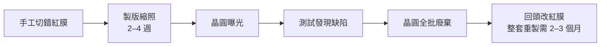

# 第 1 章　光罩手繪、紅膠帶與手工幾何學

# 1.2 人工檢查與極限錯漏：一個畫錯的切口如何讓整批晶片廢掉與漫長的重製期

## 1.2.1 錯誤的鏈條：一條切口 → 一整批廢片

紅膜手工操作的流程極度脆弱。考慮一枚晶片有 10 層紅膜、每層上萬條切割線。只要**任何一層的任何一條線**切割錯誤，後果就會沿著不可逆的製造鏈條放大：

一旦紅膜被拍照縮印成工作版（working plate），缺陷就被「冰封」進製造流程，無法即時修改；那一大張「錯誤之地圖」就這樣複製到每一枚晶片上。工程師的應對策略是**幾何約定**：在版圖的空隙中放置特殊的測試結構與對齊標記，以顯微鏡目視檢查手工比對——本質上是靠人腦與人眼執行**座標比對演算法**。

## 1.2.2 成本計算：失敗率就是 NRE

1970 年代，一枚中規模晶片（LSI，數千電晶體）的開發成本約為數十萬至數百萬美元，其中**光罩製作**就占了近三分之一。若含重製失誤，真正上市的開發成本可再上浮 20–50%。

一個直觀的模型：若設計在 $n$ 層中任一層出錯的機率為 $p$，則一次成功的機率僅為

$$(1-p)^{n} \xrightarrow{n=10,\; p=0.05} 0.6$$

換言之，即使每位工程師每層只犯 5% 的小錯，**整套晶片也只有六成機會一次通過**。這組數字解釋了 1960–70 年代為何「第二輪光罩重投（mask respin）」是家常便飯，也解釋了為何經理人開始把「自動化檢查」視為利潤問題而非技術問題——**失敗率的下降等於產能的放大**，這是 EDA 最早的經濟存在理由。

## 1.2.3 制度回應：設計審查、檢查工程師與「四人四眼」文化

錯誤代價催生了最早的**設計品質制度**：

1. **版圖審查會（design review）**：由資深工程師逐層過目，成為日後高科技產業品管文化的原型；
2. **專職檢查人（checker）**：新興職位，專責比對電路圖（schematic）與版圖（layout）的一致性——這是今日 **LVS（Layout vs. Schematic）** 的社會起源；
3. **多餘度設計**：在版圖中加入可切割的冗餘電路，讓部分缺陷在封裝前可用熔絲修復——IBM 與 Intel 都採用過此策略。

## 1.2.4 過渡系統：座標表的暴力前哨

目視逐無法擋住全部錯誤，工程師的第一個數位化自救方案是：把紅膜上每個矩形讀成**座標表**，交給程式員以**打孔卡**輸入大型主機，印出「座標清單」供第二人比對。這是雙人複誦式的手工 DRC，極慢又極貴——但它揭示了一個**革命的必要條件：設計意圖必須數位化**。

當幾何以數字的形式存在於計算機中，DRC 檢查、幾何運算、乃至後來整個 EDA 大廈的地基就有了可能性。下節所述的 Calma 與 Applicon，正是把這個過渡方案變成工業標準的人。

## 1.2.5 前因後果

- **前因**：平面製程與光罩不可逆性，使設計錯誤的代價呈指數放大。
- **事件**：人工檢查制度化（design review、checker 職位）與座標表數位化的過渡。
- **後果**：產業對「自動設計檢查」產生了真實的付費需求，直接餵養了 1.3 節的電腦繪圖公司與第 2 章的幾何資料庫時代。

---

下一節：[1.3 早期電腦繪圖系統：Calma 與 Applicon](01.3-calma-applicon.md)
