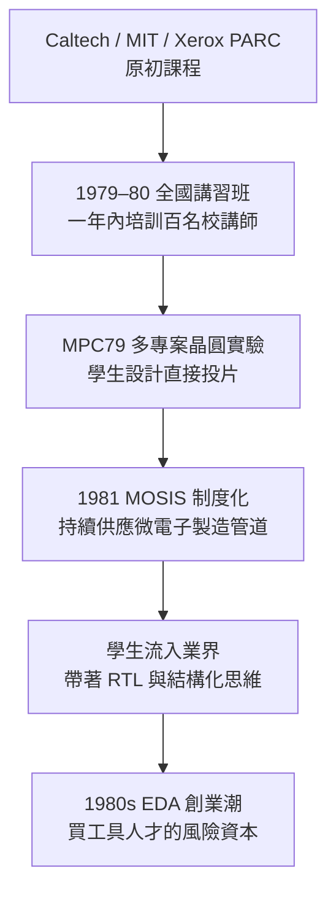

# 第 3 章　Mead–Conway 與設計解耦革命

# 3.3 大學與矽谷的狂熱：MOSIS 研發服務與第一批 EDA 創業團隊的孵化

## 3.3.1 MOSIS：讓「設計晶片」像寄一封掛號信

1981 年，USC／ISI 在國防先進研究計畫局（DARPA）的 VLSI 計畫支持下成立 **MOSIS（Metal Oxide Semiconductor Implementation Service）**。它的商業模式在當時是革命性的：

1. 許多使用者（大學、研究機構、小公司）各自提交晶片設計（當時多以 CIF 格式）；
2. MOSIS 將多個設計**拼合（stitch）到同一張晶圓**；
3. 一起投給晶圓廠製造，再切割、封裝並寄回創建者；
4. 成本由大家分攤：原本一枚晶片要數萬美元的 NRE，降至一顆**數百美元**的等級。

用制度經濟學來看，MOSIS 把**晶片製造的固定成本（fixed cost）轉化為**近似「印刷廠的印刷費」——它同時是：

- 一種**教育制度**（培養出整整一代能實做 VLSI 的學生）；
- 一種**市場創新**（驗證了「共享產能有需求」的理念，暗中鋪墊了 1987 年 TSMC 純代工模式的誕生路徑）；
- 一種**國家戰略**（DARPA 希望美國軍方與民間的晶片人才池持續擴張，以對抗日本的 VLSI 攻勢）。

## 3.3.2 課程擴散的五級火箭

Mead–Conway 思想透過一條清晰的鏈條在數年內自我複製：

這條鏈條是一個**國家級教育工程的教科書案例**：政府資助研究經費 → 大課程擴散 → 學生人才 → 產業需求 → 新市場與新公司。EDA 後來數十年能持續擴張，靠的都是這條「教育→產業」的循環泵。

## 3.3.3 第一批 EDA 創業公司的孵化

1980 年代初，目光敏銳的創業者注意到：大學送出一批批「會用結構化方法設計晶片」的畢業生，而**產業界卻沒有對應的商業工具**。於是出現了一批先驅公司：

| 公司 | 成立 | 切入點 | 日後命運 |
|---|---|---|---|
| **Monolithic Memories / VLSI Technology** 等 | 1980 前後 | cell library 與 gate array 服務 | 併入大廠或退出 |
| **Silicon Compilers Inc.** | 1981 |「矽編輯器」自動產生晶片 | 核心人員日後進入 Synopsys/Cadence 生態 |
| **Valid Logic Systems** | 1982 | 原理圖＋版圖整合環境 | 1990 年代被 Cadence 併入 |
| **Mentor Graphics** | 1981 | PCB/IC 設計工作站 | 成為三巨頭之一（6.2） |
| **SDA Systems / ECAD** | 1982–83 | 版圖與模擬工具 | 1988 合併成 **Cadence**（6.1） |
| **Gateway Design Automation** | 1981-82 | 後來的 Verilog 工具 | 1990 年被 Cadence 收購並釋出 Verilog（4.2） |
| **Optimal Solutions（後 Synopsys）** | 1986 | 邏輯綜合 | EDA 史上最偉大的軟體公司之一（4.1） |

這批公司的共同背景：創辦者多來自大學／大廠內部工具團隊，並有風險資本（Kleiner Perkins 等）的注入。EDA 的第一個黃金年代，不是由晶片需求的抽象力量孕育，而是由**具體的、正在學校實做的這一代人**親手創造的。權力傳承的路徑是「**從實驗室椅子搬到創業辦公室**」。

## 3.3.4 制度、文化與政治的合奏

- **教育改革**：MIT 1978 年課程「How to make a VLSI chip」、Berkeley、Stanford 競相跟進，促使電機系課綱全面改寫。EDA 接下來 40 年最重要的「人才流動池」就此打開。
- **美日競爭的政治壓力**：1970 年代末，日本的 VLSI 合作計畫（1976–79）似乎要壟斷 DRAM；美國國會與國防部的反應之一，就是加碼本國 VLSI 教育、資助 DARPA 的 MOSIS 與 STRATCOM 級研究。**技術革命被國家競爭加速**。
- **文化「人人可設計」**：這一思想路口，是今天的 OpenROAD（8.3）、開源工程與 FPGA 社群共享的精神起點—— 皆可回溯到 1980 年代的 MOSIS 時代。

## 3.3.5 前因後果

- **前因**：Mead–Conway 的抽象工具（3.1、3.2）＋國防部的需求＋日本的競爭壓力。
- **事件**：1981 年 MOSIS 創立；早期 EDA 公司群體誕生。
- **後果**：晶片設計產生**民主化**；「設計與製造分家」成為產業模式（最後導向 fabless＋foundry 的新分工）；歷史舞台準備好迎接下一幕：**邏輯綜合革命與 Synopsys 的崛起**（第 4 章）。

---

下一章：[第 4 章　邏輯綜合革命與 Synopsys 的崛起](04.1-degeus-synopsys.md)
