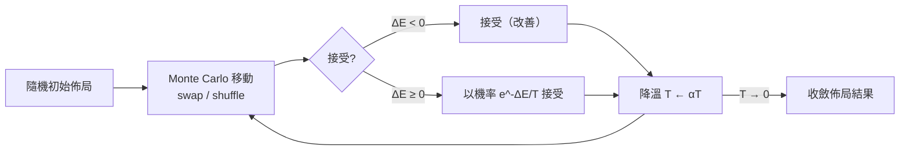

# 第 5 章　佈局繞線（P&R）、靜態時序分析（STA）與物理設計演算法（1990 年代 – 2000 年代）

## 本章導言

當邏輯綜合把「前端」自動化之後，「後端」——把上億個 cell 擺到矽上、繞線、並證明它能正常走完每一個鐘拍——成為新的瓶頸。本章三節：5.1 講佈局繞線的 NP-困難世界與退火等方法；5.2 講靜態時序分析（STA）與 PrimeTime；5.3 講驗證與 SystemVerilog。這一章是 EDA 演算法的「黃金頁」。

---

# 5.1 佈局繞線（Place and Route）：NP 困難問題下的退火演算法（Simulated Annealing）與圖論優化

## 5.1.1 問題的形式化：為什麼是 NP-困難？

給定 $N$ 個 cell 與一個初始總線（wirelist），**佈局（placement）**要求最小化總線長，而總線長近似為：

$$
L = \sum_{(i,j) \in E} w_{ij} \cdot \big( |x_i - x_j| + |y_i - y_j| \big)
$$

這是二次分配問題（QAP）的一個變體，已被證明是 NP-困難的；而**繞線（routing）**則要為每條網表分配實際金屬軌跡，同時不與其他訊號相交、不違反設計規則——在有層次的網格圖上是多端點 Steiner 樹與通道分配問題。**沒有一個已知的精確多項式演算法**可以處理百萬級 cell。

## 5.1.2 1983 年的「退火」啟示錄

1983 年，IBM 的 Scott Kirkpatrick 等三位研究員在 *Science* 發表《Optimization by Simulated Annealing》，把冶金學的退火（annealing：先熔融再緩冷）轉化為**隨機搜索演算法**：

- 以溫度 $T$ 控制接受「劣解」的機率 $P = e^{-\Delta E / T}$；
- 溫度逐漸降低，系統從探索轉向收斂。

這個演算法啟發了 Berkeley 的 **Carl Sechen** 開發出大名鼎鼎的 **Timberwolf**（1983–1985）：退火式佈局工具，證明機器可以擺出不亞於人手的佈局。Timberwolf 與同期 Yale 的 Wolf 系統，成為學術界送進產業界的**演算法種子庫**。

## 5.1.3 產業化：P&R 商品的「演算法大砲」

1990 年代，退火與**圖论優化**（最大流最小割、Fibonacci heap、線性規劃、二次規劃）被工業化為各自公司的後端引擎：

- **Cadence**：fromplace 系（後為 SoC Encounter、Innovus 等）；
- **Avant!（Gerald Hsu 等打造）**：Apollo，以精緻的規則驅動繞線聞名，2002 年隨 Avant! 被 Synopsys 併入成為 **Astro**；
- **Mentor**：在 PCB 域以 Expedition 等同名工具盤踞。

值得注意的是：**P&R 不僅是技術問題，更是「與晶圓廠協商」的問題**——繞線工具的每個版本都必須重新向領先工廠驗證，因此工具的「**先驗技巧庫**」（cornercase 處理、特殊規則）構成了無可複製的商業壁垒。

## 5.1.4 制度層面：NP-困難對人才結構的 paradox

NP-困難性對產業文化有一個微妙影響：誰也無法「解決」這些問題，因此**高校的演算法與優化博士**成為 EDA 公司最划算的吸資對象。EDA 公司形成了一種「大學式」的內部文化（大量發表論文、與學術合作），使整個產業直到今日仍以學界 電機與演算法 PhD 為人才源。**優化理論 → EDA 產品 → 學界人才的循環**，是三巨頭的另一道溝壑。

## 5.1.5 前因後果

- **前因**：cell-based 流程（3.2）＋MOSIS 民主化設計（3.3）＋演算法理論（Karp 1972 NP-理論、IBM 退火）。
- **事件**：Timberwolf 時代、工業級 P&R 工具崛起。
- **後果**：**物理設計從手工藝轉為演算法服務**；EDA 直接向上游擴張為「全流程」（Synopsys 收購 Avant! 取得 Astro；6.3）；並在 2000 年代逐漸把 STA（5.2）與實體驗證變成一條連貫流水線。

---

下一節：[5.2 靜態時序分析（STA）與 PrimeTime](05.2-sta-primetime.md)
