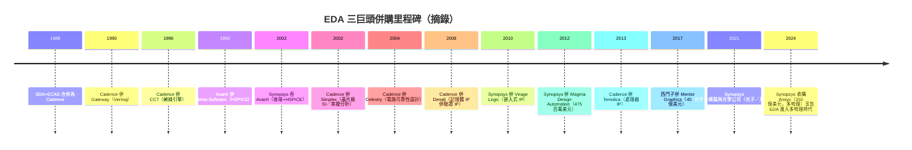

# 第 6 章　血腥併購戰：Synopsys、Cadence 與 Mentor Graphics 的三雄鼎立

# 6.3 數百次狂暴併購：EDA 產業如何透過收購創新小公司，築起全球高度壟斷的技術護城河？

## 6.3.1 產業結構的「雁行定律」：為何 EDA 天生要吃小公司？

EDA 產業有一個殘酷的輪迴結構：

1. **創新總在小公司誕生**：一個新演算法或新驗證概念，往往由 5–20 人的創業公司以 2-3 年開發完成；
2. **大公司難自研**：新點子挑戰既有產品邏輯，內部開發會被舊產品團隊排擠；
3. **苗小必被吃**：大公司以「營業收入 ＋ 股票」收購，技術被嵌入平台；
4. **創業者退場**：EDA 創業的成功出口只有「被收購」（IPO 通路自 2000 年後幾乎無）。

結果是：**1980 年代的數百家 EDA 公司，到 2010 年只剩下三家規模化玩家**。而三家的每一家，都是幾十次併購的合金產品。

## 6.3.2 最著名的一戰：Synopsys 吞併 Avant!（2001–2002）

2000 年代初最激烈、最具戲劇性的也是最血腥的——就是 Synopsys 吞併 **Avant! Corporation**：

- **Avant!** 創立於 1991 年（Gerald C. Hsu 主導），以 **HSPICE**（模擬，得自收購 Meta-Software）與 **Apollo／Star-RC**（後端佈局與寄生參數）著稱，是當時**唯一能在數位後端與 Synopsys、Cadence 對抗**的公司；
- Avant! 高級主管曾涉及 1994 年由 Cadence 前員工轉投公司後攜出 **Cadence source code**的案件——即著名1995 年 Cadence 訴 Avant! 的商業機密竊取案，Avant! 後承認刑事責任、繳付巨額賠償，這成為軟體業最著名的案件之一；
- **2001 年宣布、2002 年完成，Synopsys 以含現金與股票的多階段支付計畫（總額約 6.3 億美元）收購 Avant!**，一夜之間取得：佈局繞線（Astro）、模擬金字招牌（HSPICE）、物理驗證（Star-RC）。

這場併購的意義是結構性的：**Synopsys 由前端霸主，一舉成為全流程（RTL→GDS）平台**。Cadence 對此的反應就是後續十年的收購競速（Cadence 以自行研發與分散併購，直到 2010 年代才重新具備全流程競爭力）。

## 6.3.3 四十年的併購年表摘要

## 6.3.4 壟斷的護城河：一套自我強化的四層結構

併購策略的成功基於四層互相強化的牆：

1. **技術資產牆**：收購完整地把**人才**＋**演算法知識**＋**客戶設計資料經驗**全部吸進來；
2. **互操作牆**：產品之間（綜合→STA→P&R→驗證）共享私有資料格式，第三方工具得逐個「翻譯」，功能再好也難進入流程；
3. **客戶制度牆**：全流程捆綁授權（bundle），設計公司「一次買全」，改用競品動力降至最低；
4. **人才—學術牆**：大學課程用三巨頭授權的工具免費教學，下一代工程師一開始就熟悉其語言與方法學。

## 6.3.5 前因後果

- **前因**：EDA 市場規模小於晶片產業的 5%，但需求又被**全流程完整性**主導（缺一環即出局）；
- **事件**：1990–2020 年間三巨頭完成上百件併購；2002 年 Synopsys 併 Avant! 是結構性的轉折。
- **後果**：**壟斷結構穩固化**，使行業出現「國家戰略意義」（第 8 章）：一旦出口管制，任何想自製先進晶片的國家都會瞬間面臨整條工具鏈的真空；同時，三巨頭的鉅額獲利為下一章——**計算微影與 OPC**——的重資本投資提供了彈藥。

---

下一章：[第 7 章　深亞微米危機與 OPC](07.1-diffraction.md)
