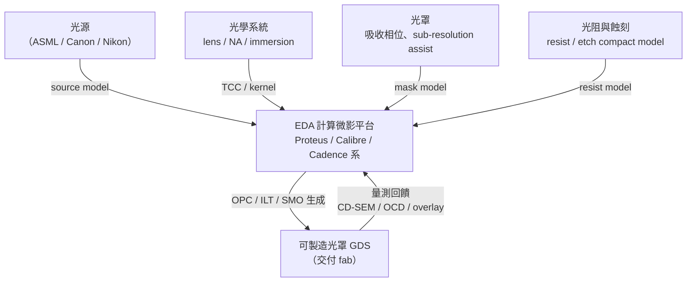

# 第 7 章　物理極限危機：深亞微米下的光學鄰近效應修正（OPC）

# 7.3 計算微影（Computational Lithography）：EDA 工具如何深入晶圓廠的光刻機內部？

## 7.3.1 定義：把「光刻」變成軟體問題

**計算微影（Computational Lithography）**是一個 2010 年代正式定型的框架：

> 以計算方法（光學建模、最優化、機器學習）**設計並最佳化整條曝光鏈**——從光源形狀（source mask optimization, SMO）、光罩圖形（OPC/ILT）、到 resist 與 etch 的行為建模——以求在物理極限下達到可量產的解析度。

它的尺度足以嚇人：一次全晶片的 model-based OPC／ILT，要對**數千億像素**等級的晶圓成像面進行數萬次模擬，峰值要求**數千台 CPU/GPU**連夜運算。業界甚至流行一句話：

> 「**EDA 公司其實是家超級電腦公司。**」

## 7.3.2 技術版圖：EDA 與設備商共用一套光學聖經

計算微影是 EDA 與光刻設備生態互相滲透的交界：

三件關鍵技術值得分點說明：

1. **SMO（Source Mask Optimization）**：不只改光罩，也改光源的形狀（illumination pupil），使特定關鍵圖形族群的成像對比度極大化；
2. **Sub-Resolution Assist Features（SRAF）**：在光罩上加入比解析度更細的小副特徵，其「像的存在」幫扶主要圖形；
3. **ILT（Inverse Lithography Technology）**：像素級的全自由優化，需要 GPU 加速（2010 年代起以 GPU 實現百倍加速）。

## 7.3.3 多重曝光（Double/Quadruple Patterning）的噩夢與 EDA 的自動化

當 193nm 光無法單次印出所需 pitch，晶圓廠採用**多重曝光**（DPT：Double Patterning Technology，SPA：SPacer Assigned，SADP／SAQP）：

- 簡言之：**把一張找不到解的光罩拆成兩張／四張**，分次曝光；
- 而「**一個 layout 怎麼拆**」本身又是組合優化問題（圖著色 graph coloring 的近似）；
- DRC 不再只是「檢查是否合法」，而是「**檢查是否可拆成一組可行的曝光圖案**」——這又反過來要求 EDA 改寫物理驗證引擎。

## 7.3.4 EDA 的資本與制度重構

計算微影的出現**重寫了 EDA 產業的資本結構**：

1. **重資本研發**：演算法能跑的前提是與晶圓廠共建一套校準資料（測試晶圓量測、模型庫），支出規模以千萬美元計；
2. **與 fab 的合約綁定加深**：光罩資料準備與 OPC 直接影響良率，EDA 與晶圓廠簽署的「**開發夥伴條款**」成為先進節點的准入門票；
3. **人才重塑**：光學、物理、數值優化、機器學習的跨域博士變成 EDA 公司的核心團隊——EDA 的研發人員畫像由「軟體工程師」轉向「**工程科學家**」。

## 7.3.5 前因後果

- **前因**：OPE 的物理現實、OPC 演算法的成功、多重曝光的出現。
- **事件**：計算微影框架成熟，EDA 工具深入光刻機的建模與優化內部。
- **後果**：這種「與製程共生」的深度綁定，是**第 8 章地緣政治封鎖能夠生效的技術根源**——因為不能只是抄一個軟體介面，還須整套模型與資料；同時也為第 9 章（3D-IC 與多物理場）與第 10 章（AI for EDA）的資本密集化時代搭好布景。

---

下一章：[第 8 章　EDA 專利枷鎖與地緣政治戰場](08.1-chokepoint.md)
