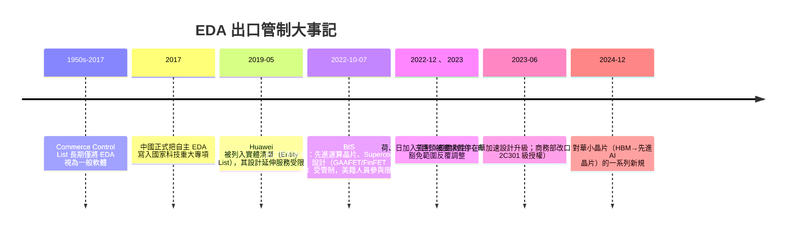

# 第 8 章　EDA 專利枷鎖與地緣政治戰場

# 8.2 美國管制出口與 EDA 軟體授權封鎖：全球半導體供應鏈脆弱點的顯影

## 8.2.1 管制時間軸（真實事件摘要）

## 8.2.2 管制的法律機制：以外籍法規改寫商業契約

美國的管制有三個法律錨點：

1. **出口管理條例（EAR, Export Administration Regulations）**：以「**外國直接產品規則（FDPR）**」延展美國技術到由美國技術製成的外國產品；
2. **實體清單（Entity List）**：特定公司（如 Huawei、中芯國際、長江存儲等）的「**美國技術使用權**」需要特別許可；
3. **人員管制**：管的是「**美國人（US Person）參與**」，使位於中國的先進設計活動連**工程師腦力**都受約束——這對 8.1 所述「校準資料中的美國血統」是沉重一擊。

## 8.2.3 生效的瞬間與產業的餘震

2022 年 10 月 7 日的 BIS 新規，被譽為半導體產業的「10 月 7 日時刻」：

- Synopsys 與 Cadence 依規指示員工**停止對部分中國客戶服務**，直至監管釐清豁免範圍；
- 中国国内趕進度：華為海思先前囤積的 EDA 授權版本被驗證可使用（不續訂新功能）；
- EDA 三巨頭的**中國營收占比**（多年來約在 10–15%）在 2023 年出現短期下滑（非全面斷供，多以「先進級別受管、成熟級別放行」的方式）；

.s. 股東也重新定價：Synopsys/Cadence 的股價在 2022.10 月間因「**中國營收不確定性**」出現數日劇烈波動。

## 8.2.4 制度與文化的後果：兩條全球性對抗路線的誕生

管制的直接後果是催生**兩條突圍路線**（8.3 詳述）：

1. **中國國家資本型**：傾舉國力量扶植本土 EDA／IP，以及透過 **開源工具鏈**（RISC-V 開放指令集＋開源 EDA）繞道；
2. **西方市場型（開源 EDA）**：美西方也開始反過來投資**開源 EDA**（OpenROAD 等），一方面保留 innovativeness、一方面防止「美國公司一枝獨大」的政策風險。

歷史上極少見過一種情況：**同一個產業，同時被國家資本與開源社群兩個方向同時包圍**——這正是 EDA 產業在 2020 年代的獨特狀態。

## 8.2.5 前因後果

- **前因**：8.1 的 choke point 結構＋中美技術競爭（晶片法案 CHIPS & Science Act 2022 的政治土壤）。
- **事件**：2019 Huawei 實體清單、2022 年 10 月 BIS 先導晶片管制。
- **後果**：全球科技公司首次在**設計工具層**落地「類似 EUV 的斷供」事件；EDA 合約、資料中心與人才流動的地緣化；三巨頭在中國成長策略從「賣工具」轉為「**賣成熟節點工具＋內建化的服務**」。

---

下一節：[8.3 國產 EDA 與 OpenROAD 開源運動](08.3-openroad.md)
