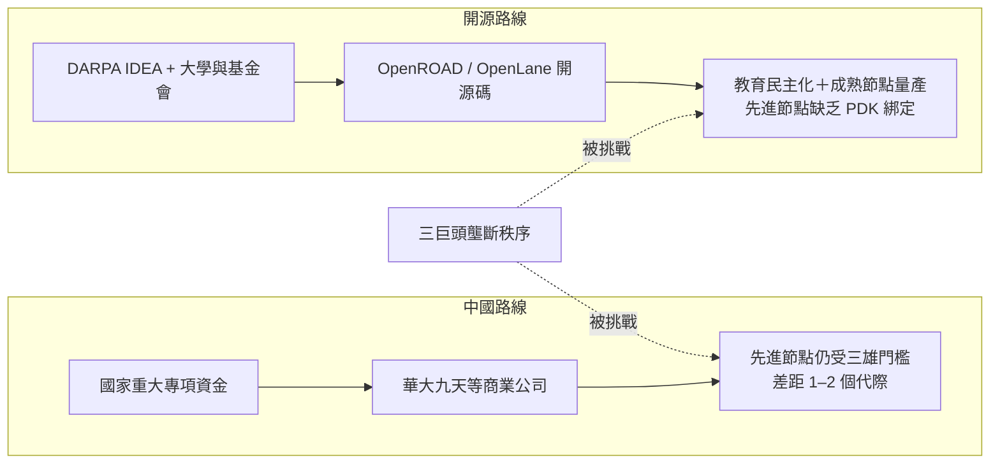

# 第 8 章　EDA 專利枷鎖與地緣政治戰場

# 8.3 國產 EDA 與開源 EDA 運動（OpenROAD）：突破三巨頭壟斷枷鎖的艱難突圍戰

## 8.3.1 中國路線：從「熊貓」到華大九天

中國的 EDA 自主力建設比大眾想像的早：

- **1980 年代末–1990 年代初**：中國啟動國家級 IC CAD 專項，開發了內部代號「**熊貓系統（PANDA）**」的國產設計系統——當時水準可用於較簡單的晶片，但未持續演進；
- **2008 年**：中國正式把「**EDA 工具**」列為《國家中長期科學技術發展規劃綱要》相關重大專項的支援方向，成立多家民企與國資背景團隊；
- **2022 年**：**華大九天（Empyrean Technology）**在深圳創業板上市，成為「國產 EDA 第一股」，主力為模擬電路設計全流程（傳承熊貓血統）＋平板顯示設計工具；
- **2022–2025**：芯華章（X-EPIC，驗證工具）、概倫電子（Primarius，器件建模與良率分析）、國微思爾芯（驗證原型）等公司各自補足 ECAD 一角。

到 2024 年，國產 EDA 在**模擬、平板顯示、驗證**類工具已具商業基本盤，但在**先進節點數位全流程**（綜合、P&R、OPC、先進 PDK 綁定）仍與三巨頭有**一至兩個代際**的差距——這正是 8.1 三重枷鎖的直接體現。

## 8.3.2 美歐路線：DARPA IDEA 與 OpenROAD

有趣的是，**被迫突圍的不只是中國**。2017 年美國國防部先進計畫局（DARPA）啟動**電子復興計畫（ERI）**，其中 **IDEA 計畫（Intelligent Design of Electronic Assets）**目標直指一個宏願：

> **任何人在 24 小時內、以零人工設計成本，自動完成由 RTL 到 GDSII 的全流程。**

由加州大學聖地牙哥分校（UCSD）Andrew Kahng 教授等領銜、後由 **Precision Innovations** 等團隊延續，形成了 **OpenROAD** 開源專案：

- 以 **OpenROAD**（後端全流程，整合 Yosys 綜合、TritonRoute 繞線等）＋ **OpenLane**（封裝流程）＋ **LibreLane** 等構成 ASCII 級完整開源 RTL-to-GDS 鏈；
- 2020 年代在**學術教育、R&D、7nm 以下流（客戶未及）以及成熟節點（skywater 130nm、GlobalFoundries 180nm 等）小晶片量產**上實測成功；
- Google 與開源社群推動其用在**大學 VLSI 教學與開源 MPW 晶圓（如 efabless 與 Google 共同推動的開源 MPW 計畫；該服務平台於 2025 年停止營運，但開源流程持續存在）**，重現了 1980 年 MOSIS（3.3）的教育民主化劇本。

## 8.3.3 兩條路線的鏡像結構

兩條路線的根本差異在**誰為工具付錢**：中國路線靠政府採購＋國產化替代的市場保護；開源路線靠基金會（如 Linux Foundation 的 CHIPS Alliance）＋大學＋社群。兩者都面對一個共同敵人：**第 7 章所揭示的「與製程共生的模型資料」難以開源或重製**。

## 8.3.4 開源 EDA 的文化回響

OpenROAD 的流行對文化層面有兩個重要效應：

1. **師道更新**：大學可以**公開源碼**教 VLSI，學生讀到的是真實演算法而不再是黑箱選單——這是 Mead–Conway（3.1）時代精神在開源時代的重現；
2. **「硬體民主化」的入口**：RISC-V（開放指令集）＋ 開源 EDA＋開放 MPW，令人想起 1970 年代個人電腦運動。該運動的終點未知，但其**制度意義**已不可逆：三巨頭不再是全行業「唯一可想像的工具樣子」。

## 8.3.5 前因後果

- **前因**：8.2 的封鎖＋3 章以來的教育民主化基因＋開源運動的技術基礎。
- **事件**：華大九天 2022 上市；DARPA IDEA→OpenROAD 生成一套完整開源 RTL-to-GDS 流程。
- **後果**：全球 EDA 格局從「三雄鐵幕」走向「**三雄宇宙＋多極突圍**」；開源社群的演算法成就（如繞線中的受限與圖理論演算法），也在 2020 年代中期反哺主流程——**EDA 產業從未有過的「體制內外對流」，在 2020s 正式成立**（另見 10.3 的展望）。

---

下一章：[第 9 章　3D-IC、CoWoS 與多物理場模擬](09.1-chiplet-3dic.md)
