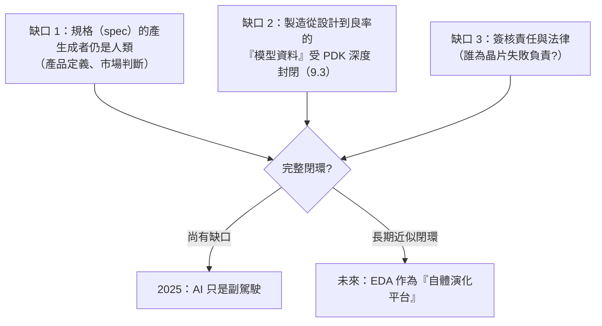

# 第 10 章　AI 驅動 EDA（AI for EDA）與大模型自主設計晶片

# 10.3 終極前沿：當 AI 開始設計下一代 AI 晶片，EDA 工具會進化為自體演化的矽基造物主嗎？

## 10.3.1 已經發生的「弱遞迴」

先冷靜地看已存在的事實（皆為真實、非幻想）：

1. **AI 加速器是為 AI 而設計的**：NVIDIA 的 GPU 世代（Hopper→Blackwell→Rubin）執行著大模型訓練，而設計這些 GPU 的 EDA 工具已嵌入 AI 功能（10.1）與 LLM 助手（10.2）；
2. **EDA 雲端化**：Synopsys/Cadence 的大型付費客戶普遍使用雲端（AWS／Azure）彈性算力跑 P&R 與驗證——AI 工具本身就是雲端原生應用；
3. **晶片需求自舉（self-bootstrapping）**：AI 晶片的市場營收養活了 EDA 研發，EDA 工具又反哺 AI 晶片效率——這個**經濟正回饋**在 2023–2025 已非常明顯。

所以「弱遞迴」（AI 參與設計 AI 晶片）已經是**既成事實**。問題只在其強度與閉環速度。

## 10.3.2 完整閉環的三個缺口

要達成「AI 自主設計下一代晶片」的完整迴圈，還有三個至今存續的缺口：

## 10.3.3 哲學框架：工具曾經「自我超越」過四次

回顧前九章的抽象階梯，你會發現「**工具大於工具使用者**」的現象早已發生多次，每一次都類似一次「半遞迴」：

1. **1970s**：SPICE 讓電路物理的求解能力超出任何工程師的心算；
2. **1980s**：邏輯綜合產生的閘級網表，工程師「看不懂但能用」；
3. **1990s–2000s**：過億 gate 的 STA 的證明結果，只能信賴工具；
4. **2010s**：OPC 後的光罩圖形常是「**含有超過人類直覺的解**」——人類跑得出、卻難以憑直覺理解那些歪斜的補償圖形。

每一次，**工程師的角色不停上層樓，從「做設計」漸變成「設定目標＋審核結果」**。AI for EDA 是這條階梯的最新一階，非本質性突破。

## 10.3.4 制度與倫理面：矽基造物主的責任鏈

如果 EDA 真的成為「自體演化平台」，產業需要制度面回答：

- **責任**：晶片失敗時，當責任者是設計公司、EDA 供應商，還是模型訓練資料提供者？（目前合約中多由設計公司劃責任；EDA 工具授權中普遍有「方圓範圍」條款）
- **安全**：軍用／自動駕駛／醫療晶片使用生成 RTL，是否需要可解釋性與「機器生成源碼認證標準」？（IEC 61508、DO-254 等功能安全標準正在面對此問題）
- **公平與地緣**：AI 能力集中於少數公司與國家，是否放大第 8 章的不對稱？（這是 2020 年代政府半導體政策的熱議題）

## 10.3.5 前因後果與開放性結語

- **前因**：10.1 的 RL 調參與 10.2 的 LLM 輔助＋既有抽象階梯的動能。
- **事件**（截至 2025 的真實狀態）：**AI 是加速器、人類仍是簽核者**；經濟正回饋的能量已使 AI 晶片與 EDA 共同成長。
- **後果**（開放問題）：完整的技術閉環仍受「規格」「模型資料」「責任制度」三缺口制約；但歷史規律（第一章到第十章）一直如此——**每次 EDA 的抽象抬升，都把昨日的「不可能」變成今日的常態**。第 11 章（結語）將以這條規律做收束。

---

[結語：點石成金的無形手](11-epilogue.md)
