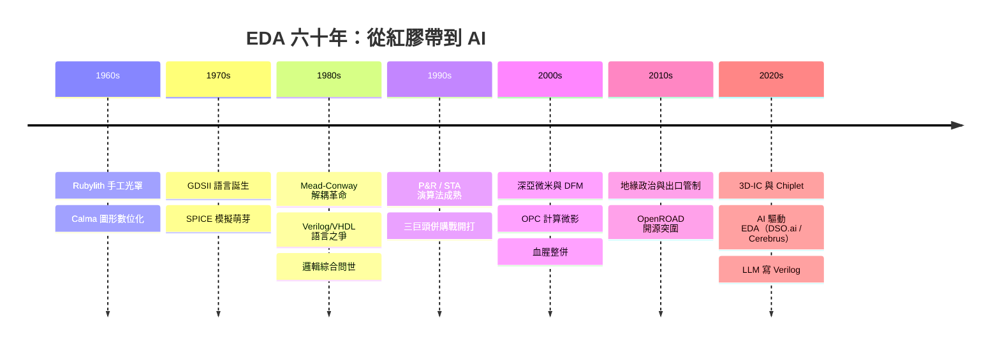

# 《EDA 的故事：從手工畫電路圖、邏輯綜合革命、晶片三巨頭到 AI 繪製千億晶片》

> 專為半導體工程師、IC 設計師、晶片架構師、EDA 軟體開發者與科技史愛好者設計的專題史。
>
> **EDA**（Electronic Design Automation，電子設計自動化）是現代半導體產業中最隱密卻也最關鍵的「晶片之母」。如果沒有 EDA 工具，面對當前擁有數百億甚至上千億電晶體的大型晶片，人類工程師即使耗費數百年也無法透過手繪完成設計。本書以**歷史演進、演算法突破與商業併購戰略**為主軸，記錄人類如何從手工畫電路圖、網表（Netlist）與圖形佈局，走過邏輯綜合（Synthesis）、靜態時序分析（STA）與物理設計（P&R）的自動化革命，經歷 Synopsys、Cadence 與 Mentor Graphics（Siemens EDA）的三雄割據，直到當代在奈米級光學鄰近效應修正（OPC）、3D-IC 先進封裝與 AI 輔助 EDA 設計的新紀元。

## 全書結構

---

## 目錄

### 前言：畫出微觀世界的神筆——EDA 如何讓人類工程師在幾釐米矽片上建造百億級數位城市

見 [00-preface.md](00-preface.md)

---

### 第一篇：前 EDA 時代與圖形設計的破曉（1960 年代 – 1970 年代）

* 第1章-光罩手繪、紅膠帶與手工幾何學
    * [1.1-幾十個電晶體時代的手工幾何：工程師如何在巨型圖紙上用紅膠帶黏貼電路](01.1-rubylith.md)
    * [1.2-人工檢查與極限錯漏：一個畫錯的切口如何讓整批晶片廢掉與漫長的重製期](01.2-human-error.md)
    * [1.3-早期電腦繪圖系統：Calma 與 Applicon 如何將圖形幾何轉化為數位打孔卡](01.3-calma-applicon.md)

* 第2章-物理佈局資料庫與 GDSII 標準的誕生
    * [2.1-Calma GDS（Graphic Data System）格式的問世：幾何圖形結構化儲存的第一次突破](02.1-gds.md)
    * [2.2-GDSII 格式的標準化：將方塊、多邊形與層次轉化為晶圓廠可讀數據的語言](02.2-gdsii.md)
    * [2.3-手工佈局與電路模擬的第一次交會：早期 SPICE 模擬器在電路驗證上的萌芽](02.3-spice.md)

### 第二篇：邏輯抽象革命與「三巨頭」的創世紀（1980 年代）

* 第3章-卡弗·米德、琳·柯維與《超大型積體電路系統導論》：晶片設計的解耦革命
    * [3.1-Carver Mead 與 Lynn Conway 的劃時代著作：將「晶片設計」與「晶圓製造」徹底解耦的設計哲學](03.1-mead-conway.md)
    * [3.2-結構化設計方法論：用邏輯門與暫存器傳輸級（RTL）替代底層電晶體幾何](03.2-structured-rtl.md)
    * [3.3-大學與矽谷的狂熱：MOSIS 研發服務與第一批 EDA 創業團隊的孵化](03.3-mosis.md)

* 第4章-邏輯綜合（Logic Synthesis）革命與 Synopsys 的崛起
    * [4.1-艾奇·德蓋斯與 Synopsys 的誕生：用演算法將高階代碼自動轉換成門級網表](04.1-degeus-synopsys.md)
    * [4.2-Verilog 與 VHDL 語言之爭：硬體描述語言（HDL）如何改變工程師寫晶片的方式？](04.2-hdl-war.md)
    * [4.3-Design Compiler 的市場統治：邏輯綜合工具如何成為全球 IC 設計師必備的「魔法開關」](04.3-design-compiler.md)

### 第三篇：演算法突破與 EDA 三雄割據的黃金時代（1990 年代 – 2000 年代）

* 第5章-佈局繞線（P&R）、靜態時序分析（STA）與物理設計演算法
    * [5.1-佈局繞線（Place and Route）：NP 困難問題下的退火演算法與圖論優化](05.1-place-route.md)
    * [5.2-靜態時序分析（STA）與 PrimeTime：告別動態模擬、用時序路徑覆蓋率確保晶片不掉拍](05.2-sta-primetime.md)
    * [5.3-驗證（Verification）與 SystemVerilog：當晶片規模飛升，如何確保邏輯漏洞無所遁形？](05.3-systemverilog.md)

* 第6章-血腥併購戰：Synopsys、Cadence 與 Mentor Graphics 的三雄鼎立
    * [6.1-約瑟夫·克斯特羅（Joseph Costello）與 Cadence 的圖形與模擬帝國建立](06.1-costello-cadence.md)
    * [6.2-Mentor Graphics 在 PCB 與物理驗證（Calibre）上的獨門絕技](06.2-mentor-calibre.md)
    * [6.3-數百次狂暴併購：EDA 產業如何透過收購創新小公司，築起全球高度壟斷的技術護城河？](06.3-ma-wars.md)

### 第四篇：深亞微米危機、光學修正與地緣政治風暴（2010 年代）

* 第7章-物理極限危機：深亞微米下的光學鄰近效應修正（OPC）
    * [7.1-當光波長大於晶線寬：光學衍射導致光罩圖形在晶圓上「變形」的噩夢](07.1-diffraction.md)
    * [7.2-光學鄰近效應修正（OPC）演算法：用超級電腦預先「反向扭曲」光罩圖形以獲得精準蝕刻](07.2-opc.md)
    * [7.3-計算微影（Computational Lithography）：EDA 工具如何深入晶圓廠的光刻機內部？](07.3-computational-lithography.md)

* 第8章-EDA 專利枷鎖與地緣政治戰場
    * [8.1-晶片設計的斷供武器：為什麼缺少 EDA 工具，任何國家都無法自主設計先進晶片？](08.1-chokepoint.md)
    * [8.2-美國管制出口與 EDA 軟體授權封鎖：全球半導體供應鏈脆弱點的顯影](08.2-export-control.md)
    * [8.3-國產 EDA 與開源 EDA 運動（OpenROAD）：突破三巨頭壟斷枷鎖的艱難突圍戰](08.3-openroad.md)

### 第五篇：AI 繪製晶片、3D-IC 與未來 EDA 新紀元（2020 年代 – 至今）

* 第9章-3D-IC、CoWoS 先進封裝與熱/電磁多物理場模擬
    * [9.1-從 2D 晶片走向 3D 堆疊：小晶片（Chiplet）與異質整合帶來的 EDA 設計維度升級](09.1-chiplet-3dic.md)
    * [9.2-多物理場（Multi-Physics）模擬：訊號完整性（SI）、電源完整性（PI）與散熱地獄的交叉求解](09.2-multiphysics.md)
    * [9.3-EDA 工具與晶圓代工廠（TSMC / Samsung / Intel）PDK（製程設計套件）的深度綁定](09.3-pdk.md)

* 第10章-AI 驅動 EDA（AI for EDA）與大模型自主設計晶片
    * [10.1-強化學習與 DSO.ai / Cadence Cerebrus：AI 如何在幾天內完成人類工程師數月的 P&R 參數搜尋？](10.1-rl-dsoai.md)
    * [10.2-大語言模型（LLM）自動生成 Verilog 代碼與 Verilog Bug 自動修復](10.2-llm-verilog.md)
    * [10.3-終極前沿：當 AI 開始設計下一代 AI 晶片，EDA 工具會進化為自體演化的矽基造物主嗎？](10.3-recursion.md)

---

### 結語：點石成金的無形手——EDA 作為半導體文明永恆的智慧放大器

見 [11-epilogue.md](11-epilogue.md)

---

## 💡 本目錄亮點

1. **完整穿透半導體 EDA 演進史**：從 1960 年代手工光罩繪製/GDSII 格式 → Mead-Conway 晶片設計解耦與高階語言 → Synopsys 邏輯綜合革命與三巨頭（Synopsys/Cadence/Mentor）併購戰 → 計算微影 OPC 與深亞微米物理驗證 → 地緣政治 EDA 封鎖 → 3D-IC 先進封裝與 AI 驅動 EDA（DSO.ai/Cerebrus）。
2. **深刻拆解 EDA 三大核心環節**：
    * **前端（Front-end）**：HDL 語言、邏輯綜合（Synthesis）、形式驗證、靜態時序分析（STA）。
    * **後端（Back-end）**：自動佈局繞線（P&R）、DRC/LVS 物理驗證、多物理場模擬。
    * **製造端（DFM）**：計算微影、光學鄰近效應修正（OPC）、PDK 研發。
3. **結構嚴謹**：全書 10 章，每章均包含 **3 個深度小節**。歷史關聯與前因後果，包含科技、經濟、制度、文化、政治、思想、教育互相的驅動關係。所有事件皆為真實史實。
