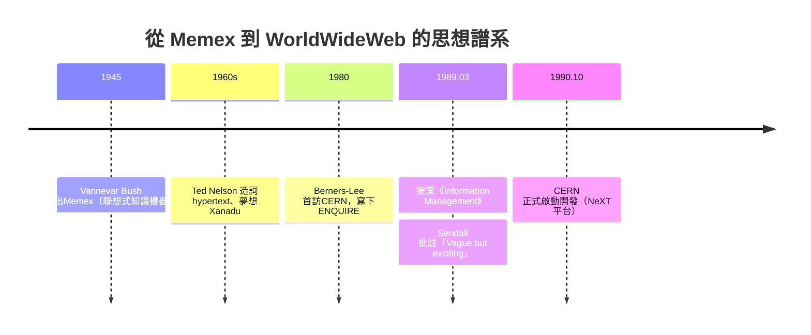

# CERN 的資訊困境：物理學家的共享難題

## 一座知識迷宮

1989 年的日內瓦郊外，歐洲核子研究組織（CERN）正處於巔峰與混亂並存的時刻。這座1954 年建立的實驗室，是冷戰時期歐洲科學外交的傑作——十二個國家合力資助，讓戰後的歐洲物理學家不必再遠渡大西洋去美國尋找加速器。到了 1980 年代末，這裡有數千名研究員、工程師與技術人員，而其中最大的特色是「流動性」：實驗合作團隊動輒橫跨十幾個國家，訪問學者平均只待上兩三年，博士研究生來了又走。人來人往之間，知識卻留不下來。

當時 CERN 的資訊管理是一片沼澤。實驗記錄、加速器規格、軟體文件、電話名冊、會議紀要散落在各處：有的在 IBM 大型主機上，有的在 VAX 小型機，有的在麥金塔的文書檔案裡，有的乾脆只存在某位即將離職工程師的腦袋裡。電腦系統異質到荒謬的程度——不同廠牌的機器、不同的作業系統、不同的檔案格式，彼此幾乎無法交談。一位新來的研究員想弄清楚某個子系統的來龍去脈，往往得靠口耳相傳，追著人問；而人一旦離開，那份知識就隨之蒸發。CERN 內部的一份調查估計，新進人員要花上大半年才能摸清組織的資訊脈絡。

這不是 CERN 獨有的問題，卻是 CERN 把問題逼到極致的場景：大科學（Big Science）時代，協作的規模第一次超過了人類記錄與傳遞知識的傳統手段。

## 一對數學家的兒子

蒂姆·伯納斯-李（Tim Berners-Lee）1955 年生於倫敦，父母都是數學家，同時在曼徹斯特大學工作，參與過英國第一台存量程式電腦、以 Ferranti 為基礎的 Manchester Mark I 相關計畫的後續工程。在這樣的家庭裡，飯桌上的話題是數學與機器；他後來回憶，童年時曾用鞋盒和圖釘做出一台「想像中的電腦」，向父母解釋運算的邏輯。這種「把抽象結構視覺化、然後動手造出來」的傾向，貫穿了他的一生。

他畢業於牛津大學王后學院，主修物理——他承認物理學吸引他，是因為它「在表面混亂之下尋找底層的數學結構」。1976 年畢業後他在電信與 real-time 系統公司打滾，寫過排印軟體、多工作業系統。1980 年，這位二十幾歲的英國軟體顧問以短期合約身分來到 CERN，進行為期六個月的諮詢工作，協助 CERN 的質子同步加速器部門整理控制系統的軟體。

## ENQUIRE：一張自己長出來的網

在 CERN 的那半年，伯納斯-李面對的正是上述的資訊迷宮。他想追蹤的是「軟體、硬體、人」之間的關係：哪支程式屬於哪個計畫？負責人是誰？他在紙上畫了許多節點與連線，然後寫出一個小型資料庫程式，取名 **ENQUIRE**——致敬他童年時讀過的維多利亞時代居家百科全書《Enquire Within upon Everything》，一本號稱「任何問題都有答案」的暢銷工具書。

ENQUIRE 的核心概念是：一切資訊都是「節點」，節點之間以有向的「連結」相連，連結本身有意義——「這個人隸屬於這個部門」「這份文件描述這個系統」。這是一張私人的超文本網。它從未對外發布，但它在伯納斯-李心中種下了一顆種子：**如果這張網不必私藏在一個人的磁碟裡，而是跨越整個組織、跨越異質的機器，會怎樣？**

超文本的思想並非憑空而來。1945 年，美國的萬尼瓦爾·布希（Vannevar Bush）在《大西洋月刊》發表〈As We May Think〉，設想一部名為 Memex 的桌面機器，讓學者以「聯想軌跡」串連文獻——人腦是以連結思考的，機器也該如此。1960 年代，特德·尼爾森（Ted Nelson）造出了 **hypertext** 這個詞，並夢想建造包羅人類文獻的 Xanadu 系統——一個註記、雙向連結、版稅自動分配的烏托邦文學機器。尼爾森的計畫宏大而曠日持久，始終未能完成；布希的 Memex 則止步於類比機械的想像。思想已經成熟，等待的是一個恰好身處「資訊爆炸現場」的人，用最務實的方式把它落地。

## 「含糊，但令人興奮」

1984 年，伯納斯-李重返 CERN，取得正式職位，投入分散式即時系統的工作。但那顆種子一直在發芽。他觀察到 CERN 的相容性問題愈演愈烈：1989 年，實驗室內已有數千台不同廠牌的電腦、好幾種網路技術並存，文件格式各行其是。階層式的檔案樹（像當時流行的 Gopher 式選單）無法表達知識的真正形態——知識是網狀的，一件事可以同時屬於多個脈絡。

1989 年 3 月，他寫下那份日後成為歷史文獻的備忘錄：**《Information Management: A Proposal》**。提案的核心訴求謙遜而務實：建立一個基於超文本、橫跨異質系統的通用資訊系統，讓 CERN 的文件、人員、專案彼此連結。他把草案交給上司邁克·森德爾（Mike Sendall）。森德爾讀完，在封面上用鉛筆寫下一行著名的批註：

> **"Vague but exciting."**（含糊，但令人興奮。）

這六個字是科技史上最幸運的評語。森德爾沒有否決這個看起來野心過大、細節闕如的提案，而是放手讓下屬去試——一個組織制度的寬容，成就了一項改變世界的發明。值得一提的是，這份提案最初只為解決 CERN 內部問題，連伯納斯-李自己都說，他刻意避免聲稱這會「改變世界」，以免嚇壞審查者。

1990 年下半年，森德爾離職，把提案還給伯納斯-李，附言「就當是你的業餘計畫去做吧」。同年秋天，伯納斯-李爭取到一台 NeXT 電腦——賈伯斯離開蘋果後創辦的公司出品的黑色立方體，內建完善的作業系統與介面開發工具，成為原型開發的完美平台。1990 年 10 月，CERN 正式核定這項專案（合作者羅伯特·卡里奧 Robert Cailliau 在制度面大力奔走），開發正式啟動。

一個物理實驗室的內部煩惱，一對數學家之子特殊的成長，一套四十五年前便已萌芽的超文本思想，加上一位上司的六字批註——所有要素在此刻匯流。三個月後，第一個網頁將被寫出。

