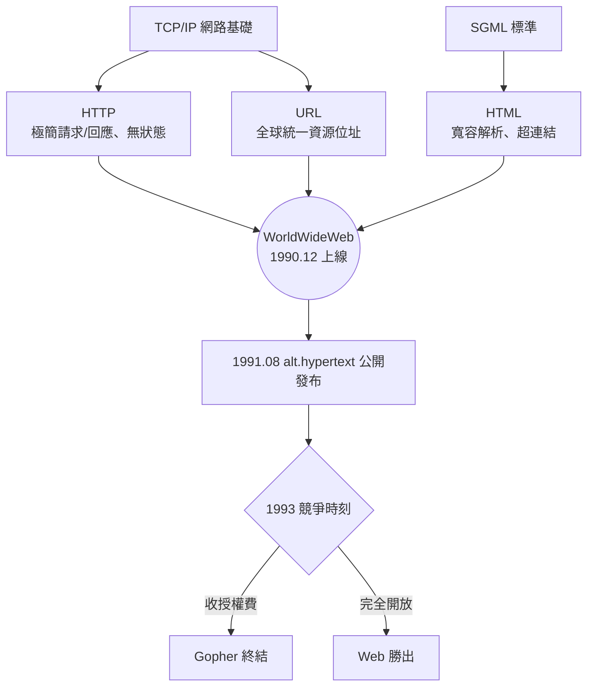

# HTTP、HTML 與 URL：三位一體的底層邏輯

## 一個人的三個發明

1990 年 10 月，CERN 正式核准「WorldWideWeb」專案。接下來的三個月，是科技史上密度驚人的三個月：伯納斯-李在 NeXT 電腦上，幾乎以一己之力，同時發明了三項彼此咬合的技術——HTTP、HTML、URL，外加一個瀏覽器與一部伺服器。此後三十餘年，全球數十億人的日常，都建立在這三塊基石之上。

這三項發明的共同特質，恰恰是它們的「不偉大」：每一項單獨看都樸素、簡陋、甚至粗糙。伯納斯-李的天才不在於創造複雜的技術，而在於**克制**——他深刻理解，一個要讓全世界的異質機器互相交談的系統，必須簡單到任何人都願意、也能夠實作。

## HTTP：極簡的對話

**HTTP（HyperText Transfer Protocol）**是瀏覽器與伺服器之間的對話規則。它跑在已經成熟的 TCP/IP 之上，但伯納斯-李設計的應用層協定簡單得近乎大膽：一個請求（GET），一行路徑；一個回應，後面接著文件。沒有狀態、沒有連線保持、沒有複雜的握手。

這種「無狀態」設計曾被人詬病（伺服器不記得你是誰），但它帶來了驚人的優點：伺服器可以同時應付成千上萬個輕量請求，任何一個請求失敗都不影響其他，實作一份能用 HTTP 的程式只需要幾天。伯納斯-李後來說，他的設計準則是「極簡主義者的寬容」——協定允許彼此不認識的程式「寬容地」互動：收到看不懂的欄位，忽略它，繼續對話。這種**寬容解析（tolerant parsing）**的哲學，是 Web 得以野蠻生長、向前相容的關鍵。

## HTML：人人可寫的標記語言

**HTML（HyperText Markup Language）**是網頁的文法。伯納斯-李沒有另起爐灶，而是站在既有標準的肩膀上：他取用 **SGML**（Standard Generalized Markup Language，ISO 1986 年核准的文件標記框架）的一個極小子集，定義了少數幾個標籤——標題、段落、清單，以及那個靈魂標籤：`<a>`（anchor，錨點），讓文字可以指向另一份文件。

HTML 的設計哲學再次是寬容：標籤打錯了、漏了結尾、瀏覽器不認得——沒關係，盡量顯示。這在學院派的標準工程師眼中是「不嚴謹」，但正是這種不嚴謹，讓一個中學生也能憑「檢視原始碼」抄出一個網頁。**知識的書寫門檻，被降到了任何人都夠得著的地方。**

## URL：讓資訊有了全球地址

三者之中，最不顯眼卻最深刻的是 **URL（Uniform Resource Locator）**。在 Web 之前，每台電腦、每個系統都有自己指涉檔案的方式；文件是「在那台機器上那個目錄裡的那個檔案」。伯納斯-李把位址抽象成一行可讀的字串：`scheme://host/path`——`http://info.cern.ch/hypertext/WWW/TheProject.html`。

這是一個哲學級的突破：**「一份資訊的位址」第一次成為全球通用、可書寫、可引用、可黏貼在紙上口耳相傳的概念。**學術引用、商業廣告、報紙文章從此有了共同的指涉系統。而 URL 的「定位」性格也埋下了去中心化的種子：連結不經過任何中央機構核發，指向哪裡，寫了就算。

在推廣上，伯納斯-李獲得了一位關鍵盟友：羅伯特·卡里奧（Robert Cailliau），CERN 的系統工程師，比伯納斯-李年長八歲，有著極強的組織與公關能力。正是卡里奧說服 CERN 高層把 Web 當成正式專案對待，日後又在全球會議上不知疲倦地推銷這個名字古怪的新系統。發明者的孤獨直覺，需要一位政治手腕嫻熟的傳道者——這是科技史上反覆出現的雙人組合。

## 1990 年聖誕：第一個網站上線

1990 年 12 月 20 日前後，第一個瀏覽器/編輯器 **WorldWideWeb**（Berners-Lee 特意把名字連成一個字，避免與「全球資訊」的泛稱混淆）在 NeXT 上運作；第一個伺服器程式 **httpd** 隨之上線，服務的機器就叫 info.cern.ch。值得一提的是，那個第一個瀏覽器不僅能讀，還能**編輯**——伯納斯-李堅信 Web 應該是可寫的媒介，讀與寫本是一體（這個理想要等到二十多年後的 wiki 與社交媒體時代才部分實現，而彼時的實現方式已偏離了他的想像）。

1991 年 8 月 6 日，伯納斯-李在 Usenet 新聞組 **alt.hypertext** 發出公告，宣布 WorldWideWeb 專案、協定與免費取得的伺服器程式。這則低調的貼文，就是 Web 對人類世界的首次亮相。

## 與 Gopher 的賽跑

1991 年，另一個競爭者幾乎同時起跑：明尼蘇達大學的 **Gopher**，一個分層選單式文件的搜尋與瀏覽系統。Gopher 曾一度聲勢浩大，許多大學爭相架設。但它與 Web 的根本差異在於結構哲學：Gopher 是**樹**（層層選單，每個文件只有一個歸屬），Web 是**網**（一份文件可以被任意多的文件連結）。知識的真實形態是網，不是樹。

致命的一擊發生在 1993 年：明尼蘇達大學宣布對 Gopher 伺服器**收取授權費**，商業使用需付費。消息一出，整個社群立刻轉向完全開放的 Web。Gopher 的死因並非技術劣勢，而是一次制度選擇——這個教訓，幾個月後將在 CERN 的董事會議室裡被反覆引用。

