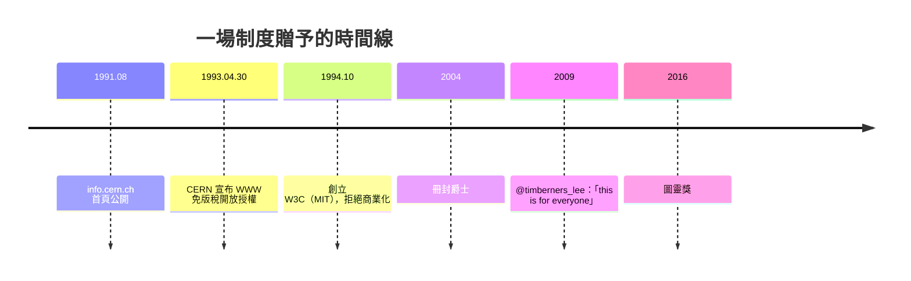

# 第一個網頁與全球無償贈予

## info.cern.ch：世界的起點

1991 年 8 月 6 日，info.cern.ch 上的第一個網頁正式對全世界開放。這個頁面本身極具象徵意義：它不是詩、不是新聞、不是廣告，而是一份關於 WorldWideWeb 專案**自身**的說明文件——什麼是超文字、如何架設伺服器、如何取得瀏覽器。世界上的第一個網站，是一份教你如何創造更多網站的文件。這種自我繁衍的性格，預示了 Web 日後的指數成長：每一個使用者都可能是下一個建設者。

那個頁面上還附有一份清單，列出當時世界上「所有」的網頁伺服器。因為 Web 太新，伯納斯-李需要維護一份虛擬圖書館來收錄新上線的站台——到 1992 年底，這份清單上只有二十幾個站台；到 1994 年，已多到無法再人工維護。Web 的成長曲線，就從這份清單的長度開始失控地攀升。

## 1993 年 4 月 30 日：一個制度決策

技術已經公開，但到了 1993 年初，一個真正的危機浮現。Web 開始受到注目，當時 CERN 最大的對手 Gopher 正因授權收費而自我毀滅；與此同時，市面上出現了多家公司躍躍欲試，想為 Web 技術申請專利、收取權利金。如果 CERN——這個技術的法定持有機構——選擇收費，或者坐視他人圈地，Web 可能重蹈 Gopher 的覆轍：被專利與授權費用窒息在搖籃裡。

伯納斯-李與卡里奧在 CERN 內部四處奔走，力陳利害。他們的核心論證是：**Web 的價值來自於它最大的網絡效應，而網絡效應的前提是零門檻。**收一分錢授權費，就會少一批採用者；採用者越少，網絡越沒有價值。開放不是慷慨，而是策略上唯一正確的選擇。這套論證說服了當時 CERN 研究部門的領導層——研究總監沃爾特·霍格蘭（Walter Hoogland）拍板定案。

1993 年 4 月 30 日，CERN 發布官方聲明：將 WWW 的協定規格與原始碼以**開放授權（open license）、免版稅（royalty-free）**的方式釋出給公眾領域，任何個人或公司皆可自由使用、修改、販售基於此的產品，無須付費、無須授權。

這個決策的意義，怎麼估計都不過分。它不是一個發明家的個人美德，而是一個**制度決策**：一個由十二國政府出資的公共科研機構，用公帑養育的發明，選擇回饋全人類。對比同期 NCSA 對 Mosaic 的商業授權路線、Gopher 的收費自殺，CERN 的選擇直接決定了此後三十年網際網路的制度地基。如果歷史在這裡拐了彎——如果 1993 年 Web 被包裹進專利牆——今天我們可能面對的是幾個彼此不相容、各自收費的封閉資訊系統，而非一個統一的、人人可及的全球網。

## 「如果我把技術變成私有」

伯納斯-李個人面對的誘惑是真實的。1990 年代中期，他清楚地知道，憑著「Web 發明人」的身份，他本可以成為億萬富翁。他的選擇是：1994 年離開 CERN，赴麻省理工學院創立**全球資訊網協會（W3C，World Wide Web Consortium）**——一個中立的標準組織，讓廠商、學界共同協商 Web 的未來規格，防止 Web 被任何一家公司私有化。

他後來多次被問到為何放棄致富，他的回答平實得近乎固執：「**如果我把這項技術變成私有的，它就不會是今天的 Web。**」在當時的氛圍裡，這幾乎是一種反直覺：同一年代，網景上市造就了一批二十多歲的百萬富翁，比爾·蓋茲是首富，人人都在談論網際網路的淘金熱。而發明者本人，坐在 MIT 一間辦公室裡，領著教授級的薪水，守護著一片公地。

榮譽遲來，但終究到來：2004 年，他因服務「全球資訊網」被冊封為爵士（Sir Timothy Berners-Lee）；2016 年，計算學界最高榮譽**圖靈獎**授予他，表彰其「發明了 WWW、第一個瀏覽器，以及使 Web 得以擴展的 URL、HTTP、HTML 關鍵協定」。2009 年，英國女王伊莉莎白二世親自開通了皇室 YouTube 頻道，並透過 Google 執行長 Eric Schmidt 之手發出「重啟 CERN」相關的第一則推文——而在同年 7 月，倫敦皇家醫學會的一場會議上，伯納斯-李在全場起立鼓掌中被起哄要發推特，他看著投影幕上工程師們連夜寫好的帳號 @timberners_lee，敲下了他人生的第一則 tweet：

> **"this is for everyone"**（這是給所有人的。）

七個字，是三十年制度選擇的註腳。

## 一場贈予的歷史回響

從大歷史的角度看，1993 年 4 月 30 日的開放聲明，可以與古騰堡活字印刷的公開推廣、大學制度的誕生相提並論——它們共同構成了「知識傳播成本斷崖式下降」的少數幾個時刻。經濟學家會說，這是史上規模最大的一次「無償贈予」：CERN 放棄了一個可能價值數千億美元的壟斷資產。思想史上，它證明了一件事：**公共財可以成為平台**——後來的 Linux、Wikipedia，都走在這條 CERN 開闢的路上。而教育與文化層面，任何人、任何孩子，從此都可以不經許可地在人類知識的公共廣場上搭起自己的角落。

