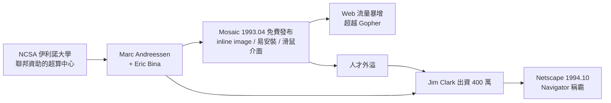

# 馬克·安德森與 Mosaic：圖形化瀏覽器

## 伊利諾大學的夜班

Web 在歐洲誕生，卻在美國中西部長出了大眾的臉孔。1992 年，伊利諾大學香檳校區的**國家超級計算應用中心（NCSA，National Center for Supercomputing Applications）**，聚集了一批領時薪工讀的學生程式設計師。這是美國學術體制的典型產物：聯邦經費資助的超級計算中心，開放給各科系的大學生打工。制度上的寬容——不問資歷、只問能寫出什麼——讓一個二十歲出頭的電腦科學系大學生拿到了入場券。

**馬克·安德森（Marc Andreessen）**1971 年生於愛荷華州小鎮，在威斯康辛成長，九歲時從圖書館借到一本 BASIC 程式設計書，自學寫出第一個程式——一個虛擬計算器。大學時他曾在 Amdahl 公司實習，接觸過大型主機世界，也在矽谷短暫浸潤。1992 年底，他在 NCSA 用上了 Web，立刻被擊中，但同時看到一個刺眼的缺口：**這東西是給物理學家的，不是給普通人的。**當時的瀏覽器（包括 Berners-Lee 的 WorldWideWeb、ViolaWWW 等）要嘛只能在 NeXT 上跑，要嘛安裝繁瑣、介面艰澀，而且都是純文字。WWW 的流量在當時只是網際網路總流量的零頭，遠落後於 Gopher。

安德森拉來了 NCSA 的資深程式設計師**艾瑞克·比納（Eric Bina）**——一位以才華與暴躁並稱的工程師。兩人立下軍令狀式的目標：三個月做出一個「人人可用」的瀏覽器。1993 年 1 月，第一版 Mosaic 在 Unix 的 X Window 上問世。

## ``：一個改變世界的標籤

Mosaic 的關鍵創新，如今看來簡單得可笑：**inline image——把圖片直接嵌進文字流裡顯示。**

在 Mosaic 之前，瀏覽器看到圖片連結，只會另開視窗或下載檔案；文字歸文字，圖像歸圖像。安德森與比納提出 `` 標籤，讓圖像成為文檔的一部分。伯納斯-李當時聽聞此事的態度是反對的——他認為這破壞了媒介的純粹性，圖像應該由外部檢視器處理。多年後，伯納斯-李坦率承認自己錯了：**正是這個「不必要」的功能，讓 Web 從學術工具變成了大眾媒介。**人類不是閱讀文字的動物，是觀看圖像的動物；報紙早已懂這個道理，第一代的 Web 工程師卻沒有。

Mosaic 的其餘創新同樣指向「大眾」二字：**易於安裝**（圖形化安裝程式，普通人在 Mac 與 Windows 上點幾下滑鼠就能用——這在 1993 年是稀有品質）；**滑鼠點擊式介面**（連結是藍色底線，點了就能去，不必理解什麼是 URL）；**統一的跨平台體驗**（Unix、Mac、Windows 三個版本，外觀一致）。1993 年 4 月，Mosaic 免費對公眾釋出（僅對商業使用附帶限制條款），附帶一份新聞稿大肆宣傳。

## 引爆點

效果立竿見影。1993 年，Web 流量在網際網路骨幹上的成長率超過百分之三十萬（從近乎零到每月數百 GB）；到 1994 年，Web 流量已超越 Gopher、FTP 等所有前輩服務，成為網際網路上成長最快的應用。新聞媒體開始報導「Mosaic」——《紐約時報》1993 年 12 月頭版報導這個免費的「網際網路導航系統」，這是 Web 第一次登上主流媒體的封面位置。數以十萬計的普通家庭，第一次透過一個滑鼠點擊的圖形視窗，看見了網際網路。

## 從學術到商業：Netscape 的誕生

1993 年底，命運的齒輪轉動。矽谷圖形公司（SGI）創辦人**吉姆·克拉克（Jim Clark）**——一位已從自己創辦的公司退休、正尋找新賭注的億萬富翁——聽說了 Mosaic 團隊，主動聯繫安德森。1994 年 4 月，剛拿到學位、正考慮去矽谷工作的安德森與克拉克在山景城會面。兩人一拍即合：克拉克出資四百萬美元與人脈，安德森召集老同僚。

1994 年，**Mosaic Communications Corporation** 成立（後因 NCSA/伊利諾大學的商標抗議，被迫改名為 **Netscape Communications**），幾乎整隊 Mosaic 原班人馬被網羅——這是學術機構人才外溢的教科書案例：NCSA 訓練的人才，接下來陸續創辦或主導了 Netscape、WebCrawler（最早的網路搜尋引擎之一）等公司，矽谷的 Web 產業血脈，很大一部分可以直接追溯到伊利諾大學那間超級計算中心的工讀辦公室。

1994 年 10 月，**Netscape Navigator** 發布，免費供教育與非商業使用，並在技術上全面超越 Mosaic：更快的渲染、逐步顯示文字與圖片（不必等整頁下載完）、更高的穩定性。幾個月內，Navigator 吃下了瀏覽器市場的絕大多數份額。

學界對這條「技術轉移」路徑的評價兩極：批評者指出，Mosaic 的商業化授權糾紛暴露了公立大學在智慧財產制度上的笨拙；讚賞者則認為，正是商業資本的介入，把一個還在實驗室裡慢火燉煮的技術，在十八個月內推向了千萬用戶。無論如何，歷史在此完成了一次關鍵交接：**Web 的下一章，不再由研究機構執筆，而由資本市場與工程師共同書寫。**

