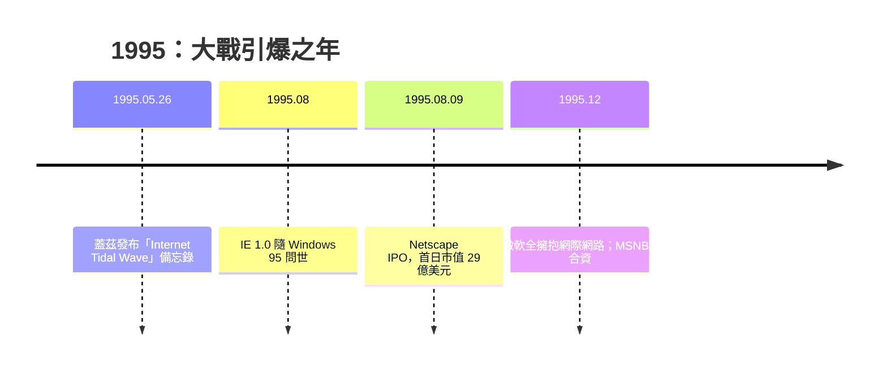

# 網景上市與微軟的 Internet Tidal Wave

## Navigator 的閃電戰

1994 年 10 月，Netscape Navigator 發布。它的策略是教科書式的「免費滲透」：教育與非商業用途免費下載，商用才收費——這讓 Navigator 以病毒式的速度在校園與新興的撥接上網人群中擴散。技術上它也比 Mosaic 領先一代：頁面邊下載邊顯示、表格排版、加密通訊（SSL，為日後的電子商務鋪路）。到 1995 年年中，Navigator 已佔據瀏覽器市場約七成以上；到年底，Netscape 的瀏覽器市佔一度接近九成。一家成立僅一年、員工數百人的公司，實質上控制了全球通往 Web 的窗口。

## 1995 年 8 月 9 日：華爾街為 Web 定價

1995 年 8 月 9 日上午，Netscape 在那斯達克上市。原定每股 28 美元的發行價，在承銷商摩根士丹利與漢鼎（Hambrecht & Quist）的評估下已屬大膽——這是一家**不盈利**的公司，招股書上寫著營收成長飛快、虧損也飛快。開盤鐘響，需求淹沒了市場：股價一路衝上 71 美元收盤，公司市值近三十億美元。那時 Netscape 成立不滿十八個月，產品免費送人，獲利遙遙無期。

《華爾街日報》後來稱這一天為「華爾街與嬰兒潮的分水嶺」——傳統估值模型（本益比、資產、獲利）在這裡失效，市場第一次為「網際網路時代的入口」這個概念定價。這一天是網路泡沫時代的精神起點：此後五年，數百個還在燒錢的 dot-com 紛紛以同樣邏輯上市。經濟史的弔詭之處在於：Netscape 本身是被微軟擊垮的，但它的 IPO 點燃的資本狂潮，卻把整個網際網路產業基礎設施（光纖、資料中心、電商）在五年內提前建成——泡沫破裂後留下的廢墟，恰恰是下一個時代的公路。

## Tidal Wave：微軟的驚醒

而在雷德蒙德（Redmond），微軟一度錯估了形勢。1994 年，比爾·蓋茲的注意力還在 Windows 95 與 MSN（一個自建的封閉線上服務）上；微軟內部甚至有一個名為 Blackbird 的專案，企圖打造一個與 Web 相競爭的封閉內容平台。改變一切的，是安德森接受記者採訪時的一句狂言：在 Web 時代，「作業系統只不過是一袋驅動程式， poorly debugged bag of drivers」。這句話傳到蓋茲耳中，如同一記警鐘：**如果瀏覽器成為應用平台，Windows 的壟斷根基將被架空。**

1995 年 5 月 26 日，蓋茲向全公司高管發出備忘錄，標題 **「The Internet Tidal Wave」**（網際網路的海嘯）。他把網際網路列為「我親自關注的最高優先級」，警告競爭者已經把微軟甩在後面，宣布公司所有專案必須向網際網路對齊，並罕見地以嚴厲口吻點名表揚了 Netscape 的瀏覽器與 Sun 的 Java——「他們正在做對的事」。這份備忘錄是微軟史上最重要的戰略轉向文件之一：一家市值數百億的公司，在八週內把整艘航空母艦調頭。

執行同樣迅捷：Blackbird 被擱置；微軟沒有從頭寫瀏覽器，而是向伊利諾大學支付兩百萬美元，**授權 Spyglass Mosaic**（NCSA 將 Mosaic 商業化授權的結果）的原始碼，在此基礎上快速拼裝出 Internet Explorer 1.0。1995 年 8 月——就在 Netscape 上市前三天——IE 1.0 隨 Windows 95 的 Plus! 套件問世；12 月，蓋茲在業界大會上宣布微軟「全力擁抱網際網路」（embrace and extend 的時代就此展開），同月微軟與 NBC 合資成立 MSNBC，MSN 也轉向 Web 技術。

## 兩種公司的對撞

大戰格局就此成形，而且是一場不對稱的戰爭。微軟是**平台公司**：它賣作業系統，瀏覽器對它而言是保衛平台的防禦工事——控制了瀏覽器，就控制了 Web 的入口，也控制了未來應用程式運行的地基。Netscape 是**應用公司**：瀏覽器就是產品，是營收的來源。當防禦者願意把防禦工事免費送出去，靠工事賣錢的公司便無利可圖。這個結構性矛盾，決定了戰爭的結局，也埋下了日後反壟斷案的伏筆。

Netscape 的應對則暴露了新創公司常見的傲慢。憑藉約九成市佔，它急於用新功能拉開差距、強化「瀏覽器即平台」的野心：1995 年發明 **JavaScript**（十天倉促設計出的語言，影響深遠），推出 **Frames**（框架頁，後來被社群唾棄）、外掛（plug-in）架構、不斷膨脹的功能集。每一版 Navigator 都更大、更慢、更不穩。安德森本人後來承認，他們把資源投在令人眼花繚亂的示範功能上，而非效能與穩定性。與此同時，IE 的每一版都在縮小差距。市場窗口就在這種「創新的炫耀」中一寸寸流失。

從經濟與制度的視角看，1995 年是 Web 歷史的轉軌時刻：技術的未來不再由學術機構或標準組織主導，而由一場世紀商業大戰決定。思想史上，它也提出了一個反覆重演的命題——**開放的平台能否在壟斷資本的夾擊下存活？**下一章的答案是：瀏覽器本身淪陷了，但 Web 的開放性，靠另一隻看不見的手保存了下來。

