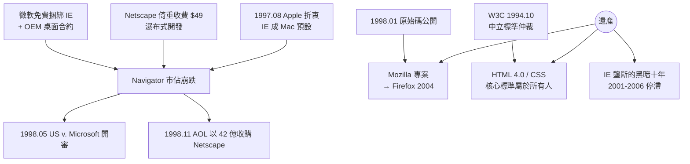

# IE 捆綁殺局與 W3C 的誕生

## 免費，是最大的武器

1995 年底的戰場態勢已定，但真正的殺局在接下來兩年展開。微軟的戰術簡單而殘酷：**把 IE 免費捆綁進 Windows。**Netscape Navigator 對企業用戶仍收費 49 美元；IE 則隨每一份 Windows 95/98 一起安裝，出現在數以億計的桌面免費奉送。對消費者而言，開機就有 IE，何必再花錢下載 Navigator？更致命的是通路控制：微軟與電腦組裝廠（OEM）簽訂嚴苛的授權合約，規定不得移除桌面上的 IE 圖示、不得將競品瀏覽器設為預設、安裝 Navigator 甚至可能失去 Windows 授權優惠——用一個作業系統的壟斷地位，去贏得另一個市場。

內部文化上，兩家公司是兩個物種。Netscape 沿用學院式的**瀑布式開發**：漫長的規劃、一年一次的大版本。微軟則展現它自 Office 與 Windows 開發中鍛鍊出的**快速迭代**能力：小團隊、每週 build、密集回饋。IE 從 1.0 到 3.0 只用了一年多，IE 3（1996）首次在功能上足以匹敵 Navigator——而且同樣免費。Netscape 被迫跟進免費（1998 年初），營收支柱隨之崩塌；它每年數億美元的營收，有相當部分來自伺服器軟體，但微軟同樣以捆綁 IIS 免費送出，第二支柱也被拆除。

戰場甚至延伸到矽谷之外。1997 年 8 月，賈伯斯重返蘋果後不久，微軟宣布以 1.5 億美元投資蘋果、續約 Office for Mac——交換條件之一，是 **IE 成為 Macintosh 的預設瀏覽器**。蘋果用戶的叛逃之路，也被封了一條。

## 法庭上的帝國

1998 年 5 月，美國司法部與二十個州對微軟提起反壟斷訴訟，**United States v. Microsoft** 開審，傑克森（Thomas Penfield Jackson）法官主審。庭上最精彩的證詞來自 AOL 的高層**大衛·科爾本（David Colburn）**：他披露 1996 年微軟曾向 AOL 開出交易條件——只要 AOL 放棄推廣 Navigator、改用 IE，微軟就願意付錢、並把 AOL 圖示放進 Windows 桌面（這張桌面入口的價值，AOL 後來估計高達每年數億美元的獲客成本）。證詞生動呈現了微軟如何用 Windows 的壟斷租值，系統性收買通路口。內部電子郵件也陸續曝光，其中以高階主管的「應切斷 Netscape 的氧氣供應」等措辭最為致命——這些文字在法庭上被反覆朗讀。

判決要到 2000 年才出爐（傑克森法官裁定微軟違法濫用壟斷、一度下令拆分，後於 2001 年和解），但市場不等法庭。**1998 年 11 月，AOL 以約 42 億美元（以股票支付）收購 Netscape**——一家三年前市值近七十億、市佔九成的公司，至此謝幕。瀏覽器大戰落幕，微軟 IE 市佔攀升至九成以上。

## Mozilla：戰敗者留下的火種

敗局之中，Netscape 做出了它最重要的遺產決策。1998 年 1 月，Netscape 宣布**公開 Navigator 的原始碼**，成立開源專案 **Mozilla**（前代代碼的暱稱，也成了 Mozilla 基金會的前身）。這是一步輸棋之後的絕望之棋，卻意外點燃了商業軟體史上最重大的開源實驗：歷經數年幾乎推倒重來的重寫，Mozilla 世系最終結出 Firefox（2004）之果，在 IE 獨霸的黑暗十年後重新撕開壟斷的裂口。開源模式（同年誕生的還有 Open Source Initiative 一詞）自此登上商業與學界的正廳。

## W3C：看不見的手

而在大戰的硝煙之外，另一股力量在默默為 Web 保存火種。1994 年 10 月，伯納斯-李在 MIT 創立**全球資訊網協會（W3C）**，CERN、MIT 與法國 INRIA 共同承擔。W3C 的角色是中立的標準仲裁者：邀集微軟、Netscape、Sun、IBM 等敵對廠商坐在同一張桌上，以「共識決」制定 Web 規格。它的制度設計（會員制、公開草案、免版稅的標準承諾，即 RAND-royalty free 政策）確保了：即使瀏覽器戰場上廠商各自推出私有擴充（Netscape 的 `<blink>`、微軟的濾鏡與 ActiveX），**核心標準仍屬於所有人**。

W3C 的代表作是 1997 年的 **HTML 4.0** 與 1996 年首發的 **CSS**（層級樣式表，由挪威人 Håkon Wium Lie 在 CERN 時期構想）——把結構與呈現分離的思想，為日後無障礙閱讀、行動裝置與語意網頁奠基。大戰期間，兩家瀏覽器忙著互拼私有功能，標準實作支離破碎；正是 W3C 的規格書，成為開發者對抗碎片化的憲章。瀏覽器大戰的殘酷，反而證明了標準組織的必要：市場競爭帶來速度，制度協商帶來相容。

## 大戰的遺產

回望 1995–1998，這場戰爭留下三份矛盾的遺產。第一，**免費瀏覽器成為常態**——消費者獲利，但這是壟斷者用掠奪性定價「送」來的，其代價由競爭者與創新承擔。第二，**標準組織的地位確立**——W3C 與隨後的 WHATWG、開源社群，成為 Web 技術治理的常設機構，「Web 屬於所有人」從口號變成制度。第三，**壟斷的十年黑暗即將到來**：IE 六年不更新（IE 6 從 2001 年到 2006 年停滯），Web 的技術演進被凍結；安全漏洞叢生，網頁開發者被迫為一個瀏覽器寫程式。這段黑暗期，正是下一代人（Google、Mozilla、Web 2.0 的建造者）起身戰鬥的起點。

