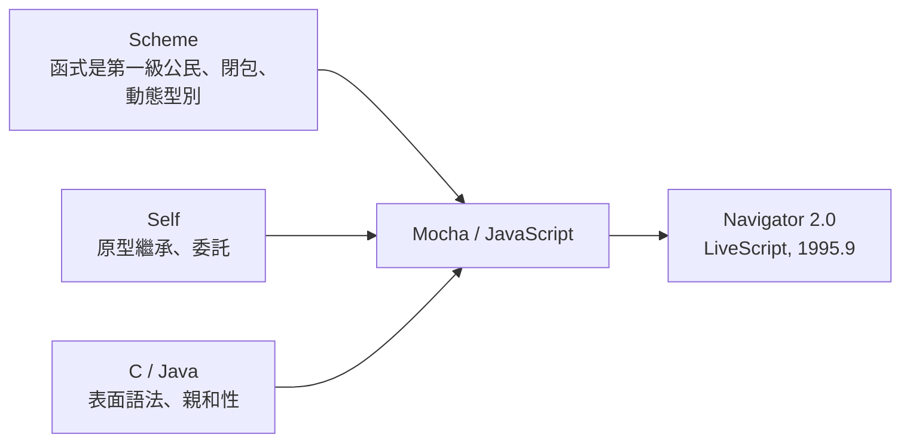

# 節標題：布蘭登・艾克的瘋狂十天

1995 年 5 月，網景內部做出決定：不要 Scheme 了。管理層要的是一個「像 Basic 的腳本語言」——簡單、鬆散、給非程式員用的東西，要趕在 Navigator 2.0 beta 之前做出來。時間給了布蘭登・艾克多少？傳說中的答案是：**十天**，做出一個可運作的原型。

十天寫一個語言，聽起來像笑話。但在 1995 年的網景，這不是玩笑，是產品時程。艾克後來回憶，他當時的想法很清楚：反正這只是原型，之後可以再改。他把時間全部押在實作上，幾乎不睡覺，一邊寫直譯器、一邊設計語言本身。這種「設計與實作同步進行、沒有回頭路」的開發方式，在工程史上通常製造災難——這次製造的是史上最成功的程式語言，以及一輩子的技術債。

十天的產物叫 Mocha。要理解它為什麼長成那個樣子，必須看見艾克揉合進去的三種血統，這三種血統分別來自三個陣營，代表三種政治妥協：

第一種是 **Scheme 的靈魂**。艾克是 Lisp 人，他把自己真正相信的東西塞進了語言核心：函式是第一級公民，可以像數值一樣被賦值、傳遞、返回；有閉包（closure），函式可以記住它誕生時的環境；動態型別，不用宣告。這些在 1995 年的工業語言裡是異端，卻是 MIT 學派的正統。可以說，JavaScript 表面上是 Basic，骨子裡是 Lisp。

第二種是 **Self 的原型繼承**。Self 是 Sun 的一個實驗性語言，拋棄了 class，物件直接從其他物件「複製、委託」而來。艾克採用了這個模型——在十天內，設計 class 體系太昂貴、太容易出錯，而原型鏈（每個物件有個 proto 指向它的範本）實作起來又快又簡單。這個省時的決定，讓 JavaScript 成為主流語言中唯一以原型繼承為核心的語言，害得之後二十年的教科書作者都必須先解釋「為什麼它不一樣」。

第三種是 **C/Java 的表面語法**。這是給管理層和市場的交代：語法長得像 Java（大括號、分號、看起來像 C 家族），讓程式員一眼覺得親切、讓主管覺得「跟 Java 是一家」。連名字後來都沾上 Java 的光（這是下一節的故事）。所以 JavaScript 的本質與外表是分裂的：**Lisp 的心、Self 的骨、Java 的皮**。

十天過後的版本，粗糙是必然的。艾克事後自嘲：「這不是計畫出來的語言，是被時間綁架的語言。」（It was not a planned language; it was hijacked by time.）那些「先天傷疤」，每一條都能追溯到期程的壓力：

- **自動分號插入（ASI）**：為了讓非程式員少踩坑，直譯器會替你補分號，結果製造了 `return` 之後換行就返回 undefined 這類詭異行為，成為二十年的面試考題。
- **`==` 的隱式轉換**：寬鬆相等會先做型別轉換再比較，`"1" == 1` 是 true、`0 == ""` 也是 true。艾克本想做個寬鬆友善的運算子，結果做出了一個行為矩陣像占星術的東西。後來 JavaScript 加了嚴格的 `===`，等於官方承認了 `==` 的失敗。
- **`this` 的動態綁定**：`this` 取決於「函式怎麼被呼叫」而非「怎麼被定義」，這個設計省了事，卻讓無數人困惑，直到 ES6 的箭頭函式才部分止血。

然而，歷史的弔詭在於：這個被綁架的語言，也**意外做對了幾件至關重要的事**。

第一，函式是一級公民。這讓「回呼（callback）」成為自然的寫法——把一個函式交給別人，事件發生時再呼叫它。第二，閉包讓回呼可以攜帶狀態。第三，整個語言從第一天就是**事件驅動**的：網頁是事件（點擊、載入、按鍵）的集合，腳本是對事件的反應。當時沒有人意識到，這正是**非同步 Web 的基因**。二十年後，Node.js 把同一組基因搬到伺服器端，單執行緒事件迴圈征服了高併發的世界——那全是 1995 年 5 月那十天埋下的種子。反諷的是，艾克設計時覺得自己是「為了表單驗證寫個小玩具」，歷史卻把玩具變成了世界最重要的執行環境。

1995 年 9 月，Navigator 2.0 beta 出貨，這門語言以 **LiveScript** 之名正式上線，內建於每一份瀏覽器拷貝中。它的傳播速度是史無前例的：不需要下載編譯器、不需要安裝任何東西，只要你看得到網頁，你就有了直譯器。到 1995 年底，全世界的網頁作者手裡突然多了一支畫筆。

而名字的故事，才正要開始鬧劇登場——那是一場商業對技術的綁架。
