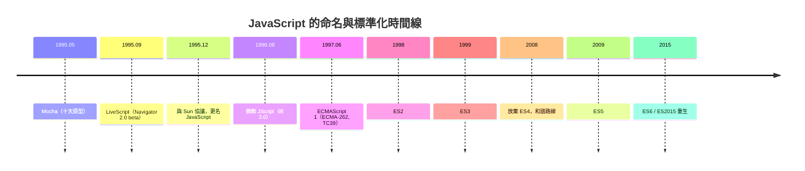

# 節標題：命名鬧劇與標準之爭：從 Mocha 到 JavaScript

一門語言的一生，往往從名字的誤會開始。JavaScript 的命名史，是技術被商業綁架的經典案例，而這場鬧劇的三幕，前後不過半年。

第一幕：Mocha。這是 1995 年 5 月艾克十天期程裡的專案內部代號，帶著網景式的咖啡趣味（Java 也是咖啡的意思，網景想押這個韻）。第二幕：LiveScript。1995 年 9 月，Navigator 2.0 beta 上線時，語言以 LiveScript 之名出貨，「Live」呼應了網景當時的行銷主軸（LiveWire 伺服器產品線），強調網頁「活」起來。第三幕：1995 年 12 月 4 日，網景與昇陽（Sun）發表聯合聲明，LiveScript 正式更名為 **JavaScript**。

這是一筆純粹的行銷交易。Java 在 1995 年年中爆紅，「網路就是電腦」的口號燒遍媒體，任何沾上 Java 之名的東西都自帶流量。協議的內容大致是：Sun 取得 JavaScript 的商標，網景則獲得「官方腳本語言」的地位——JavaScript 成為網景瀏覽器中與 Java applet 配套的正式腳本語言，彷彿它是 Java 的輕量小兄弟。實際上，兩者在技術上幾乎沒有關係：一個是編譯型、類別基礎、靜態型別；一個是直譯型、原型基礎、動態型別。後世開發者流傳的調侃一針見血：**「Java 和 JavaScript 的關係，就像火腿（ham）和倉鼠（hamster）——名字像，本質毫無關聯。」**這個名字綁架的代價延續至今：無數初學者以為要先學 Java，無數履歷把兩者搞混。

劇作家是微軟。1996 年 8 月，IE 3.0 問世，微軟推出自己的腳本語言——**JScript**。它沒有授權費，名字不能叫 JavaScript（商標在 Sun 手上），於是微軟乾脆對網景的語言做逆向工程，行為盡量模仿、細節未必相同。從此開發者面對兩種方言：網景的 JavaScript 與微軟的 JScript，加上各自的文件物件模型（DOM），「寫一次、到處跑」變成「寫兩次、祈禱能跑」。前端工程師的地獄時代由此開場，`navigator.userAgent` 偵測瀏覽器的骯髒技巧成為標準配備。

混亂催生了標準化。1996 年 11 月，網景把語言送交歐洲資訊與電信標準協會（ECMA），成立 TC39 技術委員會。1997 年 6 月，**ECMAScript 1**（ECMA-262）誕生——名字刻意中性，因為商標與政治都不允許直接叫 JavaScript。標準化的意義重大：它讓語言脫離了單一公司的私產地位，微軟與網景都得有一個共同核對的基準。隨後 1998 年 ES2（主要是編輯性修訂）、1999 年 **ES3**——正規表示式、try/catch、更完善的型別轉換規則，這是個扎實的版本，直到今天還有人說「ES3 是那個時代最被低估的成果」。

但標準化的侷限也立即顯現：標準核對的是已存在的事實，無法推動未發生的創新。ES3 之後，語言陷入**十年停滯**——這正呼應了 IE 的壟斷（下一章的主題）：當單一瀏覽器佔有九成市場，語言演進就失去了商業動力。委員會內部則上演更慘烈的戲碼：**ECMAScript 4** 的野心與崩潰。ES4 起草於 2000 年代，內容龐大到近乎重寫一門語言：真正的類別、靜態型別、命名空間、泛型……Adobe（ActionScript 3 幾乎就是 ES4 的實作）、Mozilla 支持它；微軟則反對，認為複雜度會毀掉 Web，並在 IE 團隊的立場上消極抵制。陣營分裂，委員會癱瘓，2008 年 8 月，各方在奧斯陸達成和議：**正式放棄 ES4**。

在這場戰爭中，道格拉斯・克羅克福德（Douglas Crockford）扮演了關鍵的中間路線角色。這位資深工程師在 2000 年代倡導 JSON（他從 JavaScript 的物件字面量裡挖出的資料格式，取代了臃腫的 XML），並以《JavaScript: The Good Parts》（2008）一書提出著名論點：這門語言有一個精華子集，開發者應該「只用好的部分」。當委員會在要不要整座新大廈時，克羅克福德論證的是：房子雖破，地基其實不錯。這種務實哲學促成了和解——先做小幅修訂（2009 年 ES5：strict mode、JSON 原生支援），再全力投入一次真正的重生（2015 年 ES6：let/const、class 語法糖、箭頭函式、Promise、模組）。

回望這段歷史，JavaScript 的前十五年像一場漫長的球評會：人人都在批評這門語言的傷疤，卻沒有人能讓它下場。因為它是唯一一門「每台電腦都裝了直譯器」的語言，市場壟斷了它的命運，商業綁架了它的名字，而它靠著函式與閉包的優良基因，硬是活到了重生那天。而它停滯的那十年，正是瀏覽器世界最黑暗的十年——主角換人：微軟的 Internet Explorer。
