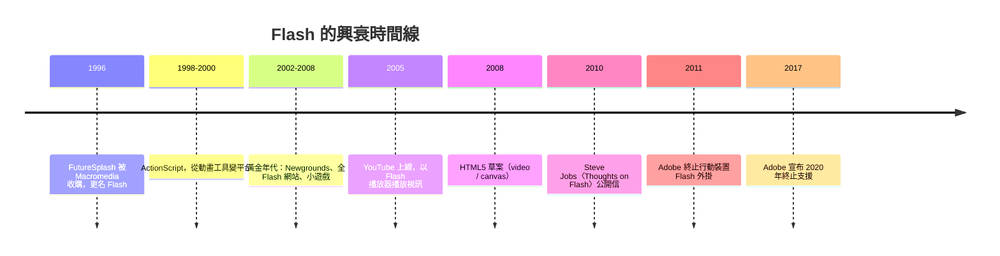

# 節標題：Flash 的短暫霸權

在瀏覽器停滯的黑暗十年裡，標準不在的地方，私有技術就稱王。Flash 的故事，正是這條鐵律最華麗的展演。

主角是強納森・蓋伊（Jonathan Gay），一位從小痴迷繪圖與程式的美國工程師。他在 1990 年代初與人合作開發了 SmartSketch，一款向量繪圖軟體；1996 年，產品轉向網路，改名 **FutureSplash Animator**——核心洞察有二：用**向量圖形**（以數學曲線描述圖形，檔案極小，適合當時的撥接頻寬）呈現動畫；用**時間軸**（timeline）作為創作介面，讓設計師像做定格動畫一樣安排畫面。1996 年底，Macromedia 收購了這家公司與產品，更名為 **Flash**。

Flash 成功的關鍵，首先是**受眾**：它是給設計師用的。不用寫程式，拖動時間軸、補間動畫（tweening）自動生成中間畫面，美術背景的人三天上手。這與 HTML 的枯燥標籤形成鮮明對比——Web 第一次擁有了「視覺的自由」。接著 1998 年起的 ActionScript（最初是簡單腳本，後來演化為完整的 ECMAScript 方言）讓 Flash 從動畫工具升級為**平台**：可以寫遊戲、做應用、載入資料。當 IE6 停滯不前、CSS 處處碰壁時，Flash 提供了一個「完全可控的環境」——你在任何瀏覽器看到的都是一樣的，因為渲染根本不交給瀏覽器，而是交給那個一統天下的外掛。

為何在黑暗十年大爆發？因為 Web 的標準工具箱有巨大的真空：**視訊沒有標準解**（RealPlayer 與 QuickTime 各自為政、體驗糟糕），**音訊沒有標準解**，**遊戲更是無從談起**，而 IE 的停滯封死了 HTML 自己長出這些能力的路。Flash 補上了所有缺口。於是整個 2000 年代中期，一個平行於 HTML 的文化帝國崛起：**Newgrounds**（1995 年創立，2000 年代成為 Flash 動畫與遊戲的聖地，《Alien Hominid》《Friday Night Funkin》的前身文化皆源於此）孕育了整整一代獨立創作者；辦公室裡偷玩的小遊戲（《Line Rider》《Desktop Tower Defense》《Crush the Castle》——後者的玩法啟發了憤怒鳥）；音樂網站、互動廣告、以及在當年被視為巔峰工藝的「全 Flash 網站」——整個網站就是一個沉浸式體驗，配樂轉場無所不能。最戲劇性的時刻在 2005 年：**YouTube** 上線，初版播放器就是 Flash——正是 Flash 的跨瀏覽器視訊能力，讓「隨點隨看」的影片分享得以實現，間接改寫了媒體史。巔峰期，Flash 裝機率接近 99%，它不是 Web 的一部分，它就是 Web。

帝國的裂縫來自兩處。其一是**行動時代**：Flash 的性能與耗電是為插電的桌上電腦設計的，跑在電池供電的智慧手機上是災難。蘋果的立場經歷了演變——早年 Macromedia 與 Apple 關係密切，Flash 也曾是 Mac 上重要的多媒體方案；但 2007 年 iPhone 問世，賈伯斯拒絕讓 Flash 進入 iOS。2010 年 4 月，他以一封公開信〈Thoughts on Flash〉定調：Flash 封閉私有、性能不佳、耗電嚴重、安全性紀錄糟糕、且不支援觸控，移動時代應屬於開放標準。世人多把這封信讀成技術宣言，但真正的底層是政治與經濟：**App Store** 生態要求應用分發的控制權，而 Flash 是一條繞過商店直接在瀏覽器裡分發應用的通道——允許它，等於在自己的城堡裡開一扇別人家的門。Adobe 2011 年宣布放棄行動版 Flash 外掛，戰爭結束。

其二是**標準的反攻**。HTML5 草案（2008 年起）補上了 Flash 帝國的兩大支柱：`<video>` 讓視訊成為 HTML 原生能力（YouTube 逐步轉向），`<canvas>` 讓程式化繪圖與遊戲不再需要外掛（許多 canvas API 的設計，靈感正來自 Flash 開發者熟悉的概念）。加上 JavaScript 的重生（ES5、ES6）與瀏覽器性能競賽，Flash 的每一項獨家能力都有了開放的替代品。2017 年 7 月，Adobe 官方宣布將於 2020 年 12 月 31 日**終止 Flash 支援**——死刑判決下達；2020 年底，瀏覽器移除外掛，一個時代正式下葬。

Flash 的教訓，是私有平台興衰週期的教科書：**它以更好的體驗戰勝殘缺的開放標準，又因開放標準追上、加上平台政治的圍剿而死亡**。「開放標準 vs 更好的私有體驗」是 Web 史上永恆的張力——開放總是慢一拍，私有總是先贏後輸，因為開放的可組合性與不依附單一公司命運的特性，在時間的複利下終將獲勝。而 Flash 留下的文化遺產——獨立遊戲的萌芽、設計師可程式化的夢想、以及對「可控環境」的執念——則以新的形式，活在今天的遊戲引擎與互動設計工具裡。
