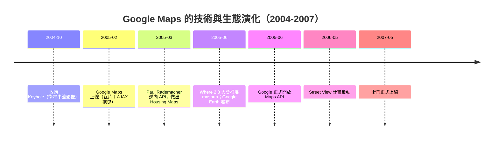

# Google Maps 的震撼降臨

2005 年 2 月 8 日，Google Maps 上線。幾天內，整個開發社群都在傳同一個訊息：「你必須去試試這個地圖。」在當時，這句話罕見到近乎誇張——地圖並非新鮮事，MapQuest 自 1996 年起就是網路地圖的代名詞，Yahoo Maps、MSN Maps 各據一方。但它們的體驗是同一種：輸入地址、按下「搜尋」、等待整頁刷新、點一下放大、再等待整頁刷新。地圖是一張張靜態圖片之間的翻頁。而 Google Maps 不同：你可以按住滑鼠直接拖曳地圖，畫面如液體般連續滑動，沒有閃白、沒有等待；放大縮小平滑即時；搜尋框不打斷頁面。許多人第一次意識到：瀏覽器裡跑的已經不是「網頁」，而是一個應用程式。

背後是三項技術的巧妙組合。其一是瓦片（tile）金字塔：不是一次載入整張巨大地圖，而是把世界切成 256×256 像素的小圖塊，依縮放層級組成金字塔（每一級放大，瓦片數約變四倍），瀏覽器只按視窗範圍抓需要的瓦片。其二是 AJAX 預取：當你拖曳時，腳本悄悄預先抓取相鄰區域的瓦片，所以你永遠覺得「下一塊已經在那裡」。其三是 DOM 渲染：瓦片以 `` 元素動態搬移與堆疊，加上 DHTML 與 XMLHttpRequest，讓整個互動不重載頁面。這正是 Ajax 哲學的完美展演——Garrett 的文章兩週前才發表，Google Maps 彷彿是為它預備的最佳教材。

接下來的事，成為 Web 2.0 史上最經典的橋段之一。Google 並未在第一天開放 API，但開發者發現：Google Maps 的頁面會向內部端點請求資料。有人逆向了這些隱藏介面，社群裡出現了「Hacking Google Maps」的教學文章。2005 年 3 月，Paul Rademacher 做出了決定性的一擊：他把 Craigslist 的租屋與售屋資料，自動疊加到 Google Maps 上，做出 Housing Maps——滑鼠點著地圖就能看見舊金山每間待租公寓的位置與照片。這個 mashup（混搭）在當時是革命性的暗示：兩個互不相識的服務，可以由第三方在使用者端組合成新產品。Housing Maps 被無數人轉寄，Tim O'Reilly 更在同年 6 月的 Where 2.0 大會上把它奉為「Web 2.0 的象徵案例」——資料是平台，組合即創新。

Google 的反應速度展現了平台戰略的老練。2005 年 6 月 29 日，Google 正式推出 Maps API——免費、寬鬆，任何網站都能嵌入地圖。與其封鎖駭客，不如收編他們成為生態的建設者：免費 API 換來的是開發者的注意力、資料的網絡效應與遷移成本——生態鎖定。Mashup 文化隨之爆發：天氣、犯罪率、選舉結果、咖啡店，萬物皆可上圖。同一時期，Amazon 開放書目 API、eBay 開放交易 API，「開放 API」從工程決策升格為 Web 2.0 企業的標準配備。

Google Maps 本身的商業旅程同樣精采。它的技術血統來自收購：2004 年 10 月，Google 買下衛星影像公司 Keyhole——這家新創靠獨特的串流式「越飛越近」影像聞名，創辦人 John Hanke 帶著團隊與技術加盟。Keyhole 的串流瓦片思想融進了 Google Maps，而 2005 年 6 月發布的 Google Earth 則是 Keyhole 原本夢想的三維版本。2006 年 5 月，Google Earth 團隊裡的 Stephen Chau 等人推動了 Street View（街景）的誕生計畫：2007 年正式上線時，那輛頂著多鏡頭相機的街景車，把「看地圖」變成了「置身地圖」。地圖從資訊產品變成體驗產品，而這一切的能量都來自那個 2005 年 2 月的早晨。

更深的意義藏在開發者的心裡。Google Maps 與 Gmail 一先一後，把「瀏覽器是文檔檢視器」的最後疑慮掃進歷史：連最吃效能、最像桌面軟體的地圖都能在瀏覽器裡流暢運行，還有什麼不能？工程師開始認真思考用 JavaScript 寫大型應用，這條路將通向 jQuery、通向模組化之爭、通向 SPA 框架的黃金年代。而 mashup 文化則預告了平台經濟的規則：誰開放資料，誰就收割生態；誰組合資料，誰就創造價值。一張能拖曳的地圖，表面上是一個產品的勝利，實質上是一份宣言——瀏覽器正式成為應用程式的作業系統。
