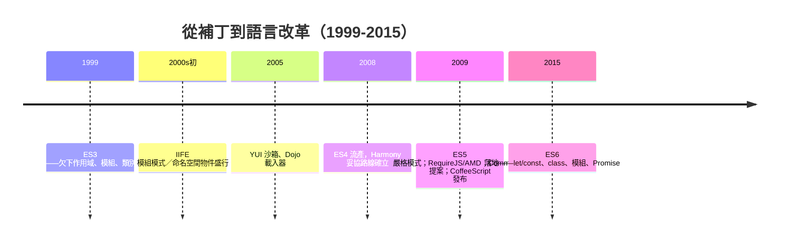

# 巨型前端的失控與模組化曙光

Ajax 之後，Web 應用開始像吹氣球一樣膨脹。2000 年代末，Gmail 量級的產品，JavaScript 程式碼動輒數十萬行，全部塞在一個或多個 `<script>` 標籤裡。此時的 JavaScript 沒有模組系統、沒有命名空間、沒有依賴管理——ES3 語言本身就是一張 1999 年的欠條。於是一場架構災難在任何大型專案裡重演：全域變數滿天飛，任何兩段程式碼都可能互相踐踏；`<script>` 標籤的書寫順序就是載入順序，也就是隱形的模組系統——檔案 A 必須排在 B 前面，因為 B 用了 A 定義的全域函式，誰敢調整 HTML 就全站崩潰；多人協作時，`init`、`utils`、`data` 這些名字被不同人重複定義，後載入者靜默覆蓋前者，錯誤只在千里之外的使用者端爆發。

語言的欠債清單越拉越長：ES3 沒有塊級作用域，`if` 裡宣告的變數洩漏到整個函式；`var` 的變數提升（hoisting）陷阱讓「先使用後宣告」不報錯；沒有類別，物件導向要靠 prototype 手工捏造，連「繼承」的正確寫法都眾說紛紜；沒有模組、沒有標準的事件、非同步只能靠 callback，多層嵌套之後就是著名的 callback 地獄——一行行 `});` 排成鋸齒，人稱「毀滅金字塔」。

社群的回應是補丁文化，一層層往上疊。第一層是 Douglas Crockford 推廣的模組模式（module pattern）：用立即執行函式（IIFE）創造閉包，把私有序藏在閉包裡，只回傳一個公開介面物件——`(function(){ ... return api; })()`。這個模式用語言最底層的特性（閉包）硬造出了「私有」與「封裝」。第二層是命名空間物件：Yahoo 前端團隊要求所有程式碼掛在 `YAHOO.util.XXX` 這樣的長名稱下，YUI 更提供沙箱機制，讓每份程式碼在自己的閉包裡領取依賴；Dojo 則較早嘗試 `dojo.require` 這樣的載入器，用同步 XHR 動態拉程式碼。第三層開始認真處理「依賴」本身：2009 年，James Burke 提出並實作了 RequireJS，催生 AMD（Asynchronous Module Definition）規範——`define(['jquery'], function($){...})`，非同步載入、顯式聲明依賴，適合瀏覽器環境。同年稍早，Kevin Dangoor 在部落格發起 ServerJS 提案（後更名 CommonJS），最初目標是讓 JavaScript 在伺服器端有標準模組格式：`var fs = require('fs')`，同步、簡潔。這兩條路線的分歧——瀏覽器的非同步 vs 通用環境的同步簡潔——將撕裂此後十年的模組論戰，並埋下 npm 的種子。

語言委員會也開始還債，但步履蹣跚。ECMAScript 4 想一步到位（類別、型別、命名空間），卻因過於激進在微軟與 Yahoo 部分成員的反對下於 2008 年流產——這場分裂是 JavaScript 史上最接近「兩種語言」的時刻。妥協的產物是 ECMAScript 5（2009）：只做了小步補救——嚴格模式（`'use strict'`）禁止隱式全域與部分陷阱、`Object.defineProperty` 帶來 getter/setter、原生 JSON 支援。它有用，但欠債的主體（作用域、模組、類別、非同步）原封不動。

絕望催生了繞道而行的人。2009 年，Jeremy Ashkenas（同時是 Backbone.js 與 Underscore.js 的作者）發布 CoffeeScript：一門編譯成 JavaScript 的新語言，語法借自 Python 與 Ruby——用縮排取代大括號、`->` 定義函式、自動補 `var`、列表推導。它的口號與 jQuery 遙相呼應：「寫得更少」。CoffeeScript 的流行不僅是語法糖的勝利，更是一份宣言：開發者已經受不了 JavaScript 本身，寧可繞道別的語言。它示範了「任何東西都能編譯成 JS」的可行路線，直接啟發了後來的 TypeScript；而它影響語言委員會最深的一點是——ES6 的箭頭函式、預設參數、解構賦值，幾乎都是 CoffeeScript 用過且被驗證好用的設計。社群用腳投票，替委員會完成了語言設計的市場調查。

回望這段掙扎，它正是後續一切的土壤。因為語言遲遲不給模組，打包器（browserify、webpack）才有存在的理由；因為 ES6 模組想取代 CommonJS，才有了 Babel 的轉譯革命；因為 CoffeeScript 證明「編譯到 JS」可行，才有新一代工具鏈的信心。大型前端在 2000 年代末的失控，與其說是 JavaScript 的失敗，不如說是一門語言被迫承擔遠超其設計者想像的負荷時，整個社群自發地、混亂地、卻不可逆地推著它進化的過程。黑暗不是終點，而是黎明前那些不得不自己造火把的年月。
