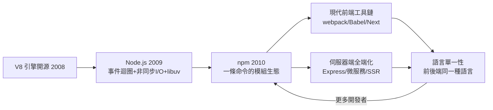

# Node.js 與 npm：JavaScript 進入伺服器

2009 年的 JSConf EU 柏林會場，一位留著長髮、沉默寡言的工程師 Ryan Dahl 上台，演示了一個把 JavaScript 跑在伺服器端、以事件驅動的實驗專案。聽眾先笑了——又有人想讓瀏覽器語言爬上伺服器——隨後在他展示能同時服務數千個連線的即時能力時，全場起立鼓掌。這個專案叫 Node.js，它將改寫伺服器端與前端工具鏈的歷史。

Dahl 的起點是一個具體的不滿。他在紐約做工作時接觸過長連線的 Web 應用（如 comet、即時推送），發現主流的 Apache 模型——每個連線一個行程或執行緒——在數千個並發連線下（經典的 C10K 問題）大量資源耗在行程切換與等待上：絕大多數執行緒其實什麼都不做，只是閒置著等 I/O。他得出近乎賭博式的結論：伺服器端編程的正確模型是事件迴圈（event loop）＋非同步 I/O＋單執行緒——「無阻塞是唯一的路」。程式設計師把所有可能阻塞的操作（讀檔、查資料庫、回應網路）都用 callback 交給系統，單一執行緒在事件迴圈上排程一切，於是整個程式永遠不等待、記憶體不隨連線數膨脹。為了跨平台封裝這個事件迴圈，他後來打造了 libuv 函式庫（最初為 Windows 支援而生，後成為 Node 的心臟）。

第二個關鍵賭注是引擎。2008 年 9 月，Google 為 Chrome 開源了 V8 引擎——丹麥團隊用先進的即時編譯技術把 JavaScript 跑得飛快。Dahl 立刻看出機會：與其自己寫直譯器，不如直接站在 V8 上。這個選擇的戰略眼光隨年月顯現——V8 由 Google 供養、持續進化，Node 不必花一毛錢就繼承了業界最強的 JS 引擎。至於為什麼選 JavaScript 而非自創語言，Dahl 的理由很直接：伺服器端非同步程式最怕的是「函式偷偷阻塞」，而 JavaScript 天生就是事件與 callback 的語言（DOM 事件模型），社群早已習慣非同步心智；語言沒有內建檔案與執行緒庫，反而乾淨——一切 I/O 都由平台來定義。「你正在使用的程式語言，其實天生適合伺服器端非同步」，這正是他在 JSConf 2009 傳達的訊息。

真正的飛輪由 npm 啟動。2010 年，開發者 Isaac Schlueter 為 Node 寫出套件管理器 npm：一個 `package.json` 描述依賴，一條 `npm install` 就把整棵依賴樹裝好，一條 `npm publish` 就能把自己的模組分享給全世界。技術上 npm 並無石破天驚，制度上卻是革命——它把「共享」的成本降到一條命令，於是共享爆炸式增長：2010 年底 npm 上有數百個套件，2015 年突破十萬，2020 年代已逾兩百萬，成為人類史上最大的軟體套件倉庫。飛輪效應清晰可見：套件越多，開發者越多；開發者越多，套件越多。2014 年 npm 與社群因治理與商業化爭執分裂出 io.js，2015 年雙方復合併成立 npm Inc. 引入商業支援；2020 年 3 月，微軟旗下的 GitHub 以約 7.5 億美元收購 npm——一個當年的業餘工具，成為十億美元級基礎設施。當然，飛輪也有陰影：2016 年的 left-pad 事件（一個 11 行的小套件被作者下架，竟癱瘓了成千上萬的建置流程）暴露了微小依賴鏈的脆弱，也迫使 npm 修改了不可撤回（unpublish）政策——生態的權力與風險，第一次如此具體地呈現在大眾面前。

Node 最大的社會效應，是讓「全端 JavaScript」成真。此前，前端寫 JavaScript、後端寫 PHP/Java/Python，團隊被語言切成兩個世界。Node 之後，同一種語言、同樣的事件非同步模型，貫通瀏覽器與伺服器；一個人可以獨立做出整個產品，創業的技術門檻驟降，MEAN（MongoDB/Express/Angular/Node）等全端堆疊成為新創標配。更隱蔽卻更深刻的影響在前端工具鏈：webpack、Babel、TypeScript 編譯器、ESLint、React 的開發伺服器、Next.js——現代前端的每一件工具，本身都是跑在 Node 上的程式。JavaScript 就此完成一個自我強化的閉環：用 JS 寫的工具，來開發 JS 寫的應用。

歷史在此完成一個端到端的迴聲。1999 年，微軟為了讓 Outlook 進瀏覽器而發明 XMLHTTP；2004-05 年，Gmail 用 JavaScript 重造了郵件客戶端——瀏覽器端以 JavaScript 為作業系統的格局自此確立。2009 年，Node 把同一種語言搬上伺服器。兩端同構之後，「語言」不再只是工具選擇，而成為一種制度基礎：型別、套件、設計模式、人力、開源套件可以在前後端之間自由流動，就像一國之內的貨幣統一讓市場整合成可能。Node.js 的故事，表面上是一個工程師對 Apache 效率的不滿，深層裡是 Web 十五年演化擠出的邏輯必然——當應用的兩端都長在 Web 上，它們終究會說同一種語言。
