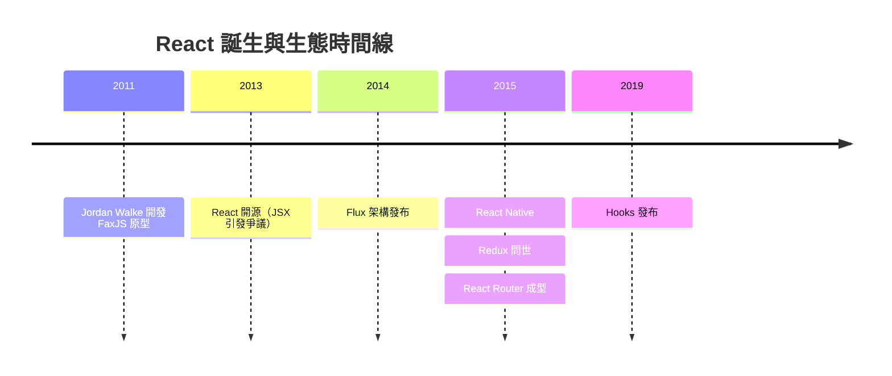
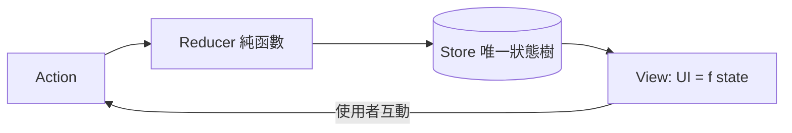
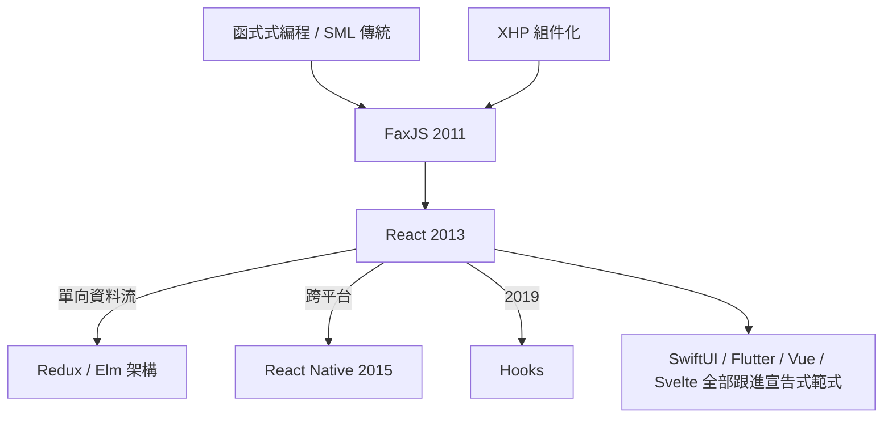

# 節標題：React 與虛擬 DOM：宣告式 UI 革命

## 痛點：一個「讚」按鈕的複雜性

2011 年的 Facebook 遇到了一個看似簡單卻無比棘手的問題：全站最有價值的按鈕——「讚」（Like）——的 UI 狀態管理已經接近失控。一個讚按鈕牽涉的不只是自己點下去變紅，還包括：好友數量即時更新、已按讚名單的彈出視窗、通知計數、附近其他元素的重繪。工程師用 jQuery 時代的手法——事件觸發、逐節點查詢 DOM、手動改屬性——寫出來的程式碼像一團毛線：任何一處狀態改動都要記得通知其他十幾處，漏掉一個就是線上事故。

這不是 Facebook 獨有的痛，而是整個 Web 應用複雜度突破臨界點的症狀。Web 正從「文檔」變成「應用程式」，但操作界面的思維還停留在文檔時代：開發者命令式地告訴瀏覽器「把這個節點的 class 改掉、把那個節點的文字換掉」。狀態散落在 DOM 各處，DOM 本身成了資料庫，而任何兩個地方都可能不同步。

解決這個問題的人，來自一個意想不到的背景。

## Jordan Walke 與 FaxJS

Jordan Walke 是 Facebook 廣告團隊的工程師，出身於函式式程式設計的傳統——他熟悉 SML/ML 系語言，深信 UI 應該是資料的純函數。他在 XHP（Facebook 內部一個讓 PHP 直接嵌入 XML 標籤、以組件方式建構 UI 的擴充）上看到組件化的價值，又從函式式世界借來一個激進的想法：**既然 UI 是狀態的投影，何不讓開發者只描述「界面應該長什麼樣」，把「怎麼改界面」全部交給機器？**

用一句公式說，就是：

$$\text{UI} = f(\text{state})$$

周末時間，Walke 寫出了名為 **FaxJS** 的原型：開發者用一種嵌入 JavaScript 的類 HTML 語法宣告界面，狀態變化時，框架自動算出新舊界面的最小差異（diff），只把必要的改動套用到真實 DOM 上。這在當時聽起來近乎荒謬——重新渲染整棵樹？DOM 操作那麼貴，誰敢這樣做？但 Walke 的洞察在於：**DOM 慢的是「操作」，不是「比較」。用 JavaScript 維護一棵輕量的虛擬樹並做 diff，成本遠低於人腦追蹤狀態依賴的錯誤成本，而且還能批次優化。**

2013 年 5 月，這個專案以 **React** 之名開源。開源社群的反應不是喝采，而是罵聲。兩個罵點最響：

1. **JSX**——「在 JavaScript 裡寫 HTML？這違反了關注點分離的百年教條！」批評者引用的是伺服器端模板分層的舊傳統，卻沒意識到 React 的組件把 HTML、邏輯、樣式綁在一起，恰恰是**更高層次的關注點分離**：按「組件」切分，而非按「技術」切分。
2. **虛擬 DOM**——「重新渲染整棵樹是效能自殺。」直到效能實測與 Facebook 自己的產品背書，懷疑才逐漸平息。

歷史一再重演這一幕：新範式的第一個受害者，是上一代範式的直覺。

## 單向資料流：對 Angular 的哲學反擊

同一時期，Google 的 AngularJS 如日中天，其**雙向資料綁定**（two-way binding）讓初學者驚豔：改資料，界面變；改界面，資料變。但 Facebook 工程師在超大規模應用中看到了雙向綁定的詛咒——資料可以在任何方向、任何層級被修改，一個 bug 的來源可能有二十個入口，追蹤狀態像在追鬼。

React 選擇了**單向資料流**：資料只能從上往下流，子組件想改資料必須透過回呼函數通知上層。2014 年 Facebook 推出 Flux 架構進一步規範這條河流的方向。到了 2015 年，Dan Abramov 與 Andrew Clark 以 Flux 為材料做出驚人的簡化——**Redux**：全域一棵唯一的狀態樹，任何變化都透過純函數 reducer 產生新狀態（不可變資料），於是「時間旅行除錯」成為可能：你可以倒帶重播整個應用的狀態史。這是把 Elm 語言的架構思想帶回 JavaScript 世界，函式式思潮正式佔領前端主流。

單向資料流不只是工程偏好，它是**除錯經濟學**：狀態變化路徑唯一，因果鏈可讀。這個觀念隨 React 擴散，成為全行業共識，連 Angular 2 之後也轉向組件化與單向為主的心智模型。

## 生態成型與 React Native

2015 年前後，React 的生態如雨後春筍：React Router 解決路由，Babel 編譯 JSX 讓舊瀏覽器也能跑新語法，Redux 統一狀態管理，Webpack 負責打包（見本章第三節）。社群完成了 Facebook 單一公司無法完成的事：把一個公司的內部方案，變成一套開放的工程標準。

同年 Facebook 推出 **React Native**，口號是「Learn once, write anywhere」——不是「write once, run anywhere」的舊夢，而是承認平台差異、但共用一個思維模型與團隊技能。宣告式 UI 首次攻入 iOS 與 Android 原生領域，其渲染層可替換的架構暗示了一個更深的事實：**React 的本質不是 DOM 函式庫，而是一套描述界面的計算模型。**

## Hooks：第二次自我革命

2019 年，React 團隊發布 **Hooks**，允許在函式組件中使用狀態與副作用（`useState`、`useEffect`），宣告 class 組件走向歷史。這是一次罕見的自我否定：React 成功的功臣——class 組件與生命週期方法——恰恰是後來複雜性的來源（邏輯被生命週期撕碎、高階組件層層包裹成「金字塔」）。Hooks 把相關邏輯聚合、把「狀態」還原為函數的普通變數，函式式思維完成最後一塊拼圖。當然，`useEffect` 的依賴陣列也帶來新的認知負擔——革命從不完美。

## 範式的勝利

回頭看，React 改變的不只是工具，而是整個行業的**思考文法**：

- **組件化**成為一切 UI 框架的通行單位；
- **不可變資料與純函數**從學院概念變成面試必考題；
- **宣告式 UI** 成為全行業範式——Vue 的響應式模板、Svelte 的編譯時方案、蘋果的 SwiftUI、Google 的 Flutter，全部都是 $UI = f(\text{state})$ 的變體。

jQuery 仍安靜地躺在數百萬網站裡，但它的時代問題——「如何操作 DOM」——已被 React 時代的問題取代：「如何描述界面」。問題的置換，就是範式的更迭。Web 開發從此不再只是「做網頁」，而是一門關於**狀態與界面的數學**的工程學科。
