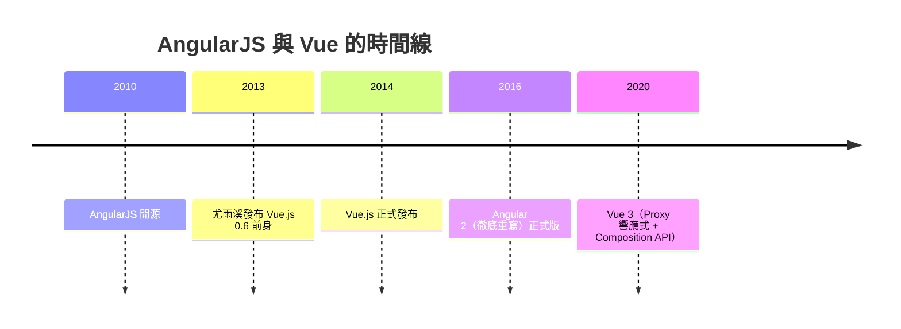
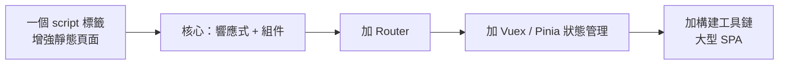

# 節標題：Angular 與 Vue：尤雨溪的漸進式哲學

## 一個工程師的兩週狂言

2010 年前後，Google 內部有個叫 Google Feedback 的專案陷入了深淵：短短數月，程式碼膨脹到 17,000 行，每加一個功能都要動七八處，團隊陷入「大型義大利麵」的絕望。工程師 Misko Hevery 看不下去了。他在內部放話：**「給我兩週，我用 20 天就能把這堆東西重寫，而且程式碼會縮到 1,500 行以下。」**

上司 Adam Abrons 半信半疑地賭了一把。Hevery 真的在幾週內把 17,000 行砍到 1,500 行左右——而支撐這場重寫的，是他業餘時間和 Abrons 開發的一個框架。Google 高層看到成果，決定把它開源。這就是 **AngularJS**。

Hevery 的洞察來自他長年在 Java 企業世界打磨的品味：測試性與依賴注入。他相信 HTML 本該是宣告式的，為什麼 Web 開發者要寫一堆命令式腳本去操作它？AngularJS 的答案是：**把語法擴展（directive）直接寫進 HTML**，讓瀏覽器「聽得懂」新標籤；再用**雙向資料綁定**，讓資料與界面自動同步。

## 雙向綁定的甜蜜與詛咒

AngularJS 的 digest 迴圈（dirty checking）哲學是：你隨便改資料，框架會在髒檢查迴圈裡反覆比對，直到狀態穩定。這對 2010 年的開發者是天降甘霖——不用手動同步，不用 jQuery 逐節點改 DOM。企業界瘋狂擁抱，AngularJS 一度是 MVC 框架的代名詞，培訓機構、企業內網、政府專案全面採用。

但甜蜜背後是三重詛咒：

1. **效能**：髒檢查是 O(n) 的輪詢，綁定點一多（成千上萬個 watcher），每次互動都是全盤掃描；
2. **隱晦的錯誤**：雙向流動讓資料來源不可追蹤，一個 bug 可能來自任何方向的任何修改；
3. **學習曲線的斷崖**：scope、digest、transclude 等概念自成一個小宇宙，入門三天，精通三年。

諷刺的是，Facebook 的 React 幾乎在每個對立面上給出答案：單向資料流、明確的渲染函數、虛擬 DOM 的細粒度更新。這場對照實驗，深刻影響了下一代的框架設計。

## Angular 2：一場豪賭的重寫

2014 到 2016 年，Google 做出了讓社群分裂的決定：**Angular 2 徹底重寫，與 AngularJS 1.x 幾乎不兼容**。新框架以 TypeScript 為一等公民（TypeScript 因此獲得巨大背書，見本章第三節）、以組件樹取代 scope、以 RxJS 的響應式流處理非同步。

Angular 2+ 是「Google 內部需求的鏡像」：超大型組織需要的是**強約束、強一致、可交接**——TypeScript 的靜態型別、依賴注入的模組化、CLI 的統一腳手架，本質上是把企業軟體工程（Java、C# 的文化）移植到前端。這讓 Angular 在銀行、保險、政府等大型機構站穩腳跟，但也讓它離「網頁設計師三行代碼搞定」的輕量世界越來越遠。原有的 1.x 社群大量流失，其中一部分人流向了一個新名字。

## 尤雨溪：設計師背景的框架作者

尤雨溪（Evan You），出生於上海，高中赴美，在紐約的 Art Center College of Design 主修設計——這是框架史上獨一無二的出身：**他不是工程師出身，而是設計師出身**。畢業後他在一家新創做創意技術，大量接觸 HTML5 與 Canvas，2012 年加入 Google Creative Lab，工作中用 AngularJS 做快速原型。

他在使用中形成了一個精準的判斷：**「我喜歡 Angular 的資料綁定，但我只想要這一部分。」** Angular 為了企業級雄心，要求你接受它的一切（模組系統、DI、directive 的寫法）；而尤雨溪想要的是一個輕量的視圖層——像 jQuery 一樣一個 script 標籤就能用，卻有響應式資料綁定的魔力。2013 年他把它做成個人 side project，2014 年 2 月正式發布，取名 **Vue.js**（法語「視圖」）。

2014 年中，他在 Hacker News 發了一篇自述，坦白 Vue 是「AngularJS 中我喜歡的部分，去掉我不喜歡的」——並說出了後來被引用無數次的心聲：Vue 是他為自己做的工具，選擇開源只是希望對別人也有用。2016 年他離開 Google、拒絕了多家公司的收購與融資綁定，靠 Patreon 群眾募資與後來的 OpenCollective 全職維護 Vue——成為「全職開源」模式最成功的案例之一。

## 漸進式框架的哲學

Vue 的核心概念是**漸進式框架**（Progressive Framework）：它不要求你全盤接受一種架構，而是承認現實世界的專案是光譜，不是單點：

小到一個登陸頁，大到 Spotify 級的 SPA，都可以在光譜上找到位置。這與 Angular 的「全有或全無」、React 的「生態拼裝」形成第三種哲學。

Vue 的設計品味處處可見設計師的敏感：模板語法貼近 HTML，讓設計師無痛閱讀；**單文件組件（.vue）**把模板、邏輯、樣式放進一個檔案但用區塊隔離，優雅地回應了當年 JSX 的爭議；動畫與過渡 API 開箱即用。而響應式系統的演化本身就是一部工程史：Vue 2 用 `Object.defineProperty` 攔截屬性存取（因此有數組下標的著名坑），Vue 3（2020）改用 ES6 **Proxy**，徹底解放，同時引入 Composition API 回應大型專案的邏輯複用問題。

## 地緣與治理：Vue 的中國現象

尤雨溪的華人身份與中英雙語的社群經營，讓 Vue 在中國獲得了壓倒性的市占——官方中文文檔一流，阿里巴巴、騰訊、字節跳動等巨頭大量採用，國內技術社區的教程、組件庫（Element UI、Ant Design Vue）極度繁榮。Vue 的治理也與 React（Meta 主導）、Angular（Google 主導）不同：它沒有母公司，由獨立團隊以公開 RFC 流程治理，被許多人視為「最民主」的主流框架。

## 三雄對照與第四極的預告

| 框架 | 背後 | 哲學 | 擅長 |
|---|---|---|---|
| React | Meta | 只給視圖層，生態自由拼裝 | 彈性、生態、跨平台 |
| Angular 2+ | Google | 完整企業框架，強約束 | 大組織、長期維護 |
| Vue | 獨立團隊 | 漸進式，低門檻與優雅 | 平緩學習曲線、快速到大型皆宜 |

2019 年，記者出身的 Rich Harris 發布 **Svelte**，喊出更激進的口號：框架應該在**編譯時消失**——不要虛擬 DOM 的 diff，直接編譯成精準更新的原生代碼。這宣告「運行時框架」並非終點，框架戰爭進入了第四極的時代。而框架百花齊放背後的推手——模組打包器與語言工具鏈的工業化——正是下一節的主角。
