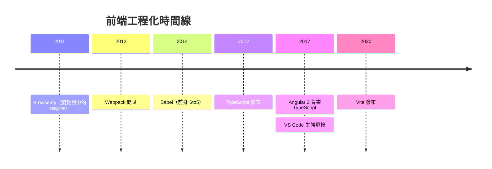
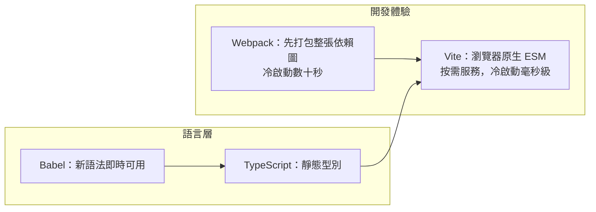

# 節標題：Webpack、Vite 與 TypeScript：工程化升級

## 從「丟進 script 標籤」到「工業生產線」

2009 年之前，前端的「工程」只是把幾個 JS 檔案按順序用 `<script>` 標籤串起來。全域變數互相污染，依賴順序全憑口口相傳，一個上百檔案的專案就是災難。當 Web 應用化、組件化（React、Angular、Vue）之後，前端突然需要處理成百上千個模組、多種資源（CSS、圖片、字體）、以及語言之間的翻譯問題。這是一場真正的**工業革命**：前端需要自己的生產線。

革命的第一步，是讓 Node.js 的模組習慣進入瀏覽器。

## Browserify 與 Webpack：把一切視為模組

2011 年，James Halliday（substack）發布 **Browserify**，讓 Node 的 `require()` 語法在瀏覽器可用——開發者終於可以用 npm 上二十萬個模組寫前端代碼。這看似小工具，實則把 npm 生態的閘門對前端打開，力量驚人。

2012 年，德國工程師 Tobias Koppers 發布 **Webpack**，走得更遠。他的核心觀念是：**一切資源都是模組**——JS 是模組，CSS 是模組，圖片和字體也是模組；透過 loader（翻譯各種格式的「進料口」）與 plugin（介入構建流程各環節的「加工站」），Webpak 把整個專案編織成一張依賴圖，再打包、切分（code splitting）、按需載入。code splitting 尤其關鍵：SPA 不再把所有代碼塞進一個巨檔，而是按路由與動態導入切割，首次載入時間從災難變成可控。到 2015–2020 年，Webpack 成為 SPA 的事實標準，配套的 npm scripts、ESLint（代碼規範檢查）、Prettier（自動格式化）共同構成前端的工程紀律——像任何成熟的軟體學科一樣，CI/CD 流水線、單元測試（Jest）、monorepo（Lerna、後來的 pnpm workspace）逐一落地。

## Babel：十七歲少年與語法的時間機器

2014 年，澳洲的 17 歲高中生 Sebastian McKenzie 發布了 **6to5**（後更名 Babel）：把 ES6 新語法編譯成 ES5，讓開發者「今天就寫未來的 JavaScript」。伴隨 JSX 的普及，Babel 成為 React 生態的必需品。它的意義遠超工具本身：**語言的演化與瀏覽器的支援脫鉤了**——標準委員會的新提案可以透過編譯器即時進入生產環境，語言演化的速度以年計加速。Babel 外掛系統後來也成為各種語法實驗（如可選鏈、裝飾器）的沙盒。

## TypeScript：語言設計大師的第二次登頂

2012 年，微軟發布 **TypeScript**，執筆者是傳奇語言設計師 **Anders Hejlsberg**——他此前的人生軌跡是 Turbo Pascal、Delphi、C#，幾乎憑一己之力定義了三代開發者的「強型別體驗」。微軟面臨的問題很實際：內部與客戶的巨型 JavaScript 專案正在失控，動態型別在百萬行代碼面前等於盲飛。

Hejlsberg 的設計哲學是**務實的漸進**：TypeScript 是 JavaScript 的**超集**——任何合法 JS 都是合法 TS；型別註解完全可選，可以一行不加地遷移；最後編譯成純 JS，零執行時開銷。這與當年微軟「強推新語言」的形象截然不同，是面向存量世界的懷柔策略。

即便如此，TypeScript 最初的幾年也不溫不火。它的翻身來自三個力的匯聚：

1. **Angular 2 的選擇**（2014 宣布）：Google 把整個框架押在 TypeScript 上，等於給它蓋了企業級認證章；
2. **DefinitelyTyped 社群型別庫**：主流函式庫的型別定義日趨完備，價值隨使用人數複利增長；
3. **VS Code 的飛輪**（2015）：微軟用 TypeScript 寫的編輯器，其自動補全、重構、跳轉體驗對 TS 專案有原生級加成——編輯體驗本身就是採用動機。

到 2020 年代，TypeScript 已是大中型前端專案的事實標準，連 Svelte、Vue 3 內部都以它重寫。JavaScript 這門「十天寫出來」的語言，最終由一位 Pascal 老將為它披上了型別的鎧甲。

## Vite：對「為什麼這麼慢」的反思

Webpack 時代的痛，每個前端都記得：改一行代碼，等數十秒重新打包；專案越大，冷啟動越久——因為 Webpack 必須先把**整張依賴圖**打包完才能開始服務。2020 年，尤雨溪發布 **Vite**（法語「快」），答案是換一個問題的問法：**開發時為什麼要打包？**

現代瀏覽器已原生支援 ES 模組（ESM）。Vite 的 dev server 直接按請求、按檔案提供模組，改哪個檔案就只處理哪個檔案（配合 ESM 的精確依賴與 HTTP 快取），冷啟動從數十秒降到毫秒級——開發體驗是質變而非量變。生產構建則採用 Rollup（後內建 Rust 加速），保證輸出優化。Vite 不綁定任何框架，React、Vue、Svelte 皆可乘載，數年間它取代 Webpack 成為新專案的預設起點。

## 紅利：前端的正名

這場工程化升級的最終產物，不是某個工具，而是**身分的改變**。當前端擁有了模組系統、靜態型別、自動化測試、CI/CD 與 monorepo，它就不再只是「寫網頁腳本的」，而是一門與後端平起平坐的軟體工程學科。工程師的職級、薪資、組織架構隨之重排——工具改變流程，流程改變組織，組織改變產業。

但盛宴之下，天花板已經浮現：無論工具鏈多麼精良，JavaScript 這門語言本身的性能極限——垃圾回收的停頓、動態型別的檢查開銷、無法觸及的底層硬體——依然橫在 3D 遊戲、影像處理、科學計算這些「重型應用」面前。攻破這道天花板的，是下一章的故事。
