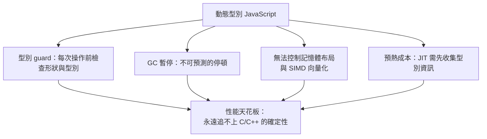
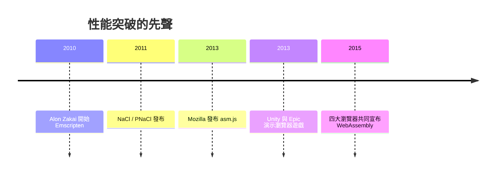

# 節標題：JavaScript 的性能天花板

## JIT 時代的榮光與極限

到 2013 年前後，JavaScript 引擎的進化史儼然是一部奇蹟史：從直譯器到 JIT，從 V8 的隱藏類（hidden classes）與內聯快取，到 IonMonkey 的推測性優化——「JavaScript 很慢」已是上個時代的笑話。第 8 章呼應《編譯器的故事》：V8 團隊把即時編譯技術推到了動態語言的極致，SunSpider 與 Octane 跑分年年翻新。

但跑分與現實之間有一道鴻溝。優化型 JIT 的性能是**統計上的**，不是**保證上的**。它的每一分速度，都建立在對「程式即將發生什麼」的賭注上，而每一筆賭注都需要籌碼：

1. **Guard 開銷**：`a + b` 在 C 裡是一條指令，在 JS 裡編譯後是「檢查 a 是不是 int32、檢查 b 是不是 int32、檢查沒有越界、否則反優化（deopt）回直譯器」的一串前置判斷。一旦引擎賭錯型別，幾千行優化代碼瞬間作廢。
2. **GC 暫停**：自動記憶體管理帶來不可預測的停頓。對 60 FPS 的遊戲（每幀 16.6 毫秒）而言，一次 8 毫秒的 GC 就是掉幀；對音訊處理，就是爆音。
3. **無底層控制**：沒有 SIMD 指令、無法手動規劃記憶體布局、無法保證資料在連續記憶體中以取得快取友善性。
4. **預熱**：JIT 要先「看」代碼跑起來才能優化，冷啟動的幾百毫秒對短生命週期任務是純浪費。

## 痛點清單：那些 JS 做不了的事

這些限制不是理論，而是一張具體的「不可能清單」：

- **3D 遊戲**：Unity 曾嘗試把整個遊戲引擎編譯成 JS 在瀏覽器跑，性能慘烈；
- **影像與視訊**：FFmpeg 這類 C 代碼巨獸移植到 JS 後慢一到兩個數量級；
- **科學計算與 CAD**：矩陣運算、幾何求值需要的是確定性與向量指令，恰恰是 JS 的短板；
- **密碼學與壓縮**：常數時間的要求與 GC 的抖動天生相剋。

Web 平台的觸角伸向一切設備，重型應用卻只能在門外徘徊——這是 2010 年代中期 Web 最深的戰略焦慮：**如果瀏覽器跑不了真正的應用，桌面與原生 App 的城牆就永遠攻不破。**

## asm.js：一個瘋狂而優雅的實驗

第一個正面的答案是 Mozilla 給的。2013 年，Mozilla 的 Luke Wagner、David Herman 與 Alon Zakai 等人發布 **asm.js**：**JavaScript 的一個嚴格子集**——只用數字型別、幾乎不用物件與垃圾回收、所有記憶體存取都透過一個 `ArrayBuffer` 模擬的堆。它仍是合法的 JS，任何瀏覽器都能跑；但引擎「認得」這種代碼後，可以跳過所有動態猜測，直接做**AOT（預先）編譯**，性能可達原生的 50–70%。

asm.js 的哲學極為聰明：不改規範、不逼用戶升級瀏覽器，用「約定俗成的子集」探路。Firefox 對 asm.js 代碼做了深度優化，而 Zakai 的 **Emscripten** 編譯器（從 2010 年開始把 C/C++ 編譯成 JS 的先驅工具鏈）成為 asm.js 生態的發動機——Unity 的瀏覽器實驗正是靠它起死回生。業界開始流傳一個半開玩笑的說法：**asm.js 是「assembly for the web」**——JavaScript 正被當作彙編語言使用。

## NaCl：Google 的平行嘗試

Google 自己也沒閒著。2011 年起，Chrome 推出 **Native Client（NaCl）**及可移植版 **PNaCl**：允許 C/C++ 編譯成受沙盒約束的原生碼在瀏覽器中執行，性能接近原生。技術上雄心勃勃，戰略上卻失敗了：NaCl 的二進制格式綁定特定架構（PNaCl 的位元碼前向相容性也難以保證），其他瀏覽器拒絕接受一個 Google 主導、偏離 Web 傳統的私有體系。NaCl 於 2017 年後逐步退役——但它累積的沙盒驗證、系統介面設計經驗，成為後來者的養分。

## 罕見的四方默契

歷史在此出現了戲劇性的一幕。瀏覽器大戰從 Netscape 對 IE 到 Chrome 對 Firefox，二十年來兵戎相見；但在性能天花板面前，四大陣營的工程師得出了一致的結論：**JS 的文字格式與動態語義是根本包袱，需要一種新的、真正的二進制目標格式。**

2015 年 6 月，Mozilla、Google、Microsoft 與 Apple 罕見地**共同宣布**了 WebAssembly 專案——以 asm.js 的經驗為起點，設計一種可移植、緊湊、可在所有引擎中快速解碼執行的二進制指令格式。Luke Wagner 的團隊提供了 asm.js 的實戰知識，Google 帶來 V8 的工程能量（且大方放棄了 NaCl 路線），微軟貢獻了驗證與工具的設計，蘋果的低調參與確保了 WebKit 的落地。這是 Web 平台史上最成功的一次跨陣營工程合作之一：沒有先發制人的私有標準，沒有「 embrace, extend, extinguish」，只有對「Web 必須能承載重型應用」的共同判斷。

「JS 是彙編語言嗎？」——這個調侃的答案是：不，但它證明了「Web 需要自己的彙編」。而那門真正的 Web 彙編，即將在下一節誕生。
